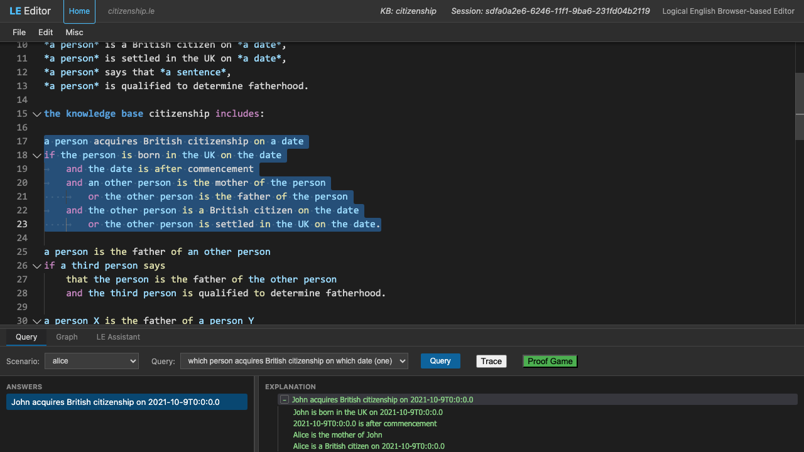

# How to use the Logical English 2 web application

*Kind: guide · Audience: users · Status: current (2026-09-20)*

The Logical English (LE) web application is a simple IDE. IDE means integrated
development environment: one screen where you write a program, run it and find
mistakes. Use the web application to write, test and correct Logical English programs.

## Contents

- [How to use the Logical English 2 web application](#how-to-use-the-logical-english-2-web-application)
  - [Contents](#contents)
  - [Getting Started](#getting-started)
  - [Executive Mode (run a program without editing)](#executive-mode-run-a-program-without-editing)
  - [File Operations](#file-operations)
    - [Opening and Saving](#opening-and-saving)
    - [Other systems' files: import and export](#other-systems-files-import-and-export)
    - [Example names, and the names they used to have](#example-names-and-the-names-they-used-to-have)
    - [Saving via URL (Quick Save)](#saving-via-url-quick-save)
    - [Several documents: file tabs](#several-documents-file-tabs)
  - [Writing Logic and Issue Reporting](#writing-logic-and-issue-reporting)
  - [Running Queries](#running-queries)
  - [The Scenario Editor](#the-scenario-editor)
    - [Layout](#layout)
    - [Editing facts](#editing-facts)
    - [Write it in English (LLM-assisted)](#write-it-in-english-llm-assisted)
    - [Saving your work](#saving-your-work)
  - [The Query Editor](#the-query-editor)
  - [Scenario Variations](#scenario-variations)
    - [Layout](#layout-1)
    - [Running and sharing](#running-and-sharing)
  - [Generate LE view (LE Assistant)](#generate-le-view-le-assistant)
  - [Explanations and Navigation](#explanations-and-navigation)
    - [Reading the Explanation Tree](#reading-the-explanation-tree)
    - [The Explanation Drill](#the-explanation-drill)
    - [Repeated Sub-explanations](#repeated-sub-explanations)
    - [The Explanation Context Menu](#the-explanation-context-menu)
    - [Explanation Preferences](#explanation-preferences)
    - [Why not: a query with no answer](#why-not-a-query-with-no-answer)
  - [Advanced Features](#advanced-features)
  - [Finding documentation](#finding-documentation)
  - [More guides](#more-guides)

## Getting Started

The landing page (`/`) shows a list of all the example programs. The list puts the
examples in folders that you can open and close. You can add two optional settings
to the URL of the page. The URL (Uniform Resource Locator) is the web address of the
page. These settings are useful when you want to share a link:

*   `?dir=<subdirectory>` shows only one example subdirectory. Examples are
    `/?dir=abduction`, or a folder in a folder, `/?dir=insureLE2/testing`. A
    "[show all]" link goes back to the full list.
*   `?expand=all` opens all the folders.

Above the list of examples, a box **searches the examples**. This box operates in the
same way as the box below *Documentation*, which searches the documents. Do these
steps:

1. Type some words, or a phrase in quotation marks.
2. Select where to search: everywhere, in the names, in the templates, or in the text.

The programs that match show below the box, with the best match first. Each program
shows the line that matched. Click a program to see its first lines. To open the
program in the editor, double-click it, push Enter or click the *Open* button. The
same panel is the picker in the editor (`File > Open example from server...`, below).

Each folder has a small link symbol (🔗) after its name. Click the symbol to copy the
web address of that folder. You can then paste the address into a message. The
symbol shows "Copied" for a short time. The address is the page with
`?dir=<the folder>`. This address opens the page with that folder open and in view.
The **Copy link** command of the browser (on the right-click menu of the symbol)
copies the same address.

Some folders have a README. A README is a short text that tells what is in the
folder. Such a folder also has a **📖 About this folder** button after its name. The
button opens the README in a panel next to the list. The button does not open or
close the folder. A README tells where to start, gives a short list of steps to try,
and refers to more documents. A link to a program in the README opens that program
in the editor. Frequently the link also selects a scenario and a question, so that
the program is ready to run.

To close the panel, click **Close** or push the Escape key. The address of the page
with `?readme=<the folder>` opens the panel on the README of that folder. The link
symbol (🔗) at the top of the panel copies that address. You can then paste the
address into a message. The **Copy link** command of the browser (on the right-click
menu of the symbol) copies the same address.

The line **Other languages** of the landing page goes to the programs in Português
Lógico, Español Lógico, Français Logique and Italiano Logico. The guide
[Logical English in other languages](languages.md) tells how a program selects its
language.

1.  **Open the editor:** Go to the address of the editor (for example,
    `http://localhost:3050/editor/`).
2.  **The parts of the screen:**
    *   **Top:** A header. The header shows the name of the file that you edit and the
        program that the server loaded.
    *   **Middle:** The writing area. The writing area uses the Monaco editor. It
        shows the words of the language in colours and marks mistakes.
    *   **Bottom:** A panel with tabs. One tab is for Queries and one tab is for the
        LE Assistant.

## Executive Mode (run a program without editing)

Some persons only want to **use** a program. They want to ask the program questions
and try different scenarios. They do not want to write or change rules. For these
persons, there is a plain screen at **`/executive`** (for example
`http://localhost:3050/executive`). This screen also operates well on a phone. The
full guide is [The executive view](executive-view.md). A summary:

- **Select a program.** When you open `/executive` with nothing added to the address,
  the screen shows a list of the example programs. To make the list shorter, type
  some letters. Tap a program to open it.
- **Select a scenario and a question.** The program screen has two pickers:
  **Scenario** (the scenarios of the program, or *(no scenario)*) and **Query** (the
  queries of the program). There is no "run" button. The query runs when the program
  opens, on its first scenario. The query runs again each time that you change a
  picker. The answers show below.
- **See why.** Each answer is a card. Tap the card to open its explanation as an
  indented tree. Green shows the conditions that are true. The tree also shows the
  *unknowns* that the system assumed. Some steps are true only because the
  statement that they deny failed ("it is not the case that …"). For these steps,
  the tree keeps those failures closed.
- **Citations first.** A program can cite its sources: rules and tables
  `with provenance`, and facts `as stated in …, confer "…"`. For such a program, an
  open answer shows a list of its **cited steps**, in the sequence of the proof. Each
  step shows the rule, the document and the passage. If the system has the text of
  the document, a **§** button opens the passage in that text. **Copy** puts the
  list on the clipboard. **Full explanation** opens all of the tree. A link next to
  the heading of the list goes directly down to the tree, past a long list of
  citations.
- **Why not.** A query with no answer shows a list of the conditions that the case
  did not satisfy. The system marks each condition *not stated* (the case does not
  give the fact) or *not met* (the case gives a different fact). Each condition also
  shows the rule that needs it, the citation of the rule, and the facts that the rule
  compared.
- **Examine variations.** A **Scenario Variations** button between the two pickers
  opens the full [Scenario Variations](#scenario-variations) window on the same
  program. In this window, you can change facts and compare results.
- **Views.** A program can declare views
  ([the language reference](../reference/language.md) §17.10). A view is a screen
  for the users of a program. A program with views shows them in a list at the top.
  When you select a view, the view replaces the two pickers with the screen that the
  author of the view described. This screen can show:
  - the facts of the case in groups,
  - the result in large text, and its citations,
  - the stage that the case gets to,
  - what is missing, and what would change the result,
  - the related documents,
  - each case with its result,
  - an interview that asks one question at a time.

  Add `&view=<name>` to the address to open one view directly. A program with no views
  of its own gives an **Automatic view**. The executive view makes this view from the
  program when it opens the program (`&view=*`). For how to write a view, refer to
  [Introducing LE Views](../tutorials/views.md).
- **Login.** The top right shows **Login** (or the user and **Logout**). A user whose
  account has the correct licence also sees the private programs
  ([Signing in, and what a licence adds](accounts.md)).

The web address contains all the data that the screen shows. Thus you can share a
result or keep it as a bookmark: `/executive?program=<name>`, and, if necessary,
`&scenario=<name>`, `&query=<name>` and `&view=<name>`. A link that names a program,
a scenario and a query runs the query immediately when the page opens. The executive
view only reads the program. The executive view never changes the program.

## File Operations

### Opening and Saving

New and Open each put the document in a new tab. Save and Save As operate on the tab
that is in front (refer to [file tabs](#several-documents-file-tabs) below).

Each menu item has a tooltip that tells what the item does. To see the tooltip, put
the mouse pointer on the item.

*   **New File:** `File > New` opens a new, empty document.
*   **Open Local File:** `File > Open...` loads a `.le` file from your computer.
    `File > Open...` also opens files for other systems, if the server can translate
    them. The server translates such a file when it opens the file, into a new tab.
    The server adds a note that tells what it did. The same file always gives the
    same translation. Sometimes the server cannot translate a part of the file. That
    part stays in the program as a `% TODO` comment, with the same words as the
    original. The server keeps the translation, and all that the translation includes
    or cites, for one day. Refer to
    [Other systems' files](#other-systems-files-import-and-export) below.
*   **Import from Another System:** `File > Import from Another System…` does the same
    translation, with the same reliability, but it shows only the files of other
    systems. Its tooltip shows the systems from which this server can translate. If
    there are no such systems, the menu item is hidden.
*   **Show the Original:** `File > Show the Original…` shows the files from which the
    system converted a program. The files show in the source viewer. By convention,
    these files are in the `sources/` folder adjacent to the program. When
    `File > Open` translates a file that you uploaded, it puts that file there. The
    translated twins of the programs of other systems also keep their originals there.
    Examples are the contract of a Solidity twin, the configuration files of a
    Socotra product, and the rule documents and rulebase of an OIA project. If there
    is one file, it opens directly. If there are more files, a list of the files
    shows first. A program with no `sources/` folder tells you so.
*   **View Original Text:** `File > View Original Text` shows in the source viewer
    where the line at the cursor came from. The same item is on the menu of the
    editor when you right-click a line of a program. The editor tries four things, in
    this sequence.
    (a) The cursor is possibly on a citation. A citation is a fact or rule with
    provenance, a scenario "as stated in" a document, or `the text of … is at …`. In
    this case, the viewer shows the cited passage. If the program gives only the
    address where the document is published, the viewer shows that address.
    (b) If not, the editor takes the rule, fact, decision table, template, scenario or
    query at the cursor. It searches for that element in the originals of the
    program: the `sources/` folder, and the documents whose text the program locates.
    The editor uses the links of the program to find the passage, and then highlights
    the passage. These links are:
    the label of the element (`rule ps1:` finds the element whose key is `ps1`; the
    comparison ignores capitals, `_` and `-`);
    the entries about the element in the migration ledger of the program, the file
    `<program>.ledger.json` that records the origin of each translated part;
    and all that the element cites.
    (c) The editor possibly finds no passage, but the program keeps originals. In this
    case, the viewer shows the originals, with a note that the editor did not find a
    passage.
    (d) If the program keeps no original text, the viewer tells you so.
    For example, in `migration/legalruleml/ex12_usc_17_504_context`, View Original
    Text in `rule ps2_tblock1` shows the LegalRuleML statement `ps2-tblock1` of the
    source.
*   **New from URL:** `File > New from URL...` opens a copy of a Logical English
    program at a web address. The `includes these resources:` of that program can
    name a file by a path relative to the program. The program can also cite
    documents. In both cases, the editor searches for these files adjacent to that
    address.
*   **Tests:** `Misc > Run the Program's Tests…` runs each expectation that the
    program states. It shows a list of the expectations, each with its result: the
    expected result, and the result that came. Click a row to open the scenario and
    query of that expectation.
*   **Open example from server:** `File > Open example from server...` shows the
    examples of the server as a tree of folders. Each folder shows how many examples
    it contains and their subject. Examples are `citizenship` at the top,
    `domains/tax/` and `migration/`. Click a folder to open it. The editor remembers
    which folders you left open.

    To search the examples, type in the box above the tree. Each word that you type
    must be in the result. A phrase in quotation marks must be in the result exactly
    as you wrote it. The list adjacent to the box selects where to search:
    **everywhere** (the default), **in names** (the name of the program and its first
    comment), **in templates** (its declaration sections: the templates, the
    predicates, the ontology, the fluents, the events) or **in the text** (all the
    text: rules, scenarios and comments).

    While you type, the editor filters the tree by name. Then, after a short time,
    the server answers with the programs that match, with the best match first. Each
    program shows the line that matched. A program with your word in its name comes
    before a program with the word in a template. That program comes before a program
    with the word only in its text.

    To select a program, click it or use the arrow keys. Its first lines then show
    below the list. To open the program, double-click it, push Enter or click the
    *Open* button. The editor opens a copy. Thus your changes never change the file
    of the server. The same panel is on the landing page, above the examples.
*   **Save:** `File > Save` or `Save As...` saves your work back to your computer.
*   **Export to Another System:** `File > Export to Another System…` writes the
    program in the format of a different system. This is possible if the server has
    a writer for a system that is applicable to the program (refer to below).
*   **QR code:** `File > QR code…` shows a QR code. The QR code opens this document
    with the scenario and query that you selected. Thus you can continue the work,
    for example on a phone. **Copy URL** copies the same address as plain text.

> **⚠️ Browser Compatibility:** To save directly back to the file that you opened, you
> need a recent browser. The browser must let a web page write to a file on your
> computer, through the *File System Access API*. Chrome and Edge can do this. In
> other browsers, for example Safari and Firefox, "Save" downloads the file.

### Other systems' files: import and export

Some servers have the InsurLE extensions installed. The hosted service has them. Such
a server translates the files of eleven other systems into Logical English. It also
writes Logical English programs in the formats of three other systems. A server
without the extensions hides `Import from Another System…`. On such a server,
`File > Open...` shows only `.le` files. For the full guide, refer to
[Other systems: importing and exporting](../integrations/index.md). That guide has a
document for each system.

*   **What the server reads** (`File > Open...` and
    `File > Import from Another System…`; the tooltip shows the systems from which
    this server translates):
    *   a Bitcoin Miniscript policy or descriptor;
    *   an Oracle Intelligent Advisor project or rulebase;
    *   a Socotra product configuration;
    *   a Solidity contract (read as LE for LPS. LPS is Logic Production System, the
        companion system for rules that act over time);
    *   an s(CASP) or Prolog program (also the s(CASP) translations of LE1);
    *   a Blawx project;
    *   a Drools rule base (DRL);
    *   an Epilog program;
    *   a LegalRuleML document;
    *   an Oracle Insurance Policy Administration transaction (Rules Palette XML);
    *   a Daml source (read as LE for LPS).
*   **What the server writes** (`File > Export to Another System…`; this item shows
    only the formats that are possible for the program):
    *   a Bitcoin Miniscript policy, with a link to the Minsc playground;
    *   LegalRuleML;
    *   Daml, for an LE for LPS program.

    The result shows with its notes, and with **Copy** and **Save…** buttons.
*   **Refusals.** Sometimes the server cannot write the program correctly in the
    selected format. Then the server writes nothing. A dialog shows a list of the
    problems. Each problem shows its line (the line number is a link) and the words of
    the program on that line. **See s(CASP)** and the s(CASP) engine refuse programs
    in the same way.
*   **The twins.** The examples include the results of the translators on published
    programs, in `migration/`. These are programs from Blawx, LegalRuleML, Miniscript
    and s(CASP). Each twin has its migration ledger (the record of the origin of each
    translated part). Each twin also has its `sources/` folder, which
    **Show the Original** opens.

### Example names, and the names they used to have

You open an example by its **name**: `/editor/index.html?example=<name>`. The same
name identifies the example to the executive view (`/executive?program=<name>`), the
QR code, the landing page and the web API. The name is the path of the example in the
example tree, without the `.le`. Examples are `citizenship`, `domains/tax/payg`,
`collections/kowalski-book/underground_emergency` and
`regulatory/eu261_integration`.

**An example that moves keeps its old name.** We put the example folders into new
groups, by purpose. All links, QR codes, papers and videos from before this change
still operate. The reason is that the server sends an old name on to the current
name. Thus `?example=rkBook/underground_emergency` opens
`collections/kowalski-book/underground_emergency`. A table in the server contains the
old names: `example_alias/2` for a single example and `example_dir_alias/2` for a
full directory. Both are in `le_kbs.pl`. The test `testing/test_example_alias.pl`
makes sure that each row of the table still goes to a file that exists.

These are the changed directory names. Each change applies to all the contents of the
directory:

| Old name | Opens today |
|---|---|
| `abduction/…` | `language/abduction/…` |
| `prolog_resources/…` | `language/includes/prolog_resources/…` |
| `tax/…` | `domains/tax/…` |
| `rkBook/…` | `collections/kowalski-book/…` |
| `LogicalThinkingInAgeOfAI/…` | `collections/logical-thinking-talk/…` |
| `RulesRus/…` | `regulatory/…` |
| `testing/…` | `fixtures/…` (the test fixtures, shown to users who logged in) |
| `insureLE2/customs/…` | `regulatory/customs/…` |
| `insureLE2/medicare/…` | `regulatory/medicare/…` |
| `insureLE2/migration/…` | `lpsPlus/migration/…` |
| `insureLE2/migration/oipa/…` | `migration/oipa/…` |
| `lpsPlus/customs/…` | `regulatory/customs/…` |
| `lpsPlus/medicare/…` | `regulatory/medicare/…` |
| `lpsPlus/migration/oipa/…` | `migration/oipa/…` |

Some single programs moved independently: `sums`, `citizenship_including`,
`white_rabbit` and approximately thirty others. Each of these programs has one
`example_alias/2` row. That table is the full list. To use an old name, you do not
have to do anything: the old name opens the example.

### Saving via URL (Quick Save)

The editor keeps a copy of the program that you edit in the address of the browser.
The copy is in a part of the address with the name `text`.

*   **To "save" your work:** Copy the current address from the address bar of your
    browser.
*   **To "load" the work again:** Paste that address into a new tab. With this method,
    you can share a short part of a program. You can also make a bookmark of one
    specific version of your rules.

### Several documents: file tabs

The strip above the editor has one tab for each open document, as a browser has one
tab for each page. A tab shows the name of the document. A tab also shows a dot when
the document has changes that you did not save.

*   To close a tab, click that dot. When the mouse pointer is on the tab, an `×`
    replaces the dot, and you can click the `×`. A middle click also closes the tab.
*   The `+` at the end of the strip opens a new, empty document in a new tab. This is
    the same as `File > New`.
*   A document that you open with `File > Open...`, `Open example from server...` or
    `New from URL...` also goes into a new tab. But if the document is already open,
    its tab comes to the front.
*   When the editor starts, it shows an empty document. If you did not type in that
    document, the next document that you open replaces it. Thus no empty tab stays.
*   `Save` and `Save As...` operate on the tab that is in front.

The program of each tab has its own panels. When you click a tab, the editor shows
that document. The program of that document also goes into these panels:

*   the **Query** panel, with its scenarios, queries, answers and explanation, as you
    left them;
*   the **LE Assistant**, which keeps a separate conversation for each program;
*   the Source Graph.

The address bar also changes. The address names the example that is now in the
panels, or contains its text, together with its scenario and query.

A rule of an **included resource** can prove a step of an explanation. When you click
that step, the resource opens in a new tab, at the rule. If the resource is already
open, its tab comes to the front. The panels stay on the program that the explanation
is about. Thus you can continue to follow the explanation. The tab of that program
has a dotted line below it. Click one of the steps of the program to make its tab
come back. If you click the tab of the resource yourself, the resource becomes the
program in the panels.

While the server loads a program, the scenario and query pickers show a busy cursor.
If you click one of these pickers, all of the window shows a waiting cursor until
the program is loaded. Then the menu opens.

## Writing Logic and Issue Reporting

The editor examines the document while you type:

*   **Colours:** The editor shows keywords, variables and templates in different
    colours. Thus you can easily see the difference between them.
*   **Mistakes:** A red wavy line below a sentence shows that the editor cannot read
    the sentence, or that a template is missing.
*   **Quick fixes:** Put the mouse pointer on a mistake to see the repairs that the
    editor gives. An example is to add the missing template for you.
*   **When you can run:** While the document has mistakes, the editor disables the
    "Query" button in the bottom panel.
*   **Show definition (F12):** Right-click a word and select **Show definition**. The
    editor goes to the rule or template that defines that word. You can also do this
    on the name of an included resource (`… includes these resources: deontic.`) or
    of a base (`… extends token:`). Then **Show definition** opens the resource. A
    Logical English resource opens in a new tab. A Prolog resource opens in the
    source viewer. **Go back** takes you back to where you were.
*   **Where it is explained:** Put the mouse pointer on a warning or an error. The
    note that shows ends with a link. The link goes to the section of the language
    reference that the message cites, or to the entry of the message in the
    [warnings guide](warnings.md).

A **?** button opens the section of the documentation about the part of the screen
that contains the button. These buttons are next to the query controls, the answers,
the explanation and the LE Assistant. They are also at the top of the Scenario
Editor, Query Editor, Scenario Variations, Explanation Drill, Proof Game and
executive view.

## Running Queries

Do these steps:

1.  **Send the program to the server:** The editor sends your program to the server
    automatically. The header at the top shows the session identifier. The session
    identifier is the name that the server gives to your working session.
2.  **Select a scenario:** In the **Query** tab, select one of the scenarios that
    your program defines (for example `scenario alice is:`). You can also select
    "Another..." and type your own facts.
3.  **Select a query:** Select one of the queries that your program defines (for
    example `query one is:`).
4.  **Run the query:** Click the **Query** button.

    If a query continues to run after some seconds, an **Interrupt** button shows.
    If a query does not finish in 4 minutes, the server stops the query and tells
    you so in the answers. There are two possible causes: a rule makes a loop, or the
    search is too large. The answers that the query found before it stopped still
    show. A note tells you that more answers are possible, and a **Keep going** button
    shows. **Keep going** runs the query again with two times the time.

    On a large program, for example a translated regulation, the answers can have a
    note. The note tells that the explanations do not show why each condition of the
    form "it is not the case that ..." is true. When the system does not include
    these parts, the query can answer in time.
5.  **Flip the result:** **Flip…** asks which smallest change to the scenario would
    change the answer. Do these steps:
    1. Select an answer.
    2. Click **Flip…**. The dialog proposes the question *which minimal change to the
       scenario makes it the case that it is not the case that* the answer.
    3. To ask for the answer itself, clear the **it is not the case that** checkbox.
       Or edit the sentence, for example to ask about a different answer.
    4. Click **Flip**.

    If you did not select an answer, the dialog proposes the query. **Flip** runs the
    proposed question as your own query on the selected scenario. Each answer is a set
    of facts to add or remove (`add: …`, `remove: …`). The proof of the changed
    scenario explains each answer. Refer to the language summary, §17.7.
6.  **All cases at the same time:** Some queries start with
    *which cases make it the case that* or *is there a case in which*. Such a query
    is a case search (language reference §17.11). A case search does not use the
    selected scenario. Each answer is one case. Each answer is a card with these
    parts:
    *   a label, for example *case 2 of 6*;
    *   the facts and comparisons that the case needs;
    *   a line that names the scenarios of the program that cover the case, or that
        tells that no scenario covers it.

    A case that no scenario covers has the button **Add as scenario**. This button
    writes a ready-made scenario for the case into the program, after the last
    scenario. The query stays selected. Click **Query** again, and the card shows
    *covered by scenario case_2*. The explanation of a case shows the rules that the
    case uses, with the facts that it assumes.

## The Scenario Editor

A scenario is a set of facts with a name. Your queries run on these facts. With the
**Scenario Editor**, you can make and change a scenario as a **form with blanks**.
You do not type the facts. Thus you do not have to remember the exact words of a
template. To open the Scenario Editor, select **Edit → Edit Scenarios…**. The
Scenario Editor opens in a separate window.

### Layout

*   **Top:** A **Scenario** picker and a **Name** field. In the picker, select
    **New…** to start a new scenario, or select a scenario to load it for editing. The
    **Name** field contains the name of the scenario in your program.
*   **Middle:** A vertical list of the facts of the scenario, one fact on each row.
*   **Bottom:** An **Add fact** picker, and the **Copy** / **Insert into Editor**
    buttons.

### Editing facts

The editor shows each fact as one row that it makes from a template. The fixed words
of the template are plain **labels**. Each slot of the template is a **field** that
you can edit. For the template `*a person* is born in *a place* on *a date*`, a fact
shows as:

> `[a person]` is born in `[a place]` on `[a date]`

You can change the fields but not the words around them. Thus you cannot break the
words by accident. Each field shows, in pale text, the template variable that it
replaces (for example *a person*). Each field becomes wider when you type into it.

Sometimes the rules of the program expect specific values in a slot. An example is
*knitted*, *woven* and other values for a fabric construction. In this case, the
field **suggests** those values while you type. When you put the mouse pointer on the
field, it shows a list of these values. When you load a scenario that exists, the
Scenario Editor finds the template of each fact and fills in the fields for you.

*   **Cite the passage.** The **❝** button on a row opens a field for the location in
    the document that states the fact. Type the passage. The Scenario Editor writes it
    as `confer "…"`. The **Provenance** of the scenario names the document. You can
    also type your own phrase after the fact, for example `according to …` or
    `as stated in … at …`. If a fact already has a citation, the row shows the
    citation, and you can change it.

*   **Add a fact:** Do these steps:
    1. Select a template from the **Add fact** menu.
    2. Click **+ Add**.
    3. Fill in the fields.

    The menu shows only the templates that are applicable as scenario facts. These are
    the templates with **`; undefined`** (a *scenario element*) and the templates that
    a scenario already uses. Plain "*X* is a *type*" statements are also possible.
*   **Delete a fact:** Click the **✕** on its row.
*   **Assume (unknown):** Each row has an **Assume** checkbox on the right. Select the
    checkbox to mark the fact as *unknown*. The Scenario Editor then writes the fact
    with `it is unknown whether …` in front of it. While the fact is assumed, you
    cannot change its fields. If the program already declares a fact as unknown, its
    **Assume** checkbox is already selected. Clear the checkbox to make the fact a
    usual fact again.
*   **Test lines** (`… expects answers …`) are too complex for this form. Thus the
    form does not show them. The Scenario Editor keeps them separately and writes them
    back as comments. Thus the scenario that you save is still valid. Examine these
    lines and make them active again in the main editor.
*   **Other lines that match no template** show in grey, and you cannot change them
    there. The Scenario Editor shows them so that nothing is lost. Edit those lines in
    the main editor. The Scenario Editor does not show comments (lines that start with
    `%`).

### Write it in English (LLM-assisted)

You can also select **Write it in English**, the last item in the **Add fact** menu.
Then you can write the facts in ordinary language. A dialog opens. Type one or more
sentences that state precise facts. An LLM (a large language model) then changes
your sentences into Logical English facts. An LLM is a program that can read and write
ordinary language. The facts use **the templates that your program already has**. The
new facts come as usual rows that you can edit.

*   **The model uses only your templates.** The model only fills in templates that you
    already have. The model does not make new sentence patterns. It also makes the
    words and the tense correct. For example, "Miguel *was* born in Portugal" becomes
    `Miguel is born in Portugal on a date`. Sometimes your sentence does not give a
    value for one of the blanks. Then the model keeps the words of the blank (for
    example `a date`), and you fill in the value. If you need new templates first, add
    them in the main editor or with the **LE Assistant**.
*   **You must set a language model.** This is the same model and the same keys as
    for the LE Assistant. Set them in the main editor in
    **Misc → API Keys & Assistant Settings…**. The dialog shows the name of the model
    that it will use, or tells you that there is no model. For more data, refer to
    [The assistants](assistants.md#write-it-in-english).
*   **The editor examines the facts before it adds them.** The editor examines the
    proposed facts against your program. It compares the result with the problems that
    the program had before. Thus only *new* problems are important. If there are no
    new problems, the editor adds the facts immediately. If there are new problems,
    the editor **warns** you. You can then select **Insert anyway**, or write your
    sentences again and select **Regenerate**.

### Saving your work

*   **Copy:** Copies all of the scenario block (`scenario <name> is:` followed by its
    facts) to the clipboard. You can then paste it in a different location.
*   **Insert into Editor:** Writes the scenario back into the main editor and closes
    the Scenario Editor window. If you loaded a scenario that exists, the new text
    **replaces** that scenario. The editor **adds** a new scenario **at the end**.

The Scenario Editor does not examine your Logical English. As with all edits, the
**server makes the last decision**. The server examines the program when the editor
loads it the next time, and it reports problems in the usual way. Possibly the
Scenario Editor window has changes that you did not copy or insert. If you try to
close the window, the Scenario Editor asks you to confirm first.

## The Query Editor

The **Query Editor** makes and changes queries in the same way as the Scenario Editor
makes scenarios: as rows with blanks, not as lines that you type. To open the Query
Editor, select **Edit → Edit Queries…**. The Query Editor opens in a separate window.
Select **New…** to start a new query, or select a query to load it. Then give the
query a **Name**.

A query is a list of **conditions**. Each condition uses one of your templates. Fill
in its blanks, or type a phrase such as `which person` to make the query report a
value. You select how the conditions connect:

*   **Add condition:** Select a template, click **+ Add**, and fill in the fields. Each
    condition after the first has an **and / or** chooser in front of it. The chooser
    is set to **and**, but you can change it. Thus a sequence such as *A and B or C*
    reads from top to bottom.
*   **Negate** a condition: Select its **not** checkbox. The Query Editor then writes
    the condition as `it is not the case that …`.
*   **Indent** a condition (⇥ moves it right, ⇤ moves it left): This puts the
    condition *inside* the condition above it. The indentation shows how the **and**s
    and **or**s make groups. A condition that is more to the right connects more
    tightly. Logical English uses indentation in exactly this way.
*   **Write it in English:** The last item in the **Add condition** menu opens the
    same language-model dialog as in the Scenario Editor. Write the query in ordinary
    language. The system writes its conditions from your templates, examines them, and
    adds them at the end. Refer to [Write it in English](#write-it-in-english-llm-assisted).
*   **Copy** puts the `query <name> is:` block on the clipboard. **Insert into Editor**
    writes the query back. It **replaces** the query that you loaded, or **adds** a
    new query at the end.

The Query Editor is simple intentionally. It does not include all the possible parts
of a Logical English query. Examples are conditions in groups inside other conditions,
and sums and counts over many facts. Write those parts in the main editor. As with the
Scenario Editor, the **server makes the last decision**. The server examines the
program when it loads the program the next time.

## Scenario Variations

In the **Scenario Variations** window, you can take a scenario and **change it**.
Then you can immediately run one or more queries on the changed version. Your program
does not change. The window is for "what if" questions: what if Alice were *not* a
citizen? To open the window, click the **Scenario Variations** button in the
**Query** tab, between **Query** and **Trace**. The window opens separately. It
already shows the scenario that you selected in the Query tab.

### Layout

*   **Scenario picker** (top): Select the scenario to start from. Select `(empty)` to
    make a scenario from nothing.
*   **Scenario facts:** The same form with blanks as in the
    [Scenario Editor](#the-scenario-editor). You can change the fields, delete facts,
    **Add fact** from a template, or select **Assume** to run a fact as *unknown*.
    **Copy Scenario** puts the resulting `scenario … is:` block on the clipboard.
*   **Queries:** A list of the queries to run. **Add Query** adds one of the queries of
    your program. Each query in the list has a ✕ that removes the query.
*   **Query** button (bottom): Runs **all** the queries in the list on the facts as
    they are now. Below each query, you see the usual answers and explanation. When
    you put the mouse pointer on an assumed step, you also see the notes. You can also
    click a step of an explanation to **show the rule or fact of that step in the main
    editor window**.

### Running and sharing

Click **Query** to run all the queries. The button then becomes disabled. The button
becomes available again only when you change something: a fact, or the list of
queries. Thus you can always see if the results below agree with the current facts.

While you work, the window keeps its **web address current**. The address contains
the changed scenario, the list of queries and the program. Copy that address to
**share exactly what you see** with a different person. This is the same as when you
share a program from the editor.

## Generate LE view (LE Assistant)

The **Generate LE view** button in the header of the LE Assistant makes a draft of a
view for the program ([the language reference](../reference/language.md) §17.10). It
adds the draft at the end of the program. The draft does these things:

*   It puts the facts that a case can state in one group.
*   It keeps the judged facts separate.
*   It uses the first query as the result.
*   It shows a list of what the program can show: citations, the stage, documents, a
    flip.

The draft does not need a language model. You can edit the draft. For example, you
can put the facts in groups with titles, put the important value at the top of the
result, or add questions for an interview. Or, you can send the improvement that the
input box of the assistant then proposes. The verifier makes sure that all that the
view names exists.

The **Open the view** link in the reply opens the view in the executive view. The
view uses the program as it is in the editor, and nothing is saved. If the knowledge
base of the program has no name, the view uses the name of the file. The draft does
not include templates whose words contain a comma or a full stop, because the lists
in a view cannot contain them. Tutorial: [Introducing LE Views](../tutorials/views.md).

## Explanations and Navigation

After a query runs:

*   **Answers:** The answers show on the left of the bottom panel.
*   **Explanation tree:** Click an answer. The reasons for the answer show on the
    right, in ordinary English, as a tree of steps. When a query has *no* answer, the
    tree explains *why* the query failed.
*   **Go to the rule:**
    *   Click a step in the explanation tree. The editor moves to the rule or fact of
        that step. If the rule is in an included resource, the editor goes to the tab
        of that resource (refer to [file tabs](#several-documents-file-tabs)).
    *   The editor highlights those lines. Thus you can quickly examine the reasoning.

### Reading the Explanation Tree

*   **Colours** show the result of each step:
    *   **green** for a condition that is *true*;
    *   **red** for a condition that *failed*;
    *   **amber** for an *unknown* condition. The program could not prove such a
        condition true or false. But the program assumed that it is true, because its
        template is declared "unknown".
*   **Notes on each step:** Put the mouse pointer on a step to read its result, for
    example "Succeeded: this condition was proven" or "Failed: this condition could
    not be proven". For a negated condition that is true, the note is "Succeeded: this
    negative condition holds (the inner statement could not be proven)".
*   **Open and close:** A step with steps below it has a `-`/`+` button. At the start,
    the top two levels are open. For each answer, the editor remembers which steps you
    left open. Thus you can go from one answer to an other answer freely.
*   **Numbers for the steps:** Select **Misc → Hierarchical Numbering** to put the
    position of each step in the tree in front of it, for example `1.2.3`.
*   **Important reason:** Put the mouse pointer on the **EXPLANATION** title. When a
    summary is available, the title has a line below it. The title then shows a
    one-line summary of the answer that you selected. The summary agrees with the tree
    as you see it. Thus it obeys your setting for repeated sub-explanations.
    Right-click the title and select **Show important reason**. The tree then opens
    down to that step, and the step flashes.

### The Explanation Drill

The **Explanation Drill** is a separate window. It takes you through the explanation
of an answer as a series of yes-or-no questions. Thus you can find and understand the
reason that is important to you. You can continue to work in the editor while the
drill is open. To open the drill, right-click the **EXPLANATION** title and select
**Explanation Drill…**.

The drill uses the explanation as a tree of possible causes. At each step, the drill
shows the **important reason** for the part of the tree that you are in. It then asks
**"Accept?"**:

*   **Yes** — You understand that part. The drill puts the part aside and goes to the
    next most important reason of the remaining reasons.
*   **Not yet** — You want more detail. The drill goes into that reason and asks about
    *its* most important part.

At the top of the window are the words *"Understanding why …:"*. These words name the
statement that the drill explains. A bar below them fills while you mark parts as
understood.

Each question keeps your answer: Yes, Not yet, or no answer yet. Thus you can go back
and change an earlier answer at any time. The drill then asks again from that point.
Each question also has a **✕** that deletes it. The drill then deletes your answer to
that question, but keeps the other answers. It then calculates again what to ask
next.

When the drill asks a new question, it **highlights the rule of that question** in the
main editor. The drill window stays in front. Click a question card to highlight its
rule again. Sometimes you answered *Not yet* to a reason, and then accepted all the
parts of that reason. Then the reason itself is accepted. The drill then goes back to
the open reasons around it, for example the other conditions of the answer. When you
accept all the reasons, the bar is full and the drill shows *"Nothing else to show."*

### Repeated Sub-explanations

A large tree frequently contains the same part of an explanation many times. This is
especially true for a tree that explains a failure. By default, the editor folds the
repeated parts:

*   The editor shows a part of an explanation that occurs many times **one time only,
    in italics**, in its usual green, red or amber. Put the mouse pointer on that part
    to see how many times it occurred: "N repeated sub-explanations", or "N repeated
    occurrences" for a condition with no steps below it.
*   **Go to full sub-explanation:** Some repeated parts have a full copy in a
    different location in the tree. These repeated parts have a small `↩` mark.
    **Right-click → "Go to full sub-explanation"** moves to the full copy. It opens
    the closed steps above the copy, and it highlights the copy for a short time. A
    repeated part with no full copy (for example, a plain repeated condition) has no
    mark and no menu item.
*   The **Hide repeated explanations** setting controls the folding. The setting is on
    by default. Turn the setting off to see each occurrence in full.

### The Explanation Context Menu

Right-click in the explanation tree. The menu has these items:

*   **Copy Explanation:** Copies all of the tree, with all its branches, to the
    clipboard. It copies the tree as plain text and as formatted text. You can then
    paste the tree into a document.
*   **Copy as Mermaid diagram:** Copies all of the tree as a
    [Mermaid](https://mermaid.js.org) flowchart. Mermaid is a method to write a diagram
    as text. You can paste the result where Mermaid diagrams are shown: GitHub,
    Obsidian, Notion, mermaid.live. The steps that are true, failed or assumed keep
    the green, red and amber of the tree. The explanation menu of Scenario Variations
    has the same item.
*   **Go to full sub-explanation:** This item shows only on a repeated step that has a
    full copy in a different location (refer to above).

### Explanation Preferences

Select **Misc → EXPLANATIONS → Preferences...**. You can set these preferences:

*   **Prefix for failed nodes:** The editor puts this text in front of each failed
    step when you copy an explanation. The prefix is useful when you paste the
    explanation in a location that does not keep the colours.
*   **Detailed failure explanations (per-rule nodes):** Sometimes more than one rule
    can prove the same statement. If this setting is on and such a statement fails,
    the tree shows one step for each rule that the system tried. Each step goes to
    that rule. Below each step are the conditions of that rule that failed. The
    additional detail makes the explanations slower. Thus the setting is off by
    default.
*   **Hide repeated explanations:** Refer to the subsection above. The setting is on
    by default.
*   **Larger important reasons:** When a query fails, its important reason can name
    only the first condition that failed at the deepest level. Or the reason can name
    all of these conditions. When this setting is on, the reason names all of them:
    "it is not the case that X, nor that Y, nor that Z". It stops after the third
    condition. The setting is on by default.

### Why not: a query with no answer

In the editor, a query with no answer shows **No answers (false)** and an explanation
of the failure. The explanation shows the conditions that the system tried. The
conditions that failed are red. Some programs put their rules into the sections
*applicability*, *question* and *remedy*
([the language reference](../reference/language.md) §17.4). For such a program, the
first step of the tree is a checklist of those sections: "applicability passed,
question failed, remedy not reached". The **Detailed failure explanations** setting
(refer to above) adds one step for each rule that the system tried.

The [executive view](executive-view.md#when-there-is-no-answer-why-not) gives the same
data in a shorter form, below the heading **Why not**. All views that
`shows its reasons` also do this. They show only the conditions that the case did not
satisfy. These conditions come from the ways to the answer that came nearest: the
ways in which the most conditions were true. Each condition has one of two marks:

*   **not stated**: the case could state this fact, but does not;
*   **not met**: a test that is false on the values of the case, a fact that the case
    states differently, or a denial whose subject is true.

Next to each condition are the rule that needs the condition, the citation of the
rule, and the facts that the rule compared. To see all of this for the program that
you have open, select **Misc → Open Executive View**. The tutorial
[Querying a program](../tutorials/querying-a-program.md) shows failed queries on an
example.

## Advanced Features

*   **Menu language:** **Misc → Language** opens a list. In the list, select the
    language of the menus, the buttons and the messages: English, Português, Español,
    Français or Italiano. The page loads again in the selected language. The browser
    remembers your selection. Before you make a selection, the editor uses the
    preferred language of your browser, if Logical English has that language. If not,
    the editor uses English. The language of the menus is not related to the language
    of the program. For example, you can edit a program in Español Lógico with English
    menus. Refer to
    [Logical English in other languages](languages.md#the-language-of-the-menus).
*   **Executive view:** ([guide](executive-view.md)) **Misc → Open Executive View**
    opens the executive view of the program in a new tab. The executive view uses the
    scenario and query that you selected in the editor. It shows the views of the
    program at the top. The executive view shows the program as it is in the editor,
    also with the changes that you did not save. The editor sends the text to the new
    tab through the storage of the browser. If you copy a link from that tab and open
    it in a different browser, the other browser shows the saved program.
*   **LPS programs:** A document can declare `the target language is: lps.`. Such a
    document does not answer queries. It operates over time. Thus the query bar shows
    two different buttons in place of the usual buttons.

    **Run in LPS** (also at **Misc → Run in LPS**) opens the Logical English → LPS
    page with the document as it is in the editor. It runs the document with the LPS
    engine. The page shows the timeline, the changes of state and the explanations.
    The LPS engine is the LPS2 program, and it must already run. To start it, run
    `LPS_LE2_LIB=<this checkout> ./lps ide` in your copy of LPS2.
    `<this checkout>` is the folder that contains this copy of Logical English 2.

    **Legal View** (also at **Misc → Legal View of This LPS Program**) opens the
    *legal view* of the program in a new tab. `le_lps_legal.pl` makes the legal view.
    The legal view is a usual Logical English program. The system makes it again each
    time, and never stores it. The legal view states the timed program again as rules
    about what is permitted:
    *   The integrity constraints of each action become one rule that tells who can do
        that action.
    *   Each causal law becomes a rule about effects
        (`… transferring … results in the balance of … being …`).
    *   The fluents become scenario elements. The fluents are the facts that change
        over time.
    *   The calls of the program become its queries: can this occur? what does it
        change? There is also a flip query: what must change to permit it?

    When the LPS server runs, the system makes the legal view from a real run of the
    program. The legal view then has one scenario for each call that the scenario of
    the program makes. Each scenario contains the state just before that call. The
    questions of the call become expectations. One expectation is whether the call can
    occur: this is true exactly when the run accepted the call. The other expectation
    is what the call changes. Thus **Misc → Run the Program's Tests…** on the legal
    view tests the view against the program. Without the LPS server, the legal view
    has only one scenario: the start state of the program. Some constraints refer to
    two actions at the same time. Some actions have no rule in the program that
    controls them. The legal view writes these constraints and actions as comments,
    not as permissions.
*   **Source Graph:** **Misc → View Source Graph** opens a diagram of the program in a
    new browser tab. You can move around in the diagram. Templates, rules, facts,
    scenarios, types and queries show as boxes. Lines connect the boxes. The lines
    show which item uses which, which depends on which, which denies which, and which
    is a kind of which.

    A panel at the side selects how the boxes are arranged, the direction of the
    diagram, and which kinds of box and line show. The editor remembers those
    selections for the next time. Click a box, and the editor highlights the text of
    that box. When you move the cursor in the editor, the diagram selects the
    matching box.

    Right-click a box to see these items:
    *   **Copy Node** copies its text to the clipboard.
    *   **Copy URL** copies a link that you can share. The link opens the diagram on
        that box.
    *   **Redraw from here**.

    The **Copy Mermaid** button copies the diagram *as you see it* as a
    [Mermaid](https://mermaid.js.org) flowchart. Mermaid is a method to write a
    diagram as text. The copy has the kinds of box and line that show now, the
    scenarios that are selected now, and the direction that you set. Scenarios become
    groups in boxes around their facts. Paste the result into GitHub, Obsidian, or
    other locations that show Mermaid diagrams.
*   **LE Assistant:** Use the **LE Assistant** tab to ask questions about your
    program, or to get help when you write new rules. The **Light Mode** checkbox in
    the header of the tab selects one of two assistants. Light is a fast assistant
    that runs on the server, and it is the default. Deep is a full coding assistant.
    The two assistants need a model and an API key. The API key is the password that
    lets this program use that model. Set them in
    **Misc → API Keys & Assistant Settings…**. Refer to
    [The assistants](assistants.md). That document also tells about the Contract
    Assistant web page.
*   **s(CASP) engine:** The **Engine** picker next to the query answers a query with
    s(CASP), not with Prolog. **Misc → ENGINE PICKER** controls if the picker shows.
    To see how your program reads in s(CASP), right-click in the editor and select
    **See s(CASP)**. If s(CASP) cannot state the program correctly, the system refuses
    the translation and shows a list of the problems. Refer to
    [s(CASP)](../reference/scasp.md).
*   **Proof Game:** The **Proof Game** button in the Query tab opens a game. In the
    game, you make the proof of the selected query yourself. Refer to
    [the Proof Game](proof-game.md).
*   **Debugger:** With the debugger, you can follow a query one step at a time.
    *   To see what your rules become in Prolog, right-click in the editor and select
        **See PROLOG**.
    *   To go through the query, click the **Trace** button in the Query tab.
    *   To set a breakpoint, click in the margin to the left of a line number. A
        breakpoint is a location where the query stops and waits for you. A red dot
        shows the breakpoint.

    In the debug panel:
    *   **Step** (F11) goes to the next goal.
    *   **Step over** (F10) goes to the next goal at the same level or above.
    *   **Continue** (F5) goes to the next breakpoint or the next answer.
    *   **Stop** stops the query.

    Each time that the query stops, the panel shows the goals that are still open. It
    also shows the values of the variables of the current goal.

## Finding documentation

*   **Search:** Three boxes search the text of all user documents:
    **Help ▸ Search the documentation…**, the box at the top of each document, and the
    box below *Documentation* on the landing page. A section is a match only if all
    your words are in it. A phrase in quotation marks must be in the section exactly
    as you wrote it. The results are sections, in groups by document, with the best
    first. A word in a heading is the most important. The same words always give the
    results in the same sequence. A link at the bottom of the results does the search
    again in the LPS2 documentation.
*   **Documentation for this:** Right-click a word of the program and select
    **Documentation for this**. The search looks for what the word *is*, not for its
    letters:
    *   A variable such as `X` or `a person` finds the documentation about variables.
    *   A date finds the documentation about dates.
    *   A word of a template finds the documentation about templates.
    *   A keyword such as `if`, `it is not the case that` or `the templates are:`
        finds the documentation about that keyword.

    If you select more than one word, the search looks for the selection as you wrote
    it. The results page also gives the word itself as a separate search.
*   **Other systems:** **Help ▸ Other systems: import and export** opens the
    [map of the integrations](../integrations/index.md), with a document for each
    system.

## More guides

*   [The executive view](executive-view.md): run a program without its text,
    citations, why not, views, links.
*   [Other systems](../integrations/index.md): a map of the integrations, a document
    for each system, the files of other systems, exports and refusals, the migration
    twins.
*   [The assistants](assistants.md): the LE Assistant, Write it in English, the
    Contract Assistant.
*   [Querying a program](../tutorials/querying-a-program.md): a tutorial on queries,
    explanations, variations, flips and the Explanation Drill.
*   [The Proof Game](proof-game.md) and [the verifier's warnings](warnings.md).
