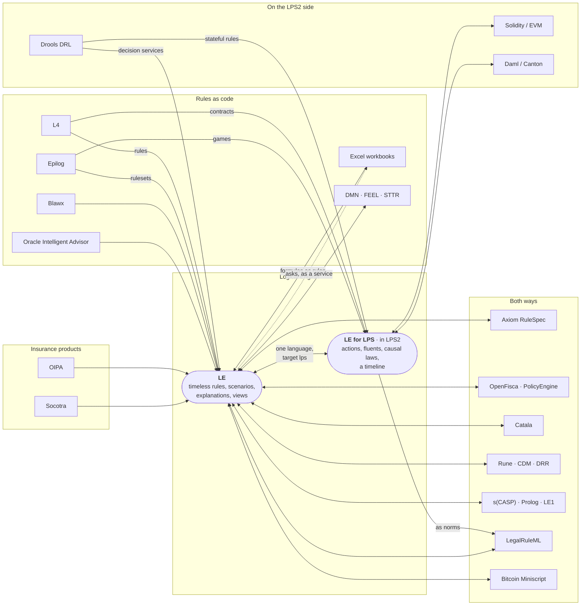

# Other systems: importing and exporting

*Kind: integration guide · Audience: users · Status: current (2026-10-26)*

The editor opens the files of other rule systems and contract systems as Logical
English (LE). The editor also writes some Logical English programs in the format of a
different system. Both translations obey fixed rules. Thus the same file always
gives the same result, and the translations do not use a language model. Each
translation also tells what it could not translate.

This page is the map. It tells which systems the editor reads and writes, and in
which direction. It also tells how import and export operate in general. Each system
has its own document, with a link below.

The systems that a server translates depend on the translators that are installed on
that server. The translators are part of the Logical English Translators. The hosted
service has the Logical English Translators. A server that runs only the Logical
English software has no translator. On such a server:

- **File ▸ Import from Another System…** is hidden.
- **File ▸ Open…** shows only `.le` files.
- **File ▸ Export to Another System…** tells you that no exporter can write the
  program.

## Contents

- [The map](#the-map)
- [The systems](#the-systems)
- [Opening another system's file](#opening-another-systems-file)
  - [What you get](#what-you-get)
  - [What could not be translated](#what-could-not-be-translated)
- [Show the Original](#show-the-original)
- [Exporting to another system](#exporting-to-another-system)
  - [When an export is refused](#when-an-export-is-refused)
- [The migration twins among the examples](#the-migration-twins-among-the-examples)
- [Adapters: keep the callers](#adapters-keep-the-callers)
- [See also](#see-also)

## The map

Each system below has a translator. An arrow that points into Logical English is an
importer. An importer reads the files of that system. A double arrow tells that the
way back also exists. Thus the editor can also write a program in the format of that
system.

**LE for LPS** is Logical English with `the target language is: lps.`. LE for LPS
programs run in time, in the LPS2 IDE. The LPS2 IDE is the editor of the sister
system, LPS (Logic Production System). The documents of the systems that are next to
LE for LPS in the diagram are in LPS2. Click a system in the diagram to open its
document.




The LPS2 editor has its own map. That map shows the systems that only LPS2 reads
(PDDL, Inform 7):
[other systems in LPS2](https://lps2.logicalcontracts.com/docs/user/integrations/index).

## The systems

| System | Ways | Document |
|---|---|---|
| Axiom RuleSpec module (United States statutes, regulations and policies as YAML) | import, export | [Axiom RuleSpec](rulespec.md) |
| Excel workbook (.xlsx, .xlsm): formulas, lookup tables, the answers of the workbook | import; asked as a service | [Spreadsheets](spreadsheets.md) |
| DMN decision model (OMG DMN 1.1 to 1.6, FEEL; the Dutch STTR files), with a TCK test file next to it | import, export (DMN 1.6, the scenarios as TCK test cases); an adapter answers the callers of Kogito, KIE Server and Camunda | [DMN](dmn.md) |
| OpenFisca or PolicyEngine model (Python variables, YAML parameters and tests) | import, export | [OpenFisca and PolicyEngine](openfisca.md) |
| Catala program (English or French), with its test scopes | import, export | [Catala](catala.md) |
| Rune file: the Digital Regulatory Reporting of ISDA, the Common Domain Model, or a model of your own | import, export (run on the engine of DRR) | [Rune](rune.md) |
| Bitcoin Miniscript policy or descriptor | import, export | [Bitcoin Miniscript](miniscript.md) |
| LegalRuleML (OASIS) | import, export | [LegalRuleML](legalruleml.md) |
| s(CASP), Prolog, the s(CASP) translations of LE1 | import; See s(CASP), the s(CASP) engine, the Prolog equivalent | [s(CASP), Prolog and LE1](scasp.md) |
| Blawx project (version 1) | import | [Blawx](blawx.md) |
| Oracle Intelligent Advisor project or rulebase | import; an adapter answers the callers of OIA | [Oracle Intelligent Advisor](oia.md) |
| Socotra product configuration | import | [Socotra](socotra.md) |
| Oracle Insurance Policy Administration transaction | import | [OIPA](oipa.md) |
| Epilog program | import (rulesets as LE, games as LE for LPS) | [Epilog](epilog.md) |
| L4 file | import (rules as LE, contracts as LE for LPS) | [L4](l4.md) |
| Drools rule base (DRL) | import (LE for LPS, and a decision service in LE) | [Drools, in the LPS2 documentation](https://lps2.logicalcontracts.com/docs/user/integrations/drools) |
| Solidity contract | import (LE for LPS); Deploy as Solidity in LPS2 | [Solidity, in the LPS2 documentation](https://lps2.logicalcontracts.com/docs/user/integrations/solidity) |
| Daml (Canton) | import, export (LE for LPS) | [Daml, in the LPS2 documentation](https://lps2.logicalcontracts.com/docs/user/integrations/daml) |

## Opening another system's file

**File ▸ Open…** opens a Logical English file (`.le`). It also opens a file of each
system for which the server has a translator. **File ▸ Import from Another System…**
does the same, but it shows only the files of the other systems. Put the mouse
pointer on that menu item. A small label (a tooltip) shows the list of the systems
that this server can translate from.

The editor sends the file to the server. The server translates the file and opens the
result in a new tab. A note below the menu bar tells these items:

- the translator that did the work,
- how many parts of the file the translator could not translate,
- all other information that the translator gives.

For a migration, the note gives the counts of the ledger of the translator. The
ledger is a record of the source (refer to the next section). To close the note,
click its `×`.

Some translators can read files with the same extension at the end of their names
(`zip`, `xml`, `json`, `txt`). Each of those translators examines the file. The
translator that recognises the file translates it. The server unpacks a zipped
project. If an archive contains only one folder, the server reads it as that folder.

Programs in **Logical English for LPS** (`the target language is: lps.`) run in time.
They do not answer queries. For such a program, the editor shows **Run in LPS** and
**Legal View**. To run the program, you need the LPS2 server. Refer to
[the editor guide](../guide/editor.md#advanced-features).

### What you get

The translation is a usual Logical English program. You can query the program, edit
it, and save it with **File ▸ Save As…**. The source file can have its own tests.
Then the translator writes these tests as scenarios, each with an `expects answers`
line. **Misc ▸ Run the Program's Tests…** then shows which of those tests the program
passes.

A migration also writes a *ledger* next to the program (`<name>.ledger.md`). The
ledger is a table with one row for each element of the source. Each row tells whether
the element was *encoded*, *approximated* or left as *residue*. For an approximated
element, a note tells how its meaning changed. The ledger also tells how many of the
tests of the source the program passes.

To read the ledger, do one of these steps:

1. In the note below the menu bar, click **Open the ledger**.
2. Or, while the program is open, click **File ▸ Show the Ledger…**.

The ledger opens in a window. To keep a copy of the ledger on your computer, click
**Save the Ledger**. The published twins (refer to the gallery) also have a ledger.
**File ▸ Show the Ledger…** opens it.

The program also starts with a short summary of the ledger, as a comment. The summary
gives the number of elements in each of the three groups, the number of expected
answers of the source tests that the program gives, and the name of the ledger file.
The summary stays in the program when you save it. The full ledger does not stay in
the program, because it can be longer than the program.

The server keeps the file that you uploaded, and its translation, for one day, in a
separate folder. The server also keeps in that folder the files that the program
includes and the documents that the program cites. Thus the citations and **Show the
Original** continue to operate while you work on the program. To keep the program for
a longer time, save it.

The program also contains the file that you uploaded **inside itself**, as one long
comment at the end. The comment contains the text of the file, line by line, below a
line that gives the name of the file. A comment is text that the system does not read
as rules. Thus the comment does not change what the program does.

The comment keeps the translation and its source file together. The server forgets
the folder after one day. A program that you save to your own computer takes nothing
with it other than its own text. A file that is not text (a PDF, an archive, a
spreadsheet) cannot go in a comment. Then the comment gives the name of the file
instead of its text. The same is true for a file that is too long.

### What could not be translated

A translator never stops on the full file because of one part that it cannot read.
The translator writes such a part into the program as a comment. The first line of
the comment starts with `% TODO`, and the part of the file follows word for word. A
migration marks the part as a *residue block*:

```le
% RESIDUE r3 BEGIN: the collision rating plugin
%   source: plugins/rating.js lines 40-61
%   ...
% RESIDUE r3 END
```

You can translate a residue block by hand. The *Migration residue* mode of the
Contract Assistant can also do the work. In this mode, the assistant translates only
the residue blocks. Then it runs the tests of the program on the result
([assistants](../guide/assistants.md#the-contract-assistant)).

A file that no translator recognises still opens. Then the editor shows a program
that contains the text of the file inside a TODO comment. The program also gives the
reason why no translator translated the file. The editor refuses an archive that no
translator recognises.

## Show the Original

**File ▸ Show the Original…** shows the source files of a program in the source
viewer. By convention, the source files are in a `sources/` folder next to the
program. File ▸ Open puts an uploaded file there. The migration twins among the
examples also keep their originals there.

- When there is only one file, the file opens immediately.
- When there are some files, the editor first shows a list, and you select one file.
- A program with no `sources/` folder tells you that it keeps no original.

The list does not show files that are not text (PDF, images, archives), because the
viewer shows only text. The copy inside the program (refer to the section above) is
the copy that the system keeps. Go to the end of a program that you opened from the
file of a different system. The file is there.

A program can also cite one of those files as the text of a document
(`the text of the policy file is at "sources/…"`). In the explanation of an answer,
the § badge next to a cited step opens the passage in that text.

**View Original Text** goes to the passage of the original from which the translator
made the sentence at the cursor. This command is in the File menu, and in the menu
that opens when you right-click a line. On a citation, the command opens the cited
passage. In other places, the command looks in the originals for the rule, fact,
table, template, scenario or query at the cursor. The search follows the links that
the translators write into the program:

- The label of the sentence. For example, `rule ps2_tblock1:` finds the element of
  the source with the key `ps2-tblock1`. The comparison of names ignores capital
  letters, `_` and `-`.
- The entries of the migration ledger about that sentence. (The `in_program` of
  each such entry is the label of the sentence or its template.) Each entry names a
  source element, for example `anc/2`. The search finds this element where the
  source defines `anc`.
- All that the sentence cites: the document, the anchor in the published address of
  the document, and the identifiers that give the location of the passage
  (`at MathVariable PremiumTaxMV`).

The source can define an element and also mention it in other places. Then the
definition wins (`key="…"`, `id="…"`, `"name": "…"`, a clause head at the start of a
line, `def …`). The highlighted passage is the element around the definition, or the
block that starts on the line of the definition. For a clause head, the clauses with
the same head that follow are also highlighted. When the search finds no passage, the
originals open with a note that tells this. A program that has no originals and no
cited text tells you that it keeps no original text.

## Exporting to another system

**File ▸ Export to Another System…** writes the program of the front tab in the
format of a different system. The menu shows only the exporters that apply to that
program. When one exporter applies, the export starts immediately. When more than one
exporter applies, the editor asks which exporter to use. The result opens in a
window. The window contains these items:

- the notes of the export. The notes tell what the export did not keep, although the
  program kept all of its meaning (comments, queries and expected answers, layout);
- **Copy** and **Save…**;
- a button for each public playground that can open the result, when the exporter
  has one;
- the exported text.

The exporters are Bitcoin Miniscript (for spending-policy programs), LegalRuleML (for
usual rule programs), DMN (for programs about one case, or about one kind of thing,
with values, conditions and decision tables), Axiom RuleSpec, OpenFisca, Catala, Rune
and Daml (for LE for LPS programs). For example, the editor
shows both Miniscript and LegalRuleML for `migration/miniscript/core_2of3_multisig`.
The LPS2 editor has the same exporters in **Misc ▸ Export to another system…**. It
also has one more exporter of its own, **Misc ▸ Deploy as Solidity…**.

### When an export is refused

An exporter first checks whether it can write the program *faithfully*. The program
can use something that the other system cannot express. Then the exporter
**refuses** and writes nothing. A translation that has a different meaning, without
a warning, is worse than no translation.

A window with the title *Not translated to …* tells how many problems the exporter
found, and lists each problem. When a problem has a location in the program, the list
gives these items:

- the line, as a link that takes you to that line,
- the words of the program at that line,
- what the other system does not have.

You can see two refusals with the examples:

- `regulatory/eu261_integration` to LegalRuleML. The program has a decision table,
  which LegalRuleML cannot state. Also, one rule cites a source (`according to`)
  inside `it is not the case that`. The window gives the line of the table. For the
  second problem, the window points at the `according to` itself, and reports the use
  of `according to`. The export of `it is not the case that` alone has no problem.
  Thus the problem is in what is inside it.
- `migration/miniscript/core_2of3_multisig` to LegalRuleML. The spending rule of the
  program counts signatures
  (`a number N is the count of each K such that …`), and
  LegalRuleML has no aggregates. The Miniscript exporter writes that same program.

An integrity constraint (`it must not be true that …`) is a problem for each system
that has no constraints of its own.

The editor refuses in the same way in all places where it translates a program into
a different language. **See s(CASP)** is in the menu that opens when you right-click
in the editor. **See s(CASP)** and the s(CASP) engine show the same list when the
program uses something that s(CASP) cannot state (refer to
[s(CASP)](../reference/scasp.md)).

## The migration twins among the examples

The translators were run on published programs of their source systems. The results
are called *twins*, and the twins are among the examples. To open a twin, select
**File ▸ Open example from server…**, or use the landing page. Each twin has its
ledger, the tests of its source written as scenarios, and its `sources/` folder.

- `migration/blawx/…`: Blawx encodings;
- `migration/epilog/…`: the rulesets of the Epilog site, with the answers of
  EpilogJS (the full list of Epilog programs is in the README of that folder);
- `migration/l4/…`: the examples and courses of L4, their rules, and the history
  views of their contracts;
- `migration/legalruleml/…`: the examples of the LegalRuleML specification;
- `migration/rulespec/…`: United States benefit rules and tax rules from the RuleSpec
  corpus of Axiom (SNAP food assistance, the Child Tax Credit, the Earned Income Tax
  Credit, Supplemental Security Income);
- `migration/miniscript/…`: Bitcoin spending policies. Each policy has a custody
  view, flip queries for lost keys, and scenarios that a recorded run on the public
  Tape network confirmed;
- `migration/scasp/…`: s(CASP) programs, including the programs of LE1.

The twins written in Logical English for LPS (Daml, Drools, Solidity, the contracts
of L4, the Epilog games) are among the examples of LPS2. The twins of Oracle
Intelligent Advisor and Socotra are only on
installations that have the lpsPlus examples (in `lpsPlus/migration/`). Only users
with access to these examples can open them.

## Adapters: keep the callers

A translated program can also answer the applications that called the other
system, in the format of that system. This part of the server is an
**adapter**. Two adapters exist: one for Oracle Intelligent Advisor, one for
the DMN engines Kogito, KIE Server, Camunda 7 and Camunda 8. Refer to
[Adapters](adapters.md).

## See also

- [The editor guide](../guide/editor.md), [the language reference](../reference/language.md).
- [Logical English for LPS](../reference/lps-target.md), and in LPS2:
  [the LE for LPS reference](https://lps2.logicalcontracts.com/docs/user/reference/le-for-lps)
  and [other systems in LPS2](https://lps2.logicalcontracts.com/docs/user/integrations/index).
- How the translators work, the ledger and the residue, for developers:
  [migration](../../dev/migration.md).
