# A Gentle Introduction to Logical English 2

*Kind: tutorial · Audience: users · Status: current (2026-10-20; screenshots of September
2026, those of s(CASP) of July)*

> **About the language of this document.** ASD-STE100 Simplified Technical
> English (STE) is a controlled form of English for technical documents. This
> document obeys these STE rules: short sentences (a maximum of 20 words in procedures and 25 words in
> descriptions), one instruction in each sentence, numbered steps for procedures,
> the active voice, simple tenses, and one word for one meaning. Some words are not
> in the STE dictionary. These words are the names in the user interface (menus,
> buttons, windows), the names of Logical English ideas (template, scenario, query,
> and others), and other technical names.

Logical English (LE) is a restricted form of English. It is ordinary English, but it
has only a small set of sentence shapes. You write rules, facts and queries in LE,
and then you *run* them. LE does not use brackets, the symbol `:-` or semicolons. Your
text is similar to a contract or a regulation. The system changes your sentences into
logic, and then it uses that logic to find answers. For each answer, the system tells
you in plain English *why* the answer is true, or why it is not true.

This tutorial shows three small programs. The first program is about a tea party of
imaginary creatures. The third program is a small part of British nationality law.
The tutorial also shows the tools of the editor. The editor is the web page where you
write and run a program. Then a fourth program, the Mad Hatter's tea shop, shows the
newer parts of the language: numbers, cascades, tables, dates, constraints and
citations.

The tea shop also shows the tools around the language: tests, the debugger, and
screens for the users of a program. The reasoner is the part of the system that finds
the answers. At the end of this tutorial, you can write LE and ask it questions. You
can also examine "what if" situations, and you can make the reasoner explain each
answer in full.

> **Do the steps with the tutorial.** All of the examples run in your browser at
> **<https://le2.logicalcontracts.com>**. This web site is a public copy of the
> system. You do not have to install software.
>
> 1. Open the editor.
> 2. Select **File → Open example from server…**.
> 3. Select the example that each section gives (`tea_party`, `happy_dragon`,
>    `citizenship`).
>
> The public copy does not contain the tea shop. You must paste the tea shop into the
> editor yourself (§16).

**Reference material.** You do not need the reference material for this tutorial, but
it is available:

- Language reference: [Logical English syntax summary](../../reference/language.md)
- Editor manual: [How to use the LE2 web application](../../guide/editor.md)
- All examples: [`examples/moreExamples/`](https://github.com/LogicalContractsOrg/LogicalEnglish2/tree/main/examples/moreExamples)

---

## Contents

- [A Gentle Introduction to Logical English 2](#a-gentle-introduction-to-logical-english-2)
  - [Contents](#contents)
  - [1. The editor: an overview](#1-the-editor-an-overview)
  - [2. Example 1 — `tea_party`: the basics of the language](#2-example-1--tea_party-the-basics-of-the-language)
    - [Templates: how you give LE your words](#templates-how-you-give-le-your-words)
    - [Facts](#facts)
    - [Rules](#rules)
    - [Negation, and sentences about sentences](#negation-and-sentences-about-sentences)
    - [Scenarios and queries](#scenarios-and-queries)
  - [3. Run a query](#3-run-a-query)
  - [4. Read an explanation](#4-read-an-explanation)
  - [5. Example 2 — `happy_dragon`: "for all cases"](#5-example-2--happy_dragon-for-all-cases)
  - [6. Example 3 — `citizenship`: a small real rulebook](#6-example-3--citizenship-a-small-real-rulebook)
  - [7. Scenario Variations: examine "what if"](#7-scenario-variations-examine-what-if)
  - [8. Unknowns: find an answer with an assumption](#8-unknowns-find-an-answer-with-an-assumption)
  - [9. Why *not*? Failure explanations](#9-why-not-failure-explanations)
  - [10. Explanation preferences and the Explanation Drill](#10-explanation-preferences-and-the-explanation-drill)
    - [Preferences](#preferences)
    - [The Explanation Drill](#the-explanation-drill)
  - [11. The important reason of an explanation](#11-the-important-reason-of-an-explanation)
  - [12. Bento Box: an explanation as boxes in boxes](#12-bento-box-an-explanation-as-boxes-in-boxes)
  - [13. Flip: what changes the answer?](#13-flip-what-changes-the-answer)
  - [14. Tests: say what you expect](#14-tests-say-what-you-expect)
  - [15. Warnings and "?": messages from the editor](#15-warnings-and--messages-from-the-editor)
  - [16. Example 4 — the tea shop: numbers, cascades, tables, dates](#16-example-4--the-tea-shop-numbers-cascades-tables-dates)
    - [Named constants and arithmetic](#named-constants-and-arithmetic)
    - [`otherwise`: the first alternative that applies](#otherwise-the-first-alternative-that-applies)
    - [A decision table](#a-decision-table)
    - [Calendar months](#calendar-months)
    - [A rule that a case must not break](#a-rule-that-a-case-must-not-break)
  - [17. Cite your sources](#17-cite-your-sources)
  - [18. The debugger: breakpoints and steps](#18-the-debugger-breakpoints-and-steps)
  - [19. A screen for the users of the program: views](#19-a-screen-for-the-users-of-the-program-views)
  - [20. The LE Assistant: write drafts with a language model](#20-the-le-assistant-write-drafts-with-a-language-model)
  - [21. A second engine: s(CASP)](#21-a-second-engine-scasp)
    - [See the s(CASP) program that LE makes](#see-the-scasp-program-that-le-makes)
    - [Answers that are *constraints*](#answers-that-are-constraints)
    - [More than one possible world, and the assumptions of each world](#more-than-one-possible-world-and-the-assumptions-of-each-world)
    - [Which engine to use](#which-engine-to-use)
  - [22. Share a program: links and QR codes](#22-share-a-program-links-and-qr-codes)
  - [23. Where to go next](#23-where-to-go-next)

---

## 1. The editor: an overview

Open the editor. Then load `tea_party` (**File → Open example from server… →
tea_party**).

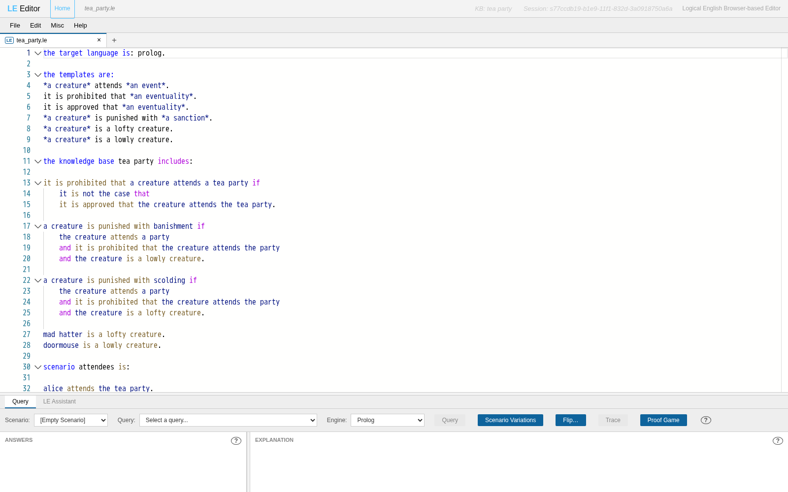

The editor has five important areas:

- **Header (top):** The header shows the file name and the name of the knowledge base
  (`KB: tea party`). A knowledge base is the set of rules and facts that the program
  defines. The header also shows a **Session** number. A session is the working copy
  of your program on the server. The server is the computer that finds the answers.
  The editor makes a session for you when you first need one, for example when you
  open the query lists. **Home** shows the list of examples again.
- **Menu bar:** The menu bar has the menus `File`, `Edit`, `Misc` and `Help`. Put the
  mouse pointer on a menu item, and a short note tells you what the item does.
  **Help** gives a list of the documents. This tutorial is in that list.
- **File tabs:** Each open document has a tab, as in a web browser. `+` opens a new,
  empty document. A dot on a tab shows that the document has changes that you did not
  save. Each tab keeps its own queries, answers and assistant conversation.
- **Code editor (middle):** You write the program in the code editor. The code editor
  is Monaco, a text editor that many programmers use. The editor shows the words of
  the language in colours. It puts a wavy line below text that is possibly incorrect.
  Put the mouse pointer on the wavy line, and the editor shows a possible repair
  (§15).
- **Bottom panel:** The bottom panel has two tabs, **Query** and **LE Assistant**. You
  run the program in the bottom panel. Each small **?** button opens the part of the
  documentation about the panel that contains the button.

The screenshots of this tutorial use the **Light** theme. The theme is the colour
scheme of the editor. The theme setting is in the **Misc** menu, together with other
settings that this tutorial uses later:

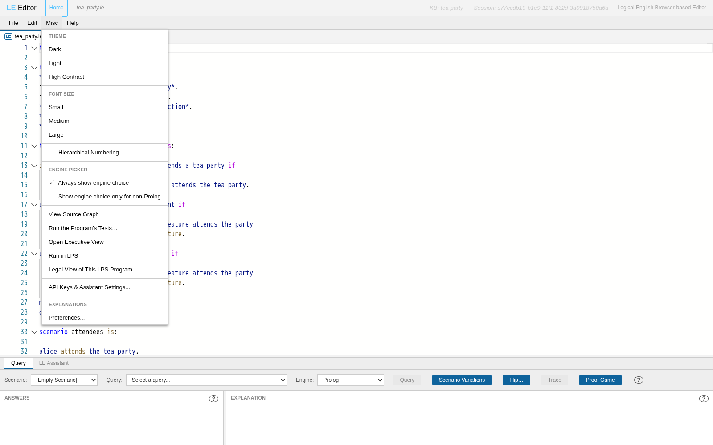

The **Misc** menu also has the font size and these important items:

- **Hierarchical Numbering** (§10).
- **Run the Program's Tests…** (§14).
- **Open Executive View** (§19).
- **EXPLANATIONS → Preferences…** (§10).
- **View Source Graph**. This item shows the program as a diagram of boxes and arrows,
  in a new tab. The diagram shows the connections between the templates, the rules and
  the facts.

---

## 2. Example 1 — `tea_party`: the basics of the language

Each LE program has a small number of kinds of section. This is the full `tea_party`
program:

```le
the target language is: prolog.

the templates are:
*a creature* attends *an event*.
it is prohibited that *an eventuality*.
it is approved that *an eventuality*.
*a creature* is punished with *a sanction*.
*a creature* is a lofty creature.
*a creature* is a lowly creature.

the knowledge base tea party includes:

it is prohibited that a creature attends a tea party if
	it is not the case that
	it is approved that the creature attends the tea party.

a creature is punished with banishment if
	the creature attends a party
	and it is prohibited that the creature attends the party
	and the creature is a lowly creature.

a creature is punished with scolding if
	the creature attends a party
	and it is prohibited that the creature attends the party
	and the creature is a lofty creature.

mad hatter is a lofty creature.
doormouse is a lowly creature.

scenario attendees is:
alice attends the tea party.
mad hatter attends the tea party.
doormouse attends the tea party.
it is approved that alice attends the tea party.
punishment expects answers ["doormouse is punished with banishment","mad hatter is punished with scolding"].

query punishment is:
    which creature is punished with which sanction.
```

The subsections that follow explain the program, one part at a time. (The
`expects answers` line is a test. §14 explains tests.)

### Templates: how you give LE your words

Before you write a sentence, you must declare the sentence patterns that you will use.
Write these patterns below `the templates are:`. Each pattern is a **template**. A
template is a sentence with parts that can change. These parts are the slots. Put
asterisks around each slot:

```le
*a creature* attends *an event*.
*a creature* is punished with *a sanction*.
```

The **head noun** of a phrase between asterisks is the main noun of the phrase. The
head noun is the **type** of the slot: the kind of thing that can go in the slot. In
the example, the types are `creature`, `event` and `sanction`. The words between the
slots (`attends`, `is punished with`) do not change. LE uses these fixed words when it
compares a sentence with the template.

A template gives the shape of a full family of sentences. When the template
`*a creature* attends *an event*` exists, LE accepts the fact
`alice attends the tea party`. LE also accepts the question
`which creature attends which event`.

> When LE compares a sentence with a template, it ignores small words such as *a*,
> *an*, *is* and *are*. Thus you can write in a natural way. But *a* and *the* still
> change the *meaning*. `a creature` starts a variable. A variable is a slot that some
> creature will fill. `the creature` refers back to the same creature. Sometimes a
> phrase starts with `the`, but no earlier phrase started its variable. An example is
> `the tea party` in a scenario. Such a phrase is the name of one specific individual
> (refer to [definite descriptions](../../reference/language.md#60-definite-descriptions-back-reference-or-global-constant)).

### Facts

A **fact** is one sentence that uses a template. A fact ends with a full stop:

```le
mad hatter is a lofty creature.
doormouse is a lowly creature.
```

`mad hatter` and `doormouse` are constants. A constant is the name of a specific
individual. A constant is not a slot to fill. A name in lower case is a constant,
the same as a name that starts with a capital letter.

### Rules

A **rule** says that one thing is true if other things are true: `Head if Body.` The
head is the conclusion. The body gives the conditions that make the conclusion true.
The words `and`, `or` and the other joining words of the language connect the
conditions. A new line with the same indentation also means "and".

In LE, the indentation of a line changes the meaning of a rule. Thus you must align
the conditions:

```le
a creature is punished with banishment if
	the creature attends a party
	and it is prohibited that the creature attends the party
	and the creature is a lowly creature.
```

Note: `the creature` uses again the variable that `a creature` started. In all of a
rule, the same words refer to the same individual.

### Negation, and sentences about sentences

To say that something is *not* true, LE uses **`it is not the case that`**. LE accepts
such a condition as true when it cannot prove the sentence that follows. Thus "not"
here means "not possible to prove from the data in the program". Write the sentence
that is not true on a separate indented line below:

```le
it is prohibited that a creature attends a tea party if
	it is not the case that
	it is approved that the creature attends the tea party.
```

In plain English, the rule means: attendance at the tea party is prohibited *if* the
attendance does *not* have approval.

Now examine the two templates that the rule uses:

```le
it is prohibited that *an eventuality*.
it is approved that *an eventuality*.
```

The slot `*an eventuality*` does not hold a creature or a date. The slot holds
*a full sentence*. The small word **`that`** lets one sentence be *about* a different
sentence. For example, look at
`it is approved that (the creature attends the tea party)`. Here, the sentence
`the creature attends the tea party` is inside
`it is approved that …`. The inner sentence is the thing that has approval.

A template with a slot for a sentence (not for a thing) is a **meta‑template**. The
word `that` is the connection. With meta‑templates, LE can say that someone prohibits,
approves, believes or says something. Legal language and everyday language use many
such phrases: "someone holds that ⟨sentence⟩". The citizenship example uses one more
meta‑template, `… says that …`.

### Scenarios and queries

A **scenario** is a set of facts with a name. The program uses the facts of the
scenario to find answers. A scenario is one case, or one situation. A **query** is the
question that you ask about that situation:

```le
scenario attendees is:
alice attends the tea party.
mad hatter attends the tea party.
doormouse attends the tea party.
it is approved that alice attends the tea party.

query punishment is:
    which creature is punished with which sanction.
```

`which creature` and `which sanction` are the blanks that we want the program to fill.
Alice will not have a punishment, because her attendance has approval. The Mad Hatter
is a lofty creature and the Doormouse is a lowly creature. Thus we expect a scolding
for the Hatter and a banishment for the Doormouse. The next section makes sure that
this expectation is correct.

---

## 3. Run a query

In the **Query** tab at the bottom of the editor, do these steps:

1. In the **Scenario** list, select `attendees`.
2. In the **Query** list, select `which creature is punished with which sanction (punishment)`.
3. Click **Query**.

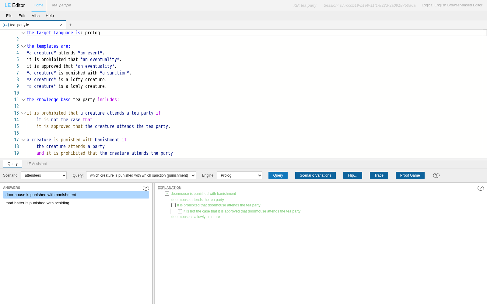

Two answers appear on the left:

- *doormouse is punished with banishment*
- *mad hatter is punished with scolding*

Alice is not in the list. This result is correct, because her attendance has
approval. Thus nothing about Alice is prohibited.

The web address at the top of the browser now contains the names of the example, the
scenario and the query. Copy that address and send it to a person. That person can
then do the same run. The other buttons in the row are **Scenario Variations**,
**Flip…**, **Trace** and **Proof Game**. Later sections tell you about these buttons.

The **Engine** list selects the reasoning program that answers your queries. §21
explains the **Engine** list. For now, keep the setting Prolog.

> When your program has errors, the **Query** button does not operate. If the button
> is grey, look for red wavy lines in the editor first. If a query continues to run
> after some seconds, an **Interrupt** button appears. Click **Interrupt** to stop the
> query.

---

## 4. Read an explanation

Click an answer, for example *doormouse is punished with banishment*. The
**EXPLANATION** panel on the right shows the reasoning as a tree:

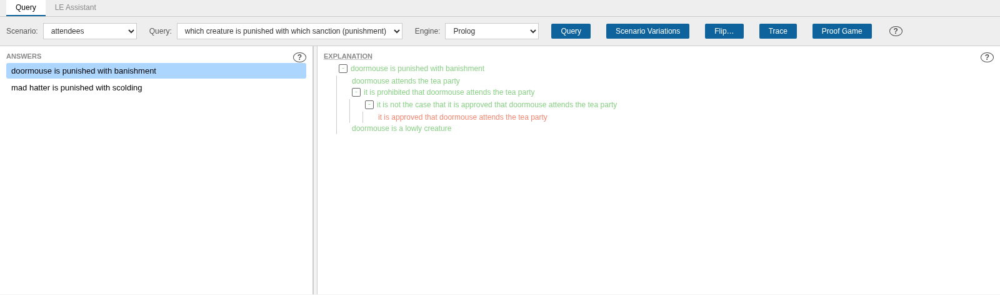

Each line of the tree is one condition. (Programmers call a line of a tree a node.)
The colour of the line shows the result for that condition:

- **green**: the reasoner proved that the condition is true.
- **red**: the reasoner could not prove the condition.
- **amber**: the condition is *unknown*. The reasoner could not prove that the
  condition is true, and it could not prove that the condition is false. Thus the
  reasoner assumed that the condition is true. (§8 tells you more about unknowns.)

In this example, the doormouse attends the tea party, the attendance is prohibited,
and the doormouse is a lowly creature. Open all the levels of the prohibition. You
find one red line: *it is approved that doormouse attends the tea party*. This red
line is inside a denial (`it is not the case that …`), and the rule needs a red line
there. The prohibition is true *because* the reasoner found no approval. Thus the line
*it is not the case that …* above the red line is green.

You can do two useful actions:

- **Click a line** of the tree. The editor goes to the rule or fact that made that
  line, and highlights the rule or fact. Use this action to find the origin of a
  line.
- Use the `−` and `+` buttons to close and open parts of the tree. At the start, the
  top two levels are open.

Right‑click in the tree to see two menu items:

- **Copy Explanation** copies the proof as plain text, and also as formatted text for
  a word processor.
- **Copy as Mermaid diagram** copies the proof in a format that many writing tools
  show as a diagram.

With these two items, you can paste the proof into a document.

---

## 5. Example 2 — `happy_dragon`: "for all cases"

Load `happy_dragon`. This program is short. It shows one new idea:
**`forall` conditions**. A `forall` condition must be true in *all* cases, not only in
one case. The program also uses again the denial from the tea party, in a different
situation.

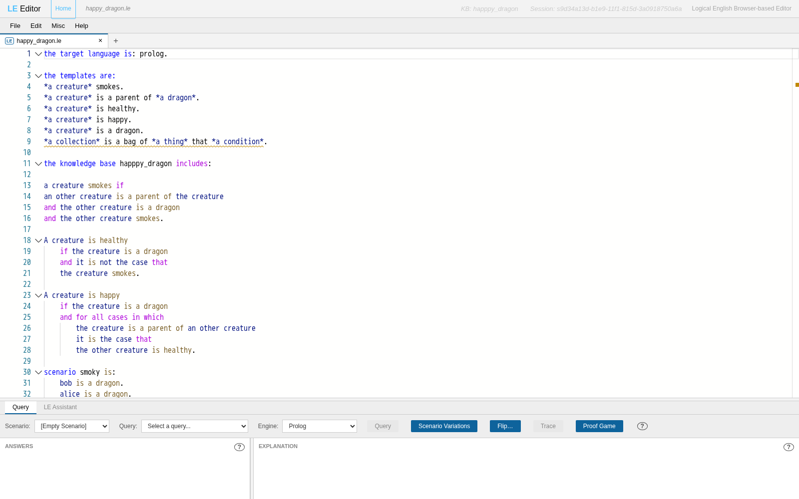

```le
A creature is healthy
    if the creature is a dragon
    and it is not the case that
	the creature smokes.

A creature is happy
    if the creature is a dragon
    and for all cases in which
	    the creature is a parent of an other creature
		it is the case that
		the other creature is healthy.
```

- **Healthy** uses the denial from §2 (`it is not the case that`). A dragon is healthy
  if the dragon does *not* smoke. The construct is not new. The rule uses the same
  construct for a different conclusion.
- **Happy** uses the new idea: **`for all cases in which … it is the case that …`**. A
  dragon is happy when *each* of its children is healthy. A dragon with no children is
  also happy. A condition about each child is true when there is no child to examine.

Also note `an other creature`. The word **other** makes that `creature` *different*
from `the creature`. Thus the rule does not make a dragon its own parent by mistake.
(A small word can have a large effect.)

Do these steps:

1. Select scenario `smoky`.
2. Select query `which dragon is happy (happy)`.
3. Click **Query**.
4. Click the answer *alice is happy*.

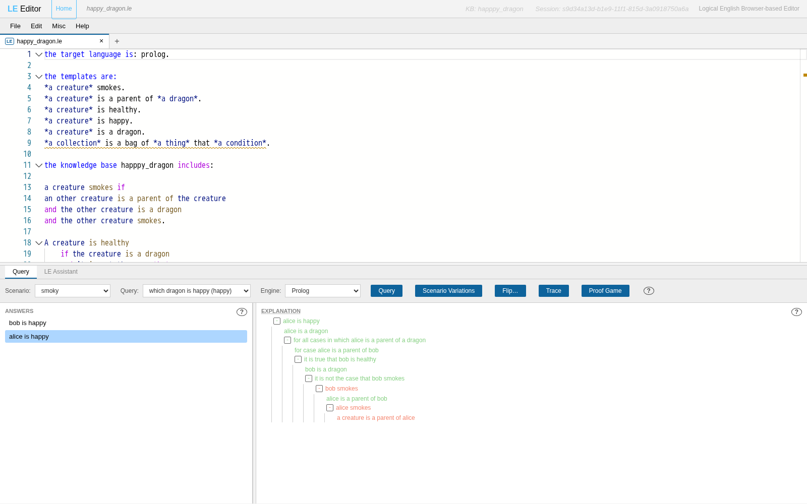

Both `bob` and `alice` are happy. The explanation for alice has the line **for all
cases in which alice is a parent of a dragon**. Open that line. You see the one
applicable case, *for case alice is a parent of bob*. Below that case is the proof
that bob is healthy. Bob is healthy because the reasoner could not prove *bob smokes*.
Bob smokes only if a parent of bob smokes, and nobody is a parent of alice.

The "for all cases" condition is now a short list of real cases. You can examine these
cases one at a time. Such lists make LE explanations easy to read.

---

## 6. Example 3 — `citizenship`: a small real rulebook

The next example is similar to real law. `citizenship` is a small version of a
well-known translation of the British Nationality Act into logic. Load `citizenship`:

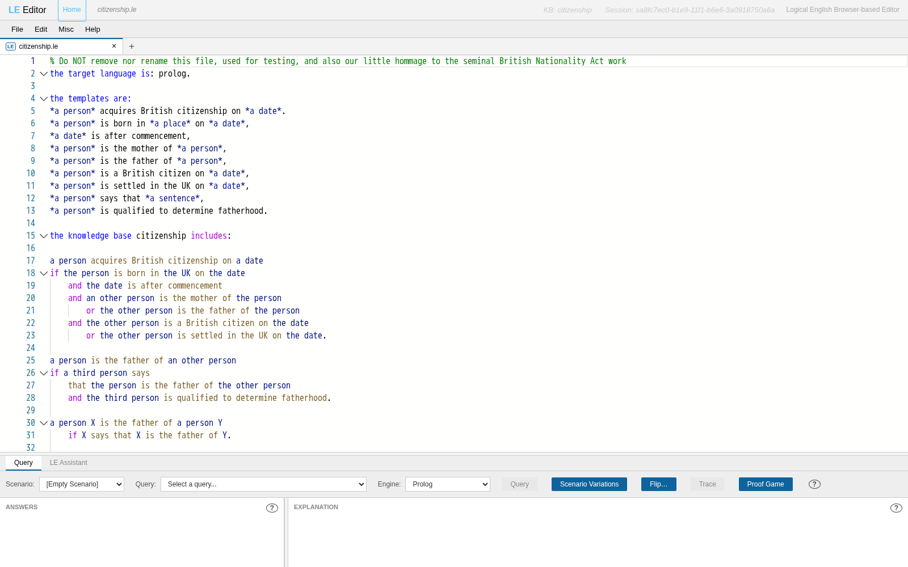

This is the main rule:

```le
a person acquires British citizenship on a date
if the person is born in the UK on the date
	and the date is after commencement
	and an other person is the mother of the person
    	or the other person is the father of the person
	and the other person is a British citizen on the date
    	or the other person is settled in the UK on the date.
```

In plain words, you acquire citizenship when these two conditions are true:

- You were born in the UK after commencement.
- At that time, one parent (the mother *or* the father) was a British citizen *or* was
  settled in the UK.

That one rule uses `and` together with `or`. The rule also uses the variable
`an other person` in more than one condition. The same words refer to the same person
in all of the rule. Thus the same parent must satisfy the "is a parent" part and also
the "citizen or settled" part.

The program uses one more **meta‑template**. A meta‑template is a sentence about a
sentence, as `it is approved that …` in the tea party (§2). Here, the sentence is
about a person who *says* something:

```le
a person is the father of an other person
if a third person says
    that the person is the father of the other person
    and the third person is qualified to determine fatherhood.
```

`… says that …` also uses `that`, so that one fact can be *about* a different
sentence. The fatherhood is true when two conditions are true. First, a third person
*says* that someone is the father. Second, that third person is qualified to determine
fatherhood.

Dates such as `2021-10-09` are usual values of the language. To compare two dates, use
`after` and `before`.

Run scenario `alice` with query `one`. Then click the answer:

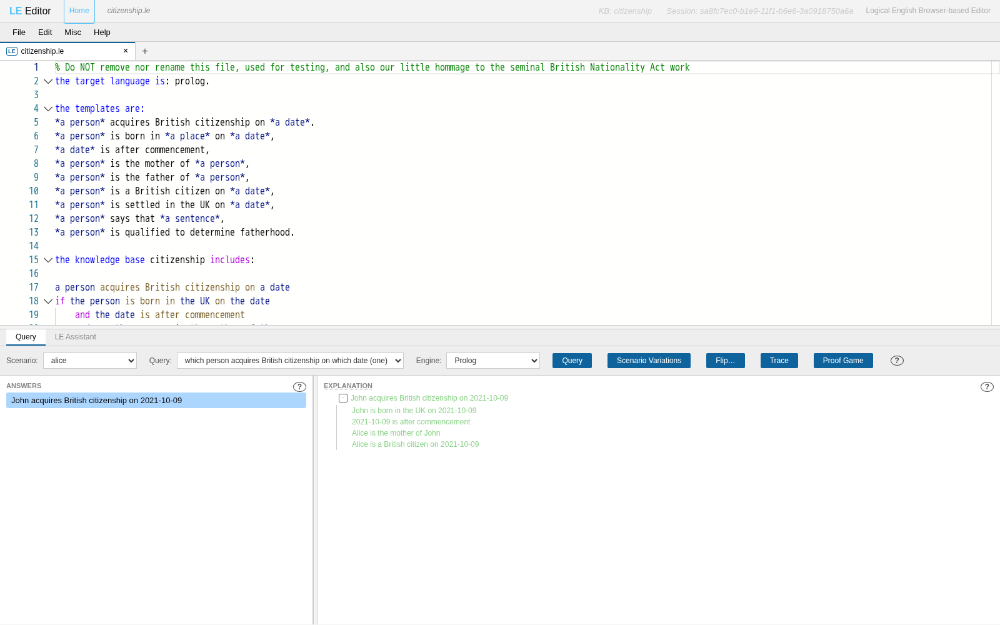

The answer is *John acquires British citizenship on 2021‑10‑09*. All lines of the
explanation are green, at all levels. John was born in the UK after commencement,
Alice is his mother, and Alice is a British citizen. The next sections change the
facts.

---

## 7. Scenario Variations: examine "what if"

The scenarios in the file do not change. But usually the real question is: *"What is
the result if the facts are different?"* In the **Scenario Variations** window, you
can take a scenario and change its facts. Then you can run the queries again on the
changed facts. Your program does **not** change.

Do these steps:

1. In the **Query** tab, select scenario `alice` and query `one`.
2. Click **Scenario Variations**, the button next to **Query**.

A new window opens. The window contains the facts of the scenario:

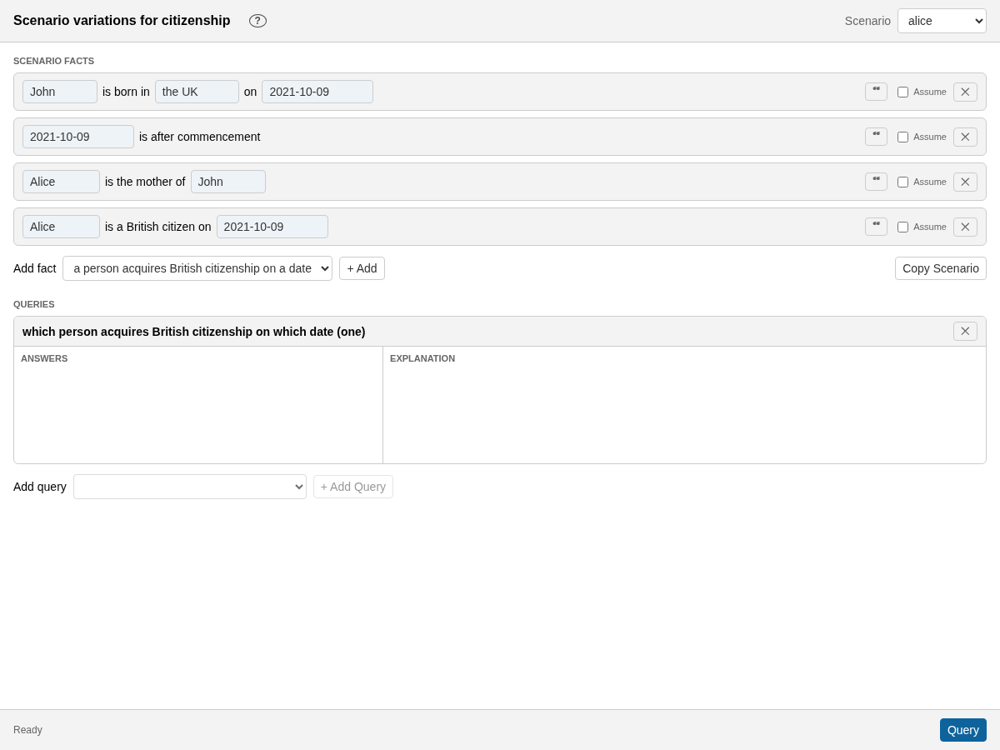

The window shows each fact as a **form with blanks**. You do not type the fact as
text. Thus you do not have to remember the exact words of a template. The window shows
the fixed words of the template as text. You can change only the blanks:

> `[John]` is born in `[the UK]` on `[2021-10-09]`

In this window, you can do these actions:

- Change the value in a blank.
- Delete a fact with its **✕** button.
- Add a fact with **Add fact**, and select its template.
- Select **Assume**. §8 explains assumptions.
- Use **❝** to record the passage of a document that states the fact (§17).

The query that you selected shows as a card below the facts. Click **Query** at the
bottom of the window. The window runs all the queries in its list on the current
facts:

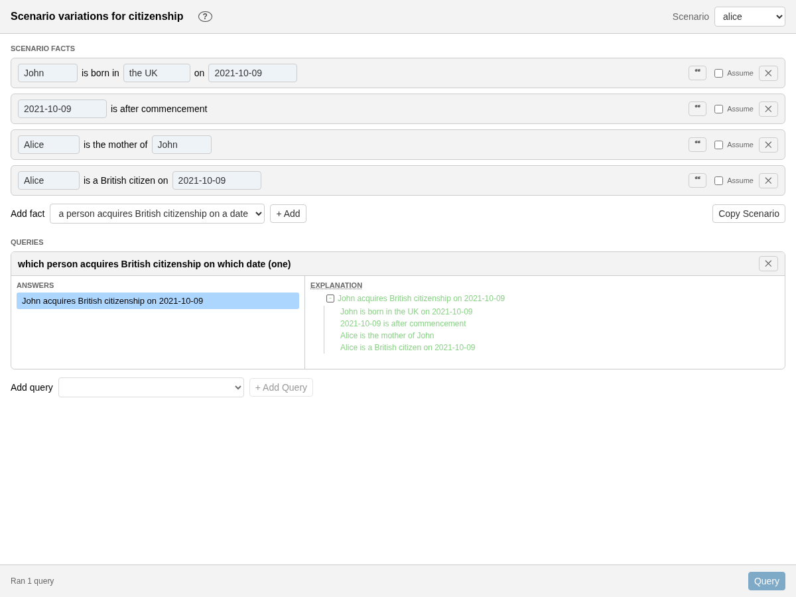

The result is a green success, the same as before. But now *you* control the facts.
After a run, the **Query** button becomes grey. When you change something, the button
becomes available again. Thus you always know if the results below agree with the
facts above.

The web address of the window contains the full variation. (A web address is also
known as a URL, short for Uniform Resource Locator.) Copy that address to **share the
same variation** with a colleague. **Copy Scenario** copies the changed
`scenario … is:` block. You can paste that block back into the program.

> The same forms can edit the scenarios that are in the program. **Edit → Edit
> Scenarios…** opens the Scenario Editor. **Edit → Edit Queries…** makes queries from
> your templates in the same way. The two editors write the result back into the
> program in the editor. Refer to the
> [Scenario Editor](../../guide/editor.md#the-scenario-editor) and the
> [Query Editor](../../guide/editor.md#the-query-editor).

---

## 8. Unknowns: find an answer with an assumption

This section shows an important feature. Possibly you are *not sure* that Alice is a
British citizen. You want to see the result if you assume that she is a citizen.

Do these steps:

1. Select the **Assume** checkbox on the row *"Alice is a British citizen on
   2021‑10‑09"*.
2. Run the query again.

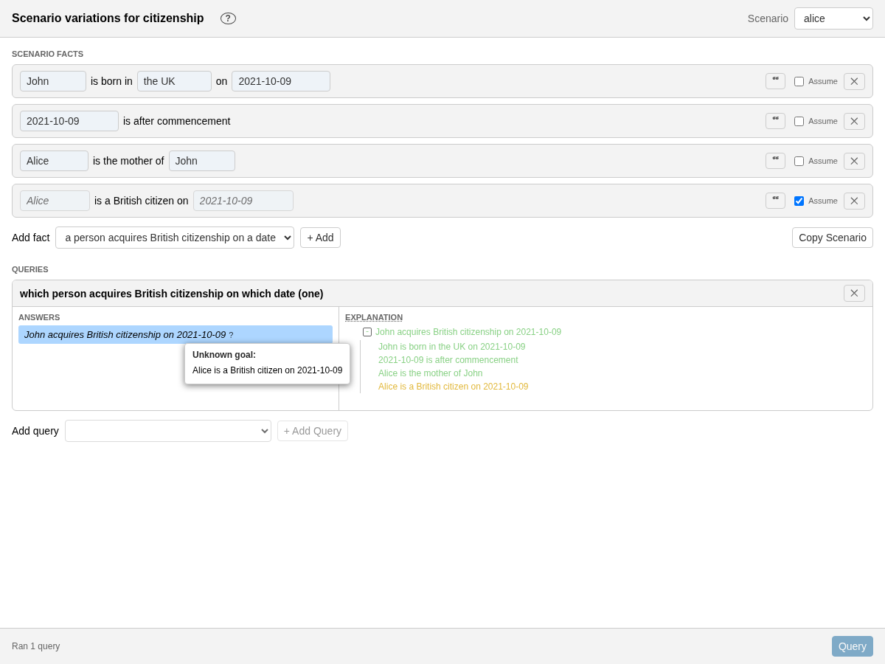

Three things changed:

1. You cannot change the blanks of the assumed fact now. The sentence is not a usual
   fact now: it is an *assumption*. When you select the checkbox, the window writes
   the sentence again as *"it is unknown whether Alice is a British citizen on
   2021‑10‑09."*
2. The answer is still there, but it has a **`?`** mark now. The mark means that the
   answer is true *only if the assumption is true*. Put the mouse pointer on the
   answer to see the list of unknowns that the answer uses.
3. In the explanation tree, the line *"Alice is a British citizen…"* is **amber**, not
   green. The reasoner did not prove the line. **The line is unknown, thus the reasoner
   assumed that the line is true.**

With amber lines, LE can find answers when it does not have all the data. Here, the
meaning is: *"John acquires citizenship if Alice is a citizen. At the moment, we
assume that Alice is a citizen."* The amber lines are the open questions that your
conclusion depends on.

**Assume a full kind of fact, not only one fact.** The **Assume** checkbox makes one
*specific* fact unknown. But sometimes a full *kind* of fact is uncertain. Then you
want the reasoner to assume each sentence of that shape when it cannot prove the
sentence. To do this, mark the **template**. Add `; assumable` after the template.
(`; unknown` and `; assumed` have the same meaning as `; assumable`.)

```le
the templates are:
*a person* is a British citizen on *a date*; assumable.
```

Now the reasoner cannot prove some "… is a British citizen on …" sentences. It treats
each of these sentences as unknown, and it assumes that the sentence is true. You do
not have to select checkboxes one fact at a time. Each answer that uses such a
sentence has the same `?` mark and the same amber line as above.

The checkbox means "assume *this* fact". The addition to the template means "each
sentence of this shape is an open question". You can also mark one sentence as open,
in the knowledge base or in a scenario. To do this, write `it is unknown whether …`:

```le
it is unknown whether Alice is a British citizen on 2021-10-09.
```

(For all the data, refer to the
[template additions](../../reference/language.md#template-additions-after-) in the
language reference.)

---

## 9. Why *not*? Failure explanations

An assumption can make an answer appear. When you delete a fact, an answer can
disappear. Delete the fact *"Alice is a British citizen…"* with its **✕** button. Then
run the query again:

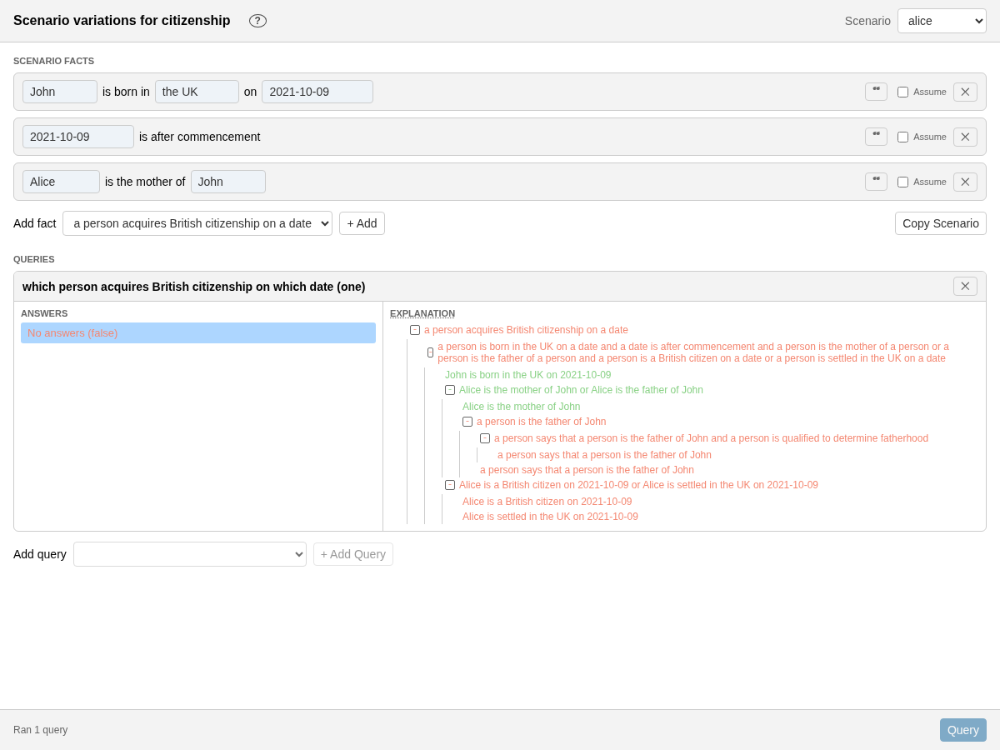

Now the result is **No answers (false)**. The explanation is now a **why‑not** tree.
The tree shows the condition that failed. The condition *"Alice is a British citizen …
or Alice is settled in the UK …"* is **red**. Without the citizenship fact, the
reasoner cannot prove either half of that "or".

The conditions that are still true stay green: John is born in the UK, and Alice is
the mother of John. Thus you can see how far the proof went before it stopped. (The
branch about the father is also red, because no fact says who the father of John is.)

A why‑not explanation is frequently *more* useful than a successful explanation. The
why‑not explanation tells you the one fact that you must add, or assume, to change the
answer. In the Scenario Variations window, right‑click a red line. The menu has the
items **Patch scenario — add this fact** and **Assume fact**. §13 shows how to ask for
such a change directly.

---

## 10. Explanation preferences and the Explanation Drill

Real rulebooks make large explanation trees. Two features help you with a large tree.

### Preferences

Select **Misc → EXPLANATIONS → Preferences…**:

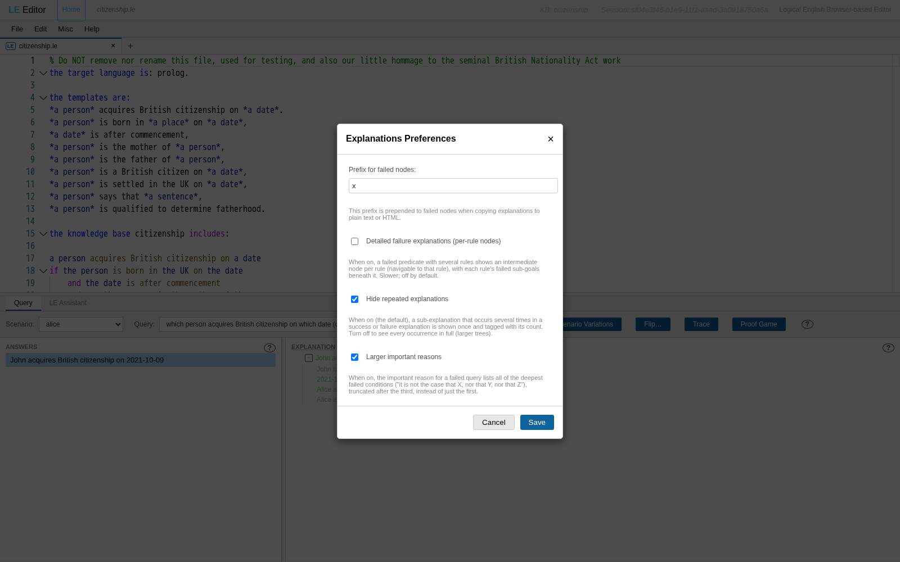

- **Prefix for failed nodes:** the words that **Copy Explanation** puts before each
  failed line. These words are useful when you paste the explanation into a location
  that does not show colours.
- **Detailed failure explanations (per‑rule nodes):** Sometimes a condition failed
  after the reasoner tried more than one rule. When this setting is on, such a
  condition shows one line for each rule. This setting gives more data, but the
  reasoner is slower. Thus the setting is off at the start.
- **Hide repeated explanations** (*on at the start; we recommend that you keep it
  on*): A large tree, and especially a why‑not tree, frequently proves the same thing
  many times. This setting shows each repetition as one line in italics, with the
  number of repetitions. Thus you see the *shape* of the reasoning, not many copies.
- **Larger important reasons:** refer to §11.

One more item in the **Misc** menu is important. **Hierarchical Numbering** puts a
number before each line. The number shows the position of the line in the tree
(`1.2.3`). These numbers are very useful when you discuss one specific step with a
different person.

### The Explanation Drill

Sometimes the tree has forty lines, but you want to know only *the* main reason. Then
use the **Explanation Drill**:

1. Right‑click the **EXPLANATION** title.
2. Select **Explanation Drill…**.

A new window opens. The window takes you through the proof as a series of yes‑or‑no
questions. The screenshot shows the drill for *alice is happy* in `happy_dragon`,
after one answer:

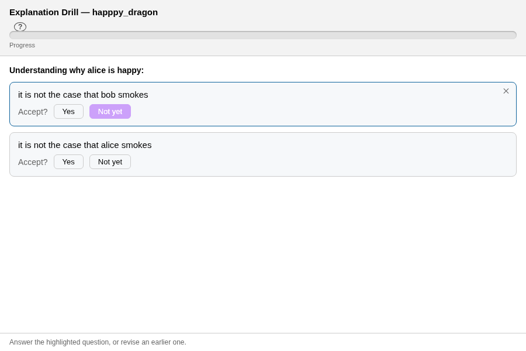

At each step, the drill shows the **most important reason** among the parts of the
proof that you did not examine yet. The drill asks **Accept?**:

- **Yes** means "I understand that part". The drill puts the part aside, and shows the
  next most important reason.
- **Not yet** means "show me more". The drill goes into that reason, and asks about
  the most important part of *that* reason. (Why is bob not a smoker? Because alice,
  his parent, is not a smoker.)

A progress bar increases when you accept parts. Each question highlights, in the
editor, the rule or fact that the question comes from. At any time, you can change an
earlier answer. At any time, you can also remove a question with its **✕** button.

For some reasons, you answered *Not yet*. When you accept all parts of such a reason,
the drill also accepts that reason. Then the drill goes back to the remaining parts
around that reason. When you accept all parts, the bar is full, and the drill shows
*"Nothing else to show."* With the drill, you can make a large proof smaller in a
systematic way. Continue until you find the one intermediate fact that explains the
answer.

---

## 11. The important reason of an explanation

A large proof has many true lines. But usually *one* line is the most important. When
the query succeeded, this line is the intermediate fact that best explains the answer.
When the query failed, this line is the missing condition that caused the failure. LE
finds this **important reason** for each answer. You can see the important reason in
two ways.

Do these steps:

1. Load `citizenship`.
2. Run scenario `alice` with query `one`.
3. Click the answer.

Put the mouse pointer on the **EXPLANATION** title to see the important reason. The
dotted line below the title tells you that the title has this function. To go to the
important reason, **right‑click the title**:

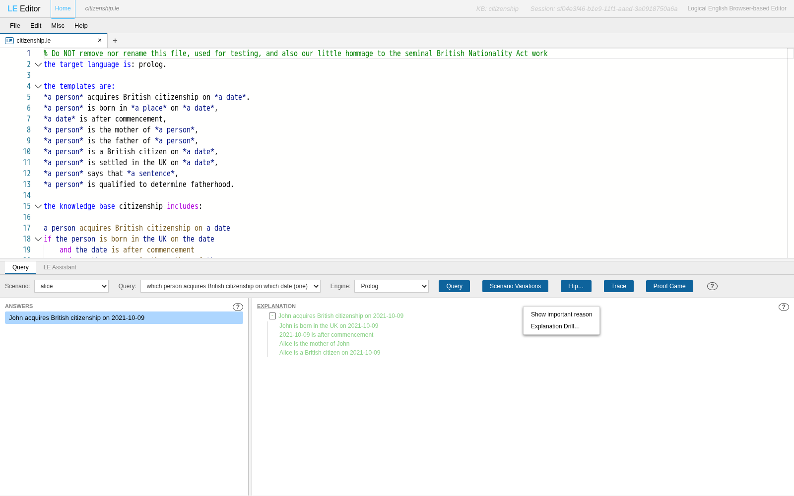

Select **Show important reason**. The tree opens down to the important line. The tree
also opens that line one more level, and the line flashes. You do not have to look
through forty green lines. The **Explanation Drill** (§10) takes you to the same line
one step at a time. **Show important reason** takes you there in one step.

Two things have an effect on the important reason:

- **Larger important reasons** (a setting, *on at the start*): When a query failed,
  the editor does not give only one deepest cause. The editor gives all the failed
  conditions at the same deepest level, as *"it is not the case that X, nor that Y,
  nor that Z"*. It stops after the third condition. Thus you can see immediately all
  the problems that you must repair.
- The setting "Detailed failure explanations" does **not** change the important
  reason. This is intentional. When you show or hide the lines for each rule, the
  editor still selects the same important fact.

---

## 12. Bento Box: an explanation as boxes in boxes

The tree is not the only way to read a proof. **Bento Box** shows the same explanation
as boxes inside boxes. The outer box is the rule that proved the answer. The boxes
inside the outer box are the conditions of that rule. The smallest boxes are the
facts. With Bento Box, you can see all the parts of a proof in one picture.

Do these steps:

1. Load `happy_dragon`.
2. Select scenario `smoky` and query `happy`.
3. Run the query.
4. Right‑click the answer *alice is happy*.
5. Select **Bento Box…**.

A new window opens:

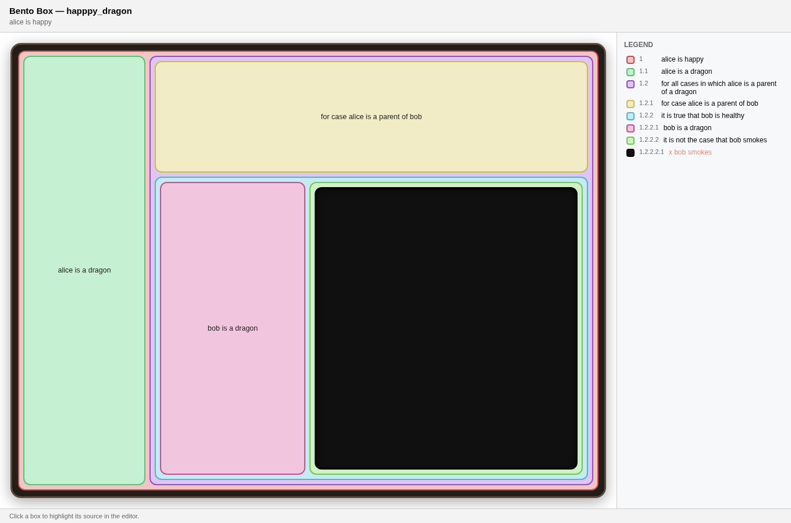

- Each box has its own colour. The **Legend** on the right gives the colours, with the
  same numbers as the hierarchical numbering of §10.
- Put the mouse pointer on a box to read its sentence. **Click** the box to highlight
  its rule or fact in the editor. This action is the same as a click on a line of the
  tree.
- A failed branch is an empty dark box. Here, the dark box is *bob smokes*. The
  reasoner could not prove *bob smokes*. Because of that failure,
  *it is not the case that bob smokes* is true.

Bento Box clearly shows the *shape* of an answer. For example, Bento Box shows if the
answer uses one large rule or many small rules.

---

## 13. Flip: what changes the answer?

In Scenario Variations, *you* try one change at a time. A **flip** does the opposite:
it asks the program to find the changes. The question is: *which smallest changes to
the scenario change this answer?*

Do these steps:

1. In the editor, load `citizenship`.
2. Select scenario `alice` and query `one`.
3. Run the query.
4. Select the answer.
5. Click **Flip…**.

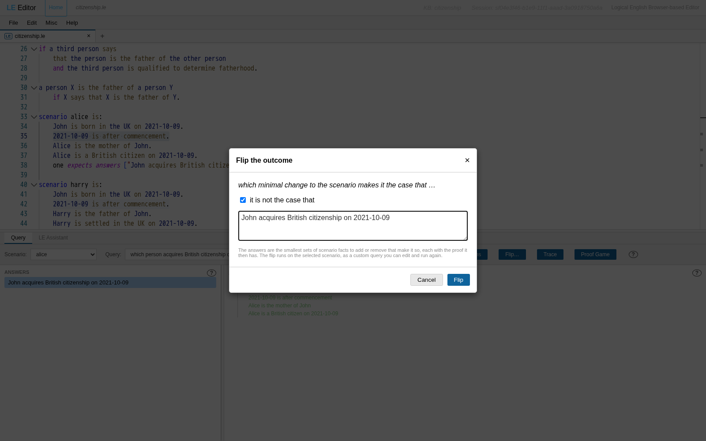

The window shows the question *which minimal change to the scenario makes it the case
that it is not the case that John acquires British citizenship on 2021‑10‑09*. You can
change the question:

- To ask what makes the sentence *true*, clear the **it is not the case that**
  checkbox.
- To ask about a different sentence, edit the sentence.

Click **Flip**:

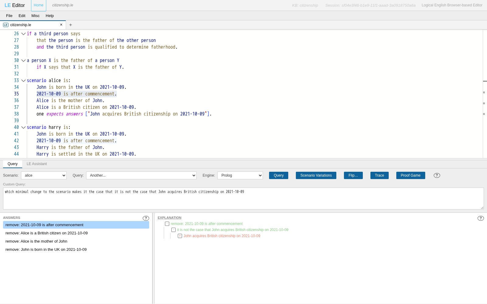

Each answer is one smallest change. Here, each change removes one of the four facts of
the scenario. Select an answer to see the proof that the changed scenario gives. The
flip is a question that you made, not a question in the program. Thus the **Query**
list now shows **Another…**. You can edit that question and run it again.

A program can also keep a flip as one of its queries:

```le
query flip is:
    which minimal change to the scenario makes it the case that
        it is not the case that John acquires British citizenship on 2021-10-09.
```

A flip adds or removes only *case* facts. Case facts are facts whose template has the
mark `; undefined` (§16). Some programs do not mark templates in that way. In these
programs, case facts are facts whose template is not the conclusion of a rule. For
more data, refer to
[flip queries](../../reference/language.md#177-flip-queries-which-minimal-change-flips-the-outcome)
and to the tutorial [Querying a program](../querying-a-program.md#5-flip-what-would-change-the-answer).

---

## 14. Tests: say what you expect

The scenario of the tea party has one more line:

```le
punishment expects answers ["doormouse is punished with banishment","mad hatter is punished with scolding"].
```

That line is a **test**. The line gives the name of a query (`punishment`, without the
word `query`). The line also gives the answers that the query must give on this
scenario. You can also say which unknowns an answer can use:
`… expects answers [...] and unknowns ["Alice is a British citizen on 2021-10-09"]`.
For a flip query, write `expects changes [[...]]`.

Each time the editor checks the program, the editor also runs the tests, for a maximum
of some seconds. When a test fails, a warning appears. To run all the tests and see
the results, do these steps:

1. Open `citizenship`. Each of its four scenarios has a test.
2. Select **Misc → Run the Program's Tests…**.

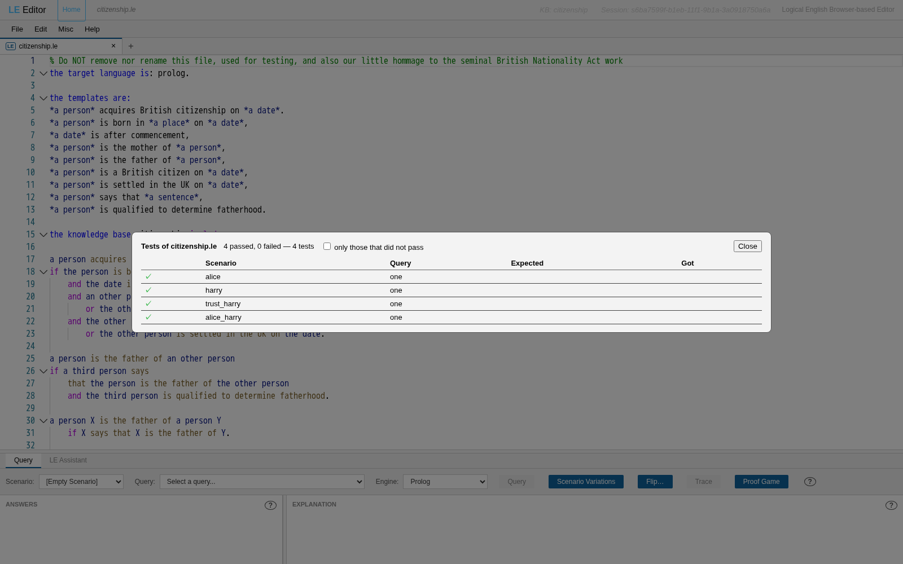

For a failed test, the report shows the expected answers and the answers that the
query gave. Click a row to select the scenario and the query of that row. Then you can
run the query. Write a test immediately when an answer is correct. Possibly a later
change to the rules makes that answer incorrect. Then the test tells you. Refer to
[testing and expectations](../../reference/language.md#12-testing-and-expectations).

---

## 15. Warnings and "?": messages from the editor

The editor checks your program while you work. An **error** has a red line below it.
An error stops the program: the program cannot run. A **warning** has a yellow line
below it. A warning tells you that something is possibly incorrect, but the program
can still run.

In `happy_dragon`, line 9 has a line below it. Put the mouse pointer on line 9:

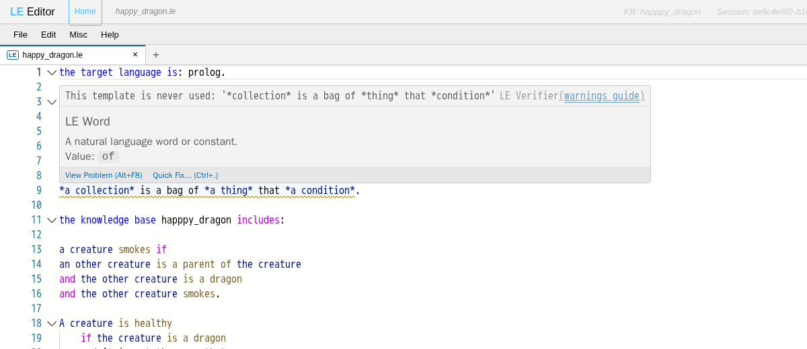

The message is *This template is never used*. The program declares the template
`*a collection* is a bag of *a thing* that *a condition*`, but no sentence of the
program uses the template. At the end of the note, there is a link, here **warnings
guide**. The link opens the part of the documentation about the warning. That part
also tells you how to repair the problem. **Quick Fix…** gives the repairs that the
editor can do, for example the addition of a missing template.

You will see these other warnings early:

- *missing template*: a sentence agrees with no template.
- *not tested by any query*: no query examines a kind of sentence.
- *test failed* (§14).

[The warnings of the verifier](../../guide/warnings.md) gives all the warnings. The
verifier is the part of the system that checks a program.

The editor gives help in other ways too:

- The **?** next to each panel opens the part of the manual about that panel.
- Right‑click a word of the program, and select **Documentation for this**.
- **Help → Search the documentation…** searches all of the documentation.

---

## 16. Example 4 — the tea shop: numbers, cascades, tables, dates

The Mad Hatter has a new tea shop. The prices of the shop need rules. The server does
not keep the program below. Thus you must put the program into the editor yourself.
Do these steps:

1. Click **+** on the row of tabs to open a new, empty document.
2. Paste the program into the document.
3. Open the **Scenario** list.

The program loads, and its scenarios and queries appear in the lists.

```le
the target language is: prolog.

the templates are:
    *a guest* orders *a number* cups of tea; undefined.
    *a guest* is a member; undefined.
    *a guest* has an unbirthday today; undefined.
    *a guest* is banished; undefined.
    *a party* has *a number* guests; undefined.
    the membership of *a guest* started on *a date*; undefined.
    the discount of *a guest* is *a percentage*.
    the bill of *a guest* is *an amount*.
    *a guest* is one cup away from a free cup.
    the cake for *a number* guests is *a cake* under table cakes.
    the cake of *a party* is *a cake*.
    the membership of *a guest* expires on *a date*.

the constants are:
    the price of a cup is 3.

the table cakes is, with first match:
    size   | guests        | cake
    small  | <= 2          | cupcake
    medium | > 2 and <= 6  | sponge cake
    large  | > 6           | three tier cake

the knowledge base tea shop includes:

the bill of a guest is an amount A
    if the guest orders a number N cups of tea
    and the value of the price of a cup is a price P
    and the discount of the guest is a percentage D
    and A = (N - N // 3) * P * (100 - D) / 100.

a guest is one cup away from a free cup
    if the guest orders a number N cups of tea
    and R = N mod 3
    and R = 2.

the discount of a guest is a percentage
    if the guest is a member
        and the percentage is 20
    otherwise the guest has an unbirthday today
        and the percentage is 10
    otherwise the percentage is 0.

the cake of a party is a cake
    if the party has a number guests
    and the cake for the number guests is the cake under table cakes.

the membership of a guest expires on a date
    if the membership of the guest started on a start date
    and the date is 6 months after the start date.

it must not be true that
    a guest is a member
    and the guest is banished.

scenario saturday is:
    alice orders 5 cups of tea.
    alice is a member.
    the hatter orders 7 cups of tea.
    the hatter has an unbirthday today.
    the dormouse orders 2 cups of tea.
    the membership of alice started on 2026-08-31.
    the garden party has 5 guests.
    bills expects answers ["the bill of alice is 9.6", "the bill of the hatter is 13.5", "the bill of the dormouse is 6"].
    nearly expects answers ["alice is one cup away from a free cup", "the dormouse is one cup away from a free cup"].
    cake expects answers ["the cake of the garden party is sponge cake"].
    expiry expects answers ["the membership of alice expires on 2027-02-28"].

scenario trouble is:
    the knave orders 2 cups of tea.
    the knave is a member.
    the knave is banished.
    bills expects answers [].

query bills is:
    the bill of which guest is which amount.

query nearly is:
    which guest is one cup away from a free cup.

query cake is:
    the cake of which party is which cake.

query expiry is:
    the membership of which guest expires on which date.
```

Two notes before you continue:

- The templates with the mark **`; undefined`** are the *case facts*. Case facts are
  facts that scenarios state and that no rule concludes. The flip of §13 and the views
  of §19 both use this mark.
- Each query here has a test. Thus, before you change the program,
  **Misc → Run the Program's Tests…** must report five passed tests.

### Named constants and arithmetic

`the constants are:` gives a name to a value. Write one name on each line. A rule
reads the value with `the value of the price of a cup is a price P`. An explanation
shows that value as one of its reasons: *the price of a cup is 3*. Change the price in
that one location, and all the bills change.

The rule calculates the bill with arithmetic. You can use `+`, `-`, `*`, `/`,
brackets, and two operations for whole numbers: `//` (divide and round down) and `mod`
(the remainder after a division). Each third cup is free. Thus a guest pays for
`N - N // 3` cups. The names in a formula are short capital letters, for example `N`,
`P` and `D`. A condition must introduce each name first, as `a number N` does.

Run `bills` on `saturday`, and select the bill of the hatter:

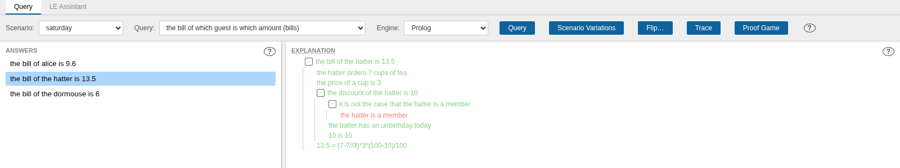

The query `nearly` finds the guests whose next cup will be free. First,
`R = N mod 3` calculates the remainder. Then `R = 2` checks the remainder. You can
also write `N mod 3 = 2` as one condition, with the same result. LE calculates a
formula on each side of `=`. Refer to
[arithmetic and comparisons](../../reference/language.md#7-arithmetic-and-comparisons).

### `otherwise`: the first alternative that applies

The discount is a **cascade**. A cascade is a list of alternatives that the reasoner
tries in sequence. A line that starts with `otherwise` starts a new alternative. That
alternative applies only when all the earlier alternatives failed. Here, the discount
is 20 for members. Otherwise, the discount is 10 for a guest who has an unbirthday
today. Otherwise, the discount is 0.

Alice is a member, thus her discount is 20. The hatter is not a member, but he has an
unbirthday today, thus his discount is 10. The discount of the dormouse is 0. The
explanation for the hatter shows the cascade. First, the explanation shows
*it is not the case that the hatter is a member*: the alternative that did not apply.
Then the explanation shows the alternative that applied.

The conditions of an alternative can also be on the same line as the `otherwise`
(`otherwise the guest has an unbirthday today and the percentage is 10`). But on
separate lines, as above, the conditions are easier to read. Refer to
[`otherwise` cascades](../../reference/language.md#172-otherwise-cascades).

### A decision table

`the table cakes is, with first match:` is a small **decision table**: a set of
rules in rows. The table is for the one template that gives the name
of the table: the template that ends with `… under table cakes`. The columns of the
table are the slots of that template, in sequence. One more column at the front holds
the name of each row. The last column holds the result.

A cell can hold a value, a comparison such as `> 2 and <= 6`, or the word `any`. The
word `any` agrees with all values. *First match* means that the first applicable row
gives the answer. Run `cake`. The garden party has 5 guests, thus the cake of the
party is *sponge cake*. The explanation gives *row medium of table cakes* as the
reason. Refer to [decision tables](../../reference/language.md#173-decision-tables).

### Calendar months

`the date is 6 months after the start date` counts **calendar months**. If the later
month has the same day of the month, LE uses that day. If the later month does not
have that day, LE uses the last day of that month. Run `expiry`. The membership of
Alice started on 31 August 2026. The membership expires on **2027‑02‑28**, because
February has no day 31. Days operate in the same way: `… is 30 days after …`.

### A rule that a case must not break

```le
it must not be true that
    a guest is a member
    and the guest is banished.
```

An **integrity constraint** says that some conditions must never be true at the same
time. If the facts of a scenario break a constraint, the scenario contradicts itself.
Then the reasoner gives no conclusions from that scenario. Run `bills` on the scenario
`trouble`. In this scenario, the knave is a member and the knave is also banished:

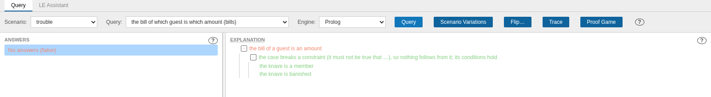

The query gives no bill, and the explanation tells you why: *the case breaks a
constraint … its conditions hold*. The two facts that cause the problem are below that
line. Constraints are most important together with unknowns (§8). LE does not give an
answer that must *assume* something that a constraint prohibits. Refer to
[integrity constraints](../../reference/language.md#33-integrity-constraints-it-must-not-be-true-that-).

---

## 17. Cite your sources

Rules come from a source, for example a law, a policy, or a notice on the wall of the
tea shop. Facts come from a person. LE can record the source of a rule or a fact. This
record does not change the conclusions of the rules.

Make three changes to the tea shop:

1. Give the bill rule a label. The label gives the document that the rule puts into
   logic:

   ```le
   rule every_third_cup with provenance the tea shop notice,
           confer "Every third cup is on the house":
   the bill of a guest is an amount A
       if the guest orders a number N cups of tea
       ...
   ```

2. In the first line of the scenario, give the document that the facts of the
   scenario come from. After `confer`, quote a passage of that document:

   ```le
   scenario saturday is, as stated in the order book at page 12:
       alice orders 5 cups of tea, confer "Alice, five cups".
   ```

3. Say who states a fact, and give the reason:

   ```le
       the hatter has an unbirthday today,
           according to the March Hare, because "he says so every day".
   ```

These four additions are **trailers**: `according to`, `as stated in … at …`,
`because` and `confer`. A comma comes before each trailer. Run `bills` again, and
select the hatter:

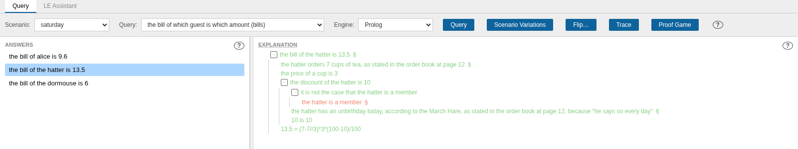

Each step that has a source now gives the name of that source, with a **§** badge.
Click the § of *the bill of the hatter is 13.5*:

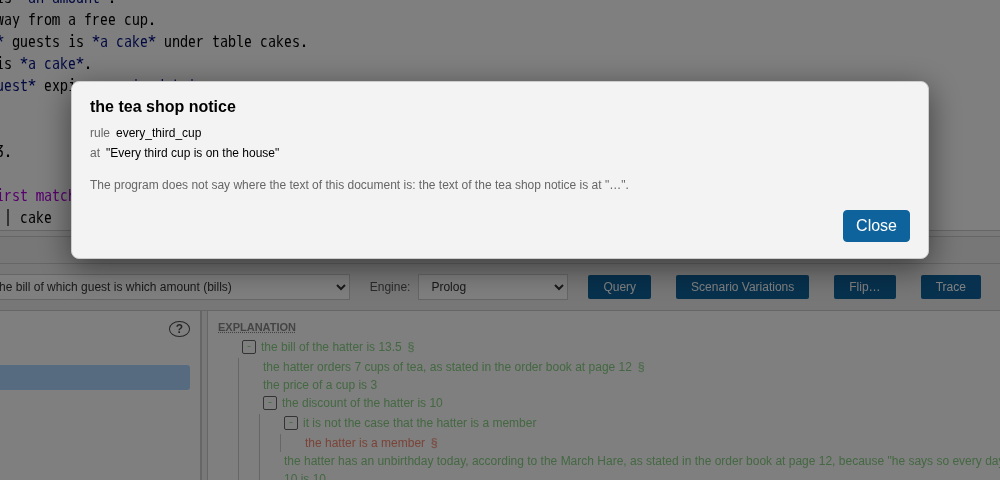

The **source viewer** gives the name of the document, the rule and the passage. The
viewer can also show the document, with the passage highlighted. For this, the program
must say where the text of the document is. The message on the screen gives the same
advice:

```le
the tea shop notice is published at "https://example.org/notice.html".
the text of the tea shop notice is at "notice.txt".
```

(Such a text file is in the same folder as the saved program.) When the program says
where the text is, you can open the passage. Right‑click a line of the program that
cites a source, and select **View Original Text**. The verifier also makes sure that
each quoted passage is in the text. Refer to
[provenance trailers](../../reference/language.md#171-provenance-trailers-and-judged-templates)
and [rule labels and provenance](../../reference/language.md#155-rule-labels-and-provenance).

---

## 18. The debugger: breakpoints and steps

Sometimes an answer is missing, and the explanation does not show clearly why. Then
you can look at the program while it runs, one step at a time. Do these steps:

1. Load `tea_party`.
2. Select scenario `attendees` and query `punishment`.
3. Click in the margin to the left of line number 20
   (`and the creature is a lowly creature`). This click sets a **breakpoint**. A
   breakpoint is a location where the run will pause.
4. Click **Trace**.
5. In the **LE Debugger** panel, click **Continue**.

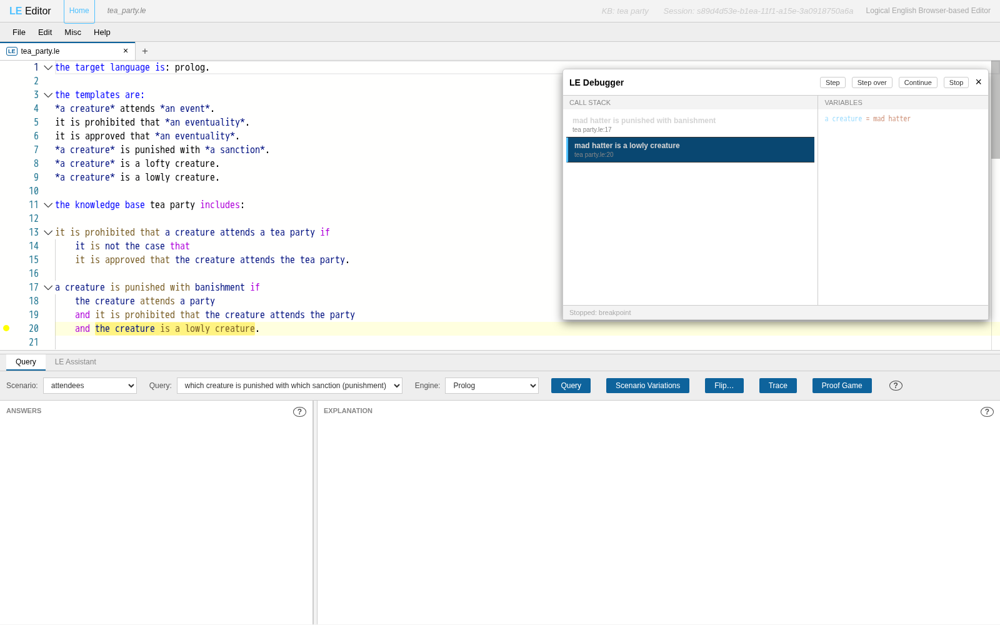

The run stops at line 20, and the editor highlights that line. The **call stack**
gives the questions that the reasoner is answering at this moment. The most recent
question is the last question in the list. Thus you can see how the run came to this
line.

Here, the reasoner tries to prove that *mad hatter is punished with banishment*. For
this proof, the reasoner now asks if *mad hatter is a lowly creature*. (He is not a
lowly creature, thus this rule will fail for him.) **VARIABLES** shows the value of
each variable at this moment: *a creature = mad hatter*.

From here, you can use these commands:

- **Step** (F11) goes to the next question. If the reasoner uses a rule to answer the
  question, **Step** goes into that rule.
- **Step over** (F10) goes to the next question at this level. **Step over** does not
  stop inside the rules that the question uses.
- **Continue** (F5) runs until the next breakpoint, or until the next answer.
- **Stop** stops the query.

Right‑click in the editor, and select **See PROLOG**. The editor shows the Prolog that
LE made from your program. Prolog is the logic programming language that LE
translates your program into. For more data, refer to the
[editor manual](../../guide/editor.md#advanced-features).

---

## 19. A screen for the users of the program: views

The editor is for the person who *writes* a program. Other people use the decisions of
the program: for example, a shop assistant, a caseworker or a citizen. These people
need a simpler screen. **Misc → Open Executive View** opens such a screen. The screen
shows the program without its text, a scenario list, a query list, and the answers as
cards. Each card opens to show its explanation. The executive view uses the program in
its current state in the editor, with the changes that you did not save.

A **view** tells how that screen looks for one kind of decision. You write a view in
LE, at the end of the program. You do not have to start with nothing. Do these steps:

1. Open the tea shop.
2. Select the **LE Assistant** tab.
3. Click **Generate LE view**. This command does not need a language model.

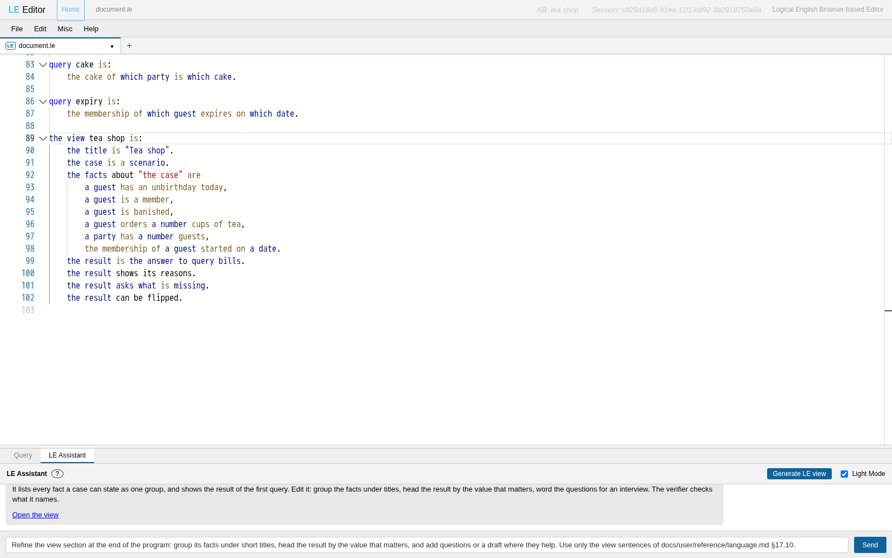

The draft view gives a list of the case facts. The draft uses the first query as the
result to show. The draft also adds all the other items that the program can show.
Change the draft into the view below. This view adds a title, puts the orders together
in a group, and shows the amount at the top of each answer:

```le
the view till is:
    the title is "The Mad Tea Shop".
    the case is a scenario.
    the facts about "the orders" are
        a guest orders a number cups of tea,
        a guest is a member,
        a guest has an unbirthday today.
    the result is the answer to query bills, headed by the amount.
    the result shows its reasons.
```

Then do these steps:

1. Select **Misc → Open Executive View**.
2. At the top, select the view **The Mad Tea Shop**.

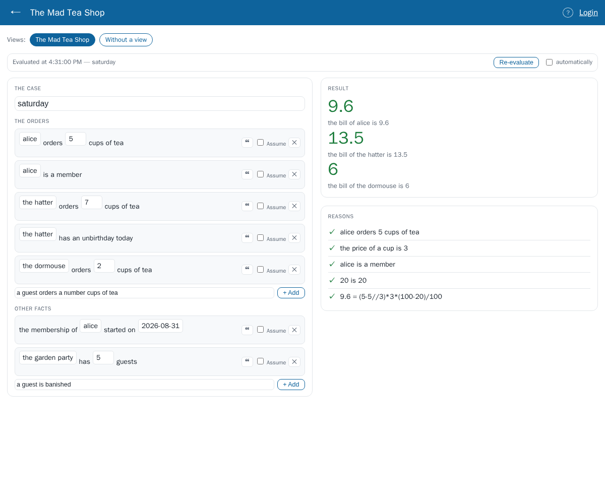

The orders show as rows that you can edit. The other case facts are below the orders.
The screen shows each bill in large letters, with its reasons below the bill. Change
the 5 cups of Alice to 7, and click **Re‑evaluate**. Her bill becomes 12.

A view does not change how the program reasons. The verifier checks each sentence of
the view against the templates and queries of the program. A view can also do an
interview, with one question at a time. A view can also show what changes the result.
The tutorial [Introducing LE Views](../views.md) makes views step by step.
[The executive view](../../guide/executive-view.md) describes the screen.

---

## 20. The LE Assistant: write drafts with a language model

You do not have to write all the templates and rules yourself. The **LE Assistant**
tab is next to the **Query** tab. In this tab, you have a written conversation. A
language model is a computer program that writes text. You ask in plain English for
the change that you want. Examples: *"add a rule…", "fix this warning", "why does
scenario saturday fail?"* Then a language model edits the program for you.

While the assistant works, it **runs the verifier and the queries** many times. Thus
the assistant gives you back a program that LE can read and run.

The **Light Mode** checkbox selects how the assistant works:

- **Light** is the setting at the start. Light mode is a quick cycle on the server. It
  only edits your program and runs the verifier and the queries.
- When you clear the checkbox, you select **Deep** mode. Deep mode runs a full coding
  agent: a program that can write and test software. A coding agent does more, but it
  takes more time.

To use the assistant, do these steps:

1. Select **Misc → API Keys & Assistant Settings…**. (API means Application
   Programming Interface.)
2. Select a model.
3. Enter the key that your model provider gave you. If the server supplies its own
   keys, you do not need a key.
4. Type a request, for example *"add a rule that a guest is thirsty if the guest
   orders more than 6 cups of tea, with its template and a query"*.
5. Click **Send**.

The assistant edits the program, checks the program, runs the program, and puts the
result into the editor. If you do not like a change, select **Edit → Undo**.

**Write it in English** in the Scenario Editor and in Scenario Variations uses the
same models. Write a sentence that describes a case. The model changes the sentence
into facts that use *your* templates.

> The assistant saves time, but it is not an authority. Always read what the assistant
> wrote. For the repetitive parts, the assistant does most of the typing. Examples of
> these parts are templates, the outline of a scenario, or a rule in a new shape. Refer
> to [the assistants](../../guide/assistants.md).

---

## 21. A second engine: s(CASP)

All the examples above used the **Prolog** engine of LE. An engine is the software
that does the reasoning. LE can also run the *same program* on a second engine,
**s(CASP)**. s(CASP) also starts from the question and works backwards. s(CASP) gives
three things that Prolog cannot give:

- answers that are **constraints**: conditions, not fixed values;
- **more than one possible world** for one query (the makers of s(CASP) call these
  worlds "stable models");
- **abduction**: s(CASP) finds what must be true for an answer to be true.

A program gives its preferred engine in its first line
(`the target language is: scasp.`). With the **Engine** list in the **Query** tab, you
can change the engine manually. For a program that is only for Prolog, you can hide
the list: **Misc → ENGINE PICKER → Show engine choice only for non‑Prolog**. The
s(CASP) engine must be installed on the server that runs the program. If the engine
is not installed, a query and **See s(CASP)** both tell you.

### See the s(CASP) program that LE makes

LE writes a *separate* s(CASP) program from your rules. To see that program,
right‑click the editor and select **See s(CASP)**:

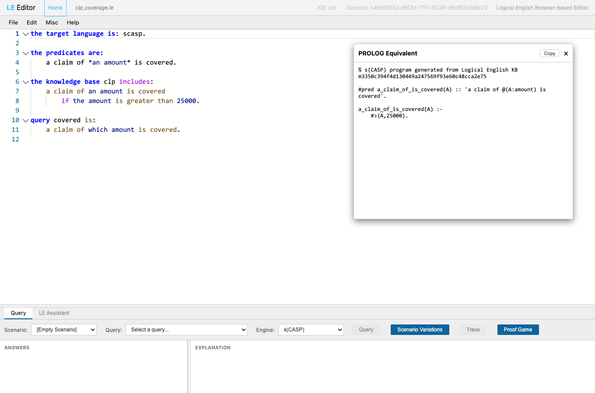

Note two things in the result:

1. Each LE template becomes a **`#pred`** line with the English sentence of that
   template. Thus the explanations of s(CASP) use the words of your subject, not
   symbols.
2. The comparison `the amount is greater than 25000` becomes the **constraint**
   `#>(A, 25000)`. This constraint is a condition on an amount that is not known yet.
   The constraint is not a test on a fixed number.

The next feature uses this second point.

### Answers that are *constraints*

Comparisons become constraints. Thus s(CASP) can answer a query **without a specific
scenario**. Do these steps:

1. Load `language/scasp/clp_coverage`. The first line of the program gives `scasp`.
   Thus the engine list selects s(CASP) for you.
2. Select the `covered` query.
3. Do not select a scenario.
4. Click **Query**.

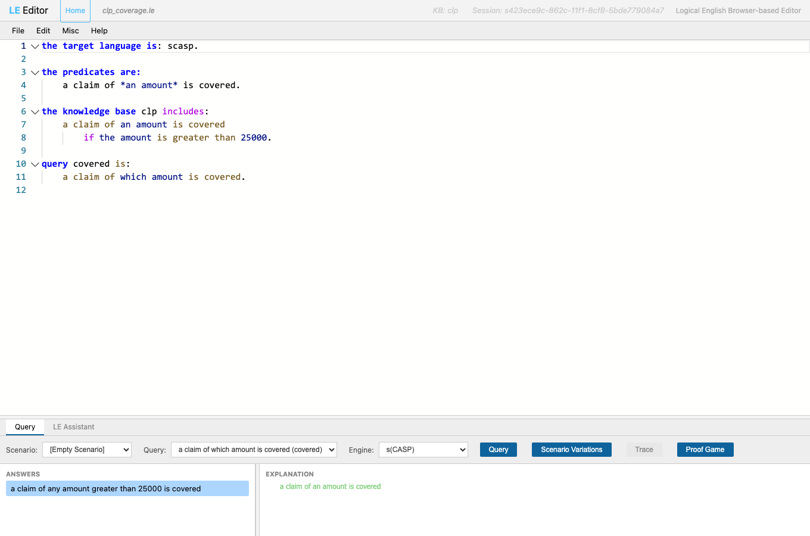

The answer is not a value but a *phrase*: **"a claim of any amount greater than 25000
is covered."** You asked "which amounts are covered?". The answer is the condition, in
the words of your template. With this type of question, you can ask directly: *"In
which conditions is this sentence true?"*

### More than one possible world, and the assumptions of each world

Some programs have *assumable* facts (`; assumable`, §8). In such a program, one query
can be true in **more than one way**. s(CASP) gives each of these ways as a separate
**model**. A model is a full picture of one possible state of things. Here, s(CASP)
runs the program `language/abduction/loan_approval`. This program keeps some facts
about the applicant open:

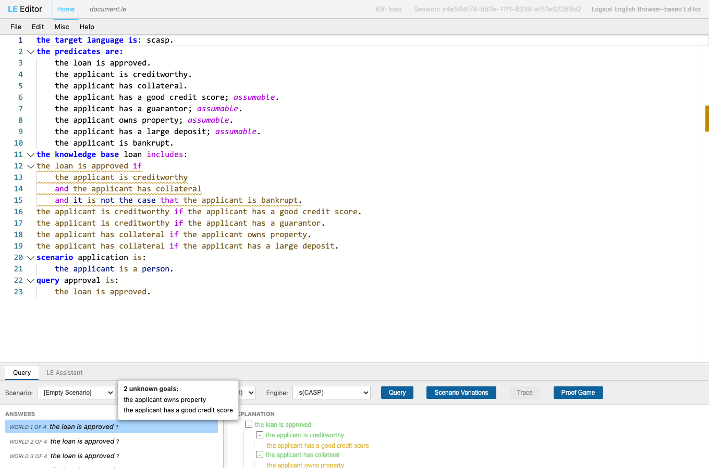

- The answers panel puts the results in groups: **"world 1 of 4", "world 2 of 4",
  …**. There is one card for each world that is really different.
- Each card has the **`?`** mark that you know from §8. The mark means that the answer
  is true *with assumptions*. To see the assumptions, put the mouse pointer on the
  card, or read the amber lines of the tree: *"2 unknown goals: the applicant owns
  property, the applicant has a good credit score."* This result is abduction. The
  engine tells you what it *had to assume* for the approval of the loan. Each world
  assumes something different.

s(CASP) also gives more data about denials. Prolog shows a failed `not` only as
something that Prolog could not find. s(CASP) *proves* the denial. s(CASP) shows, rule
by rule, why the sentence inside the denial fails.

### Which engine to use

Use **Prolog** as your usual engine. Prolog is faster. Prolog is also the engine that
can calculate totals and counts, use dates, run embedded `prolog` goals, and use large
sets of facts.

Use **s(CASP)** in these conditions:

- You want answers that are constraints.
- You want to ask "what must we assume?".
- You want more than one possible world.
- Your program goes in a circle through a denial. Prolog can operate incorrectly with
  this shape, and the editor gives a warning about it.

Sometimes s(CASP) cannot express a program correctly. Then s(CASP) does not run the
program incorrectly. s(CASP) refuses the program, gives a list of the problems and
their lines, and tells you to use Prolog. For all the data, refer to
[s(CASP) on Logical English](../../reference/scasp.md).

---

## 22. Share a program: links and QR codes

You already know two ways to share a program:

- the web address of the editor (`?example=…&scenario=…&query=…`, §3);
- the link to a Scenario Variations window (§7).

Sometimes you want to give a program to a person with a phone: for example, in a talk,
in a classroom or at a desk. For this, use **File → QR code…**. A QR code (Quick
Response code) is a square black‑and‑white pattern that a phone camera can read. This
menu item makes a QR code for your program:

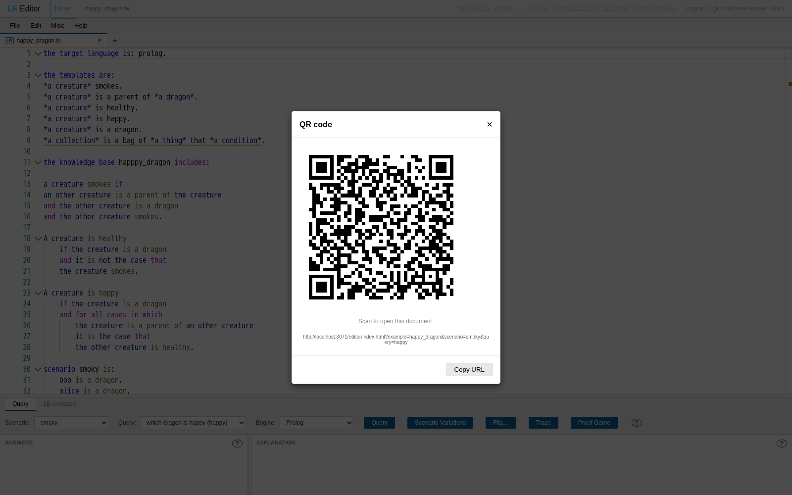

When the other person scans the pattern, the browser of that person opens the same
program, scenario and query. **Copy URL** copies the same link. You can paste the link
into a message.

An example on the server goes as a short web address. A document that you edited and
did not save goes in full. The editor compresses the text of the program into the
link, after a `#lzp=` mark. When a person opens the link, the editor decompresses the
text. Thus you can share a program that is only in your editor.

If a document is too large for a pattern that a camera can read, the window tells
you. The window does not make a pattern that nobody can scan. To keep a program, use
**File → Save As…** to save the program on your computer. Use **File → Open…** to open
the program again.

---

## 23. Where to go next

You now know the main parts of LE:

- **Templates** declare your words. **Facts** and **rules** (`Head if Body`) say what
  is true. **`and`**, **`or`**, **`it is not the case that`** and
  **`for all cases in which`** make the logic. **Scenarios** give the situations, and
  **queries** ask the questions. **Tests** (`expects answers`) make sure that the
  answers stay correct.
- **Constants**, **arithmetic** (with `//` and `mod`), **`otherwise`** cascades,
  **decision tables**, **calendar months** and **integrity constraints** give most of
  the functions that a rulebook needs. **Provenance trailers** say where each rule and
  each fact comes from.
- The **Query** tab runs a program. **Explanations** show why an answer is true: as a
  tree, as the **important reason**, as a **Bento Box**, or with the **Drill**.
  **Scenario Variations** and **Flip…** examine "what if". With **Assume**, the
  program can reason when something is unknown. Amber shows what the reasoner assumed.
  A why‑not tree tells you what is missing. The **debugger** shows the run.
- **Views** and the **executive view** give the users of a program their own screen.
  The **LE Assistant** writes and repairs LE for you. The **s(CASP)** engine adds
  constraint answers and possible worlds. A **QR code** sends a program to a phone.

Next steps:

- Do the tutorial [Querying a program](../querying-a-program.md). The tutorial uses a
  real regulatory program about the compensation for air passengers in the EU
  (European Union). It shows queries, why‑not explanations, flips and the Drill on
  that program. Then do the tutorial [Introducing LE Views](../views.md).
- Read the [language reference](../../reference/language.md) quickly, for the parts
  that this tutorial did not show:
  - the ways to add and count values over many facts (`sum`, `count`, …);
  - the `is a` hierarchy, which says which kinds of thing are kinds of other things;
  - synonyms;
  - templates with prepositions;
  - the resources and the libraries that a program can include;
  - the other [regulatory‑decision constructs](../../reference/language.md#17-regulatory-decision-constructs):
    judged templates, the applicability / question / remedy skeleton, and
    `according to` inside a rule.
- Read the [editor manual](../../guide/editor.md) for the Scenario Editor, the Query
  Editor, the file tabs, the Source Graph and the other features. Then play the
  [Proof Game](../../guide/proof-game.md). In the Proof Game, you make a proof
  yourself.
- If you use a different rules system, refer to
  [Other systems: importing and exporting](../../integrations/index.md). This document
  tells you which files of other systems the editor can open as LE, and write again.
- Look at the [examples](https://github.com/LogicalContractsOrg/LogicalEnglish2/tree/main/examples/moreExamples):
  `language/includes/citizenship_including`, `royal_family`,
  `language/templates/subset`, the `domains/tax/` set, and the programs of
  [`examples/regulatory/`](https://github.com/LogicalContractsOrg/LogicalEnglish2/tree/main/examples/regulatory).
  You can open all of these examples from the running system at
  **<https://le2.logicalcontracts.com>**.

Now write a rule. Start with the tea party: someone must decide which creature is
banished.
