# Querying a program: answers, explanations and what-ifs

*Kind: tutorial · Audience: users · Status: current (2026-09-16)*

This tutorial is about how to *run* a Logical English (LE) program. It is not about
how to write a program. We use a program that is already written, and we ask it
questions. We run the queries of the program and read its explanations. We try
"what if" variations, and we ask what changes an answer. Then we examine an
explanation, one reason at a time.

The program is `examples/regulatory/eu261_integration.le`. The program decides the
compensation for a cancelled flight under EU Regulation 261/2004. Its rules tell
when a passenger has a right to compensation. They also tell the amount, which
changes with the distance of the flight. The important part is *extraordinary
circumstances*. A carrier (the airline) pays nothing if the carrier shows that such
circumstances caused the cancellation. The program decides that question with two
judgments of the Court of Justice:

- *Wallentin-Hermann* (C-549/07): technical problems that the carrier finds during
  maintenance are a usual part of the activity of a carrier. Thus such problems are
  not extraordinary;
- *Peskova* (C-315/15): a bird strike is not a usual part of that activity.

Sections 1 to 6 occur in the Logical English editor. Sections 7 and 8 occur in the
executive view. The executive view is a screen of the program for its users.

To open the program, do these steps:

1. Select **File ▸ Open example from server…**.
2. Below the `regulatory` heading, select `eu261_integration`.

The web address `/editor/index.html?example=regulatory/eu261_integration` also opens
the program. The text of the program fills the editing area. The **Query** panel is
along the bottom.

## Contents

1. [Run a query](#1-running-a-query)
2. [Read the explanation](#2-reading-the-explanation)
3. [When there is no answer](#3-when-there-is-no-answer)
4. [Scenario Variations: what if?](#4-scenario-variations-what-if)
5. [Flip: what changes the answer?](#5-flip-what-would-change-the-answer)
6. [The Explanation Drill](#6-the-explanation-drill)
7. [The same program for its users](#7-the-same-program-for-its-users)
8. [Views: a screen for one decision](#8-views-a-screen-made-for-one-decision)
9. [Quick reference](#9-quick-reference)

## 1. Running a query

A run needs two things from the program. The first thing is a **scenario**. A
scenario is the set of facts of one case. The second thing is a **query**. A query
is the question. Select the scenario and the query in the Query panel.

The program has four scenarios:

| Scenario | The case |
|---|---|
| `new_claim` | The flight AZ123 of anna from Vienna (800 km) is cancelled. Alitalia says that a technical problem that it found during maintenance caused the cancellation |
| `notified` | The same flight, but Alitalia told anna about the cancellation 20 days before |
| `bird_strike` | The same flight, cancelled after a bird strike. Alitalia says that it could not control the bird strike |
| `outside_the_eu` | A flight from Istanbul |

Each fact of a scenario tells its source, for example:

```le
the cancellation of flight AZ123 is caused by the inspection defect,
    according to Alitalia, as stated in the carrier letter at paragraph 3.
```

The main query is `claim`:

```le
query claim is:
    which passenger is entitled to compensation of which amount for which flight.
```

To run the query, do these steps:

1. In the **Scenario** list, select `new_claim`.
2. In the **Query** list, select `claim`. The list shows the text of the query, and
   then the name of the query.
3. Click **Query**.

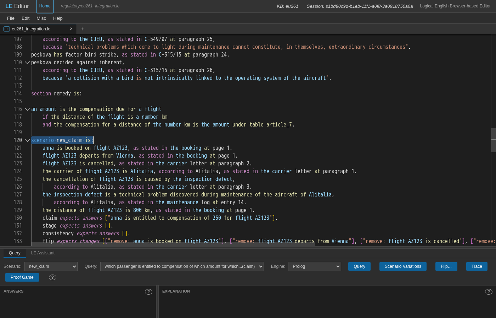

The answer appears on the left, below **ANSWERS**. The answer is already selected:

> anna is entitled to compensation of 250 for flight AZ123

The flight is 800 km. The decision table `article_7` of the program gives 250 for
distances up to 1500 km.

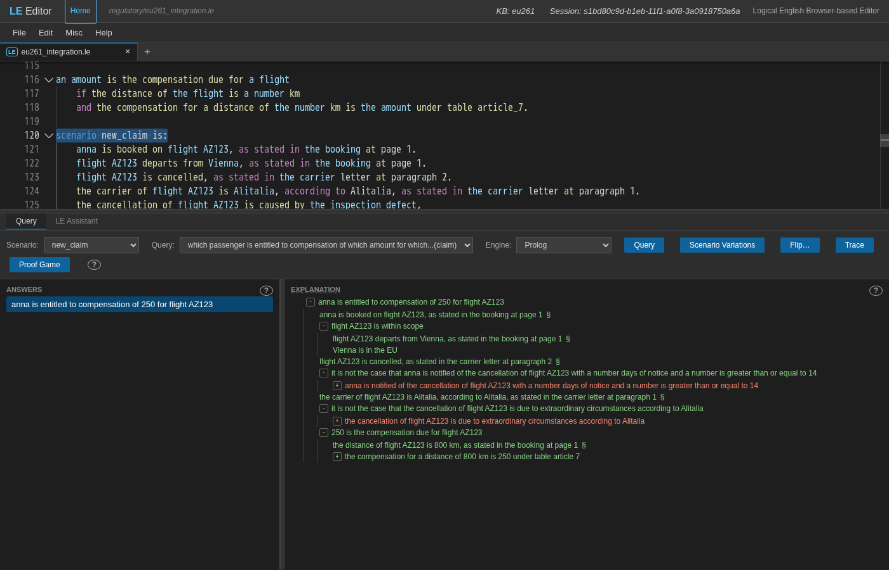

(The query panel is small when the editor opens. To give more space to the answers
and the explanation, drag up the bar above the **Query** tab.)

The web address at the top of the browser now contains the names of the program, the
scenario, the query and the selected answer. Copy that address and send it to a
person. That person can then see the same run.

## 2. Reading the explanation

The **explanation** on the right shows how the program found the answer. The
explanation is a tree of the sentences of the program. The tree shows each condition
of the rule that concluded the answer. Below each condition, the tree shows the
proof of that condition. The top levels are already open. Use the `+` and `-` signs
to open and close the other levels. A **§** after a fact points to the document that
states the fact.

For `new_claim`, these are the conditions below the answer:

- anna is booked on flight AZ123, *as stated in the booking at page 1*;
- flight AZ123 is within scope (it departs from Vienna, and Vienna is in the EU);
- flight AZ123 is cancelled;
- it is not the case that anna is notified of the cancellation with a number days of
  notice and the number is at least 14;
- the carrier of flight AZ123 is Alitalia;
- it is not the case that the cancellation of flight AZ123 is due to extraordinary
  circumstances according to Alitalia;
- 250 is the compensation due for flight AZ123: the distance is 800 km, and *the
  compensation for a distance of 800 km is 250 under table article 7*, by *row a of
  table article 7*.

Look at these points:

- **Green** shows a condition that the program proved. **Red** shows a condition that
  the program could not prove.
- **A red line inside a negation is what the rule needs.** Open *it is not the case
  that the cancellation of flight AZ123 is due to extraordinary circumstances…*. Below
  that line, *the cancellation … is due to extraordinary circumstances* is red. The
  program could not prove that line, thus the negation is true. Open more levels to
  see the reason. The inspection defect *counts as inherent in the normal exercise of
  the activity of Alitalia*. The reason is that the defect is *forced for inherent by
  wallentin hermann*. That judgment decided for *inherent* (C-549/07, paragraph 25) on
  a factor, *maintenance problem*. The inspection defect also has that factor.

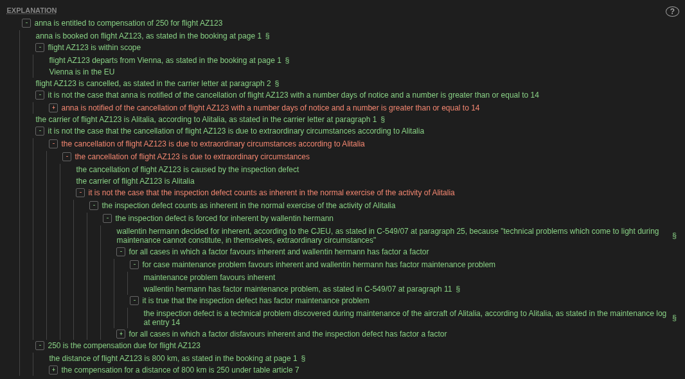

- **Click a step to see its origin.** The editor goes to the rule or the fact that
  proved the step, and selects that rule or fact. For example, click *250 is the
  compensation due for flight AZ123*. The editor selects the rule of the `remedy`
  section. Some steps have their proof in an included file, for example the library
  of precedents. Put the mouse pointer on such a step, and the editor shows the name
  of that file and the line in the file.

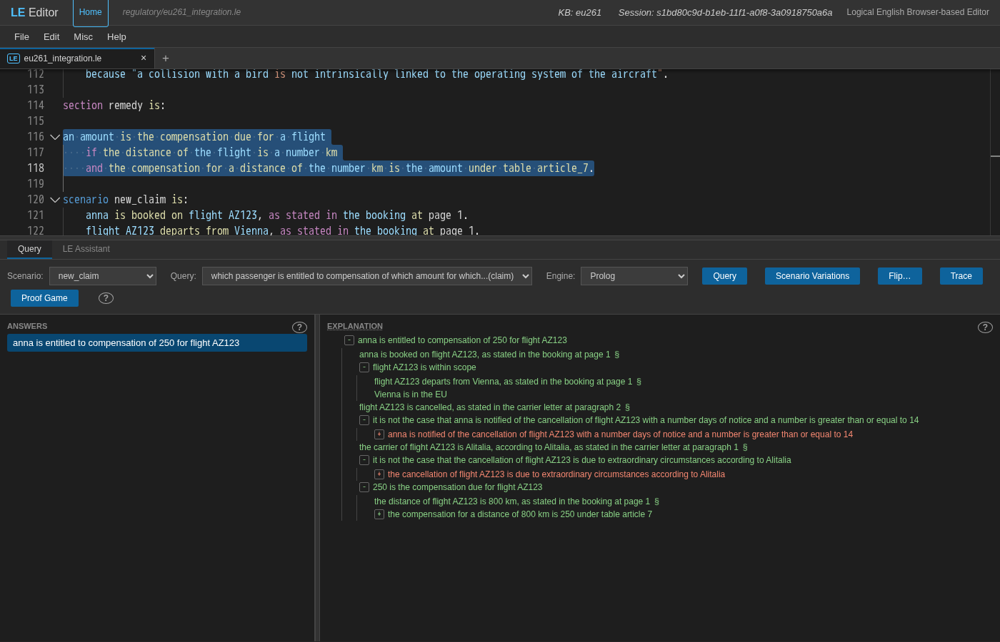

### The important reason

When an answer is selected, the **EXPLANATION** title has a line below it. Put the
mouse pointer on the title. The editor then shows the most important reason of the
answer. For `new_claim`, that reason is:

> the inspection defect counts as inherent in the normal exercise of the
> activity of Alitalia

Right-click the title to see two more items. **Show important reason** opens the tree
at that step and makes the step flash. **Explanation Drill…** is the subject of
section 6.

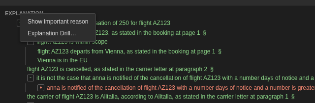

Right-click inside the tree to see two items. **Copy Explanation** copies the
explanation as plain text and as HTML. HTML (HyperText Markup Language) is the format
of a web page. **Copy as Mermaid diagram** copies the explanation in the format of a
diagram. **Misc ▸ EXPLANATIONS ▸ Preferences…** sets how the editor shows trees. For
large programs, keep **Hide repeated explanations** on. With this setting, the editor
shows a sub-explanation in full only one time, also if it occurs many times. The
[editor guide](../guide/editor.md#explanations-and-navigation) describes each
preference.

## 3. When there is no answer

Select the scenario `notified` and run `claim` again. The list of answers says **No
answers (false)**. The explanation now tells why the query failed.

The rules of the program are in three sections: *applicability*, *question* and
*remedy*. Refer to [the language reference](../reference/language.md) §17.4. The
first step of a failure explanation is a checklist:

> section checklist: applicability passed, question failed, remedy not reached

Below the step of the rule, the red condition is the condition that stopped the rule:

> it is not the case that anna is notified of the cancellation of flight
> AZ123 with a number days of notice and a number is greater than or equal to 14

That condition failed because the two parts below it are true. Alitalia *did* tell
anna 20 days before the cancellation (according to Alitalia, as stated in the notice
email). And 20 is at least 14.

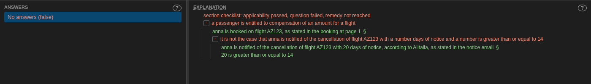

Above the red condition, *anna is booked on flight AZ123, as stated in the booking at
page 1* is green. A failure explanation shows the conditions that were true before the
condition that failed. It also shows their citations. Now try the other two
scenarios:

- `outside_the_eu`: *applicability failed*. The flight is not within scope, because
  the program cannot prove *Istanbul is in the EU*.
- `bird_strike`: *question failed*. Here *the cancellation … is due to extraordinary
  circumstances according to Alitalia* is true. The collision with the bird has the
  factor *bird strike*. Thus *peskova* forces the collision against *inherent*.
  Alitalia also states that it could not control the collision (the incident report,
  page 2). Thus the negation fails.

The program also has a query only for the stage:

```le
query stage is:
    the query fails at which section.
```

For `notified`, the answer to `stage` is *the query fails at question*. For
`outside_the_eu`, the answer is *the query fails at applicability*. For `new_claim`,
there is no answer, because that claim does not fail.

## 4. Scenario Variations: what if?

The **Scenario Variations** window takes a scenario and lets you change its facts.
Then the window runs queries on the changed case. Your program does not change.

Do these steps:

1. Select `new_claim` and `claim`.
2. Click **Scenario Variations**.

A window with the title *Scenario variations for eu261* opens. The window shows the
facts of the scenario as rows. In each row, the words of the template are fixed. A
template is the sentence pattern that the program declares. The values in the row are
fields that you can change. Next to each row are its citation (*as stated in the
booking at page 1*), an **Assume** box and a **✕**. The `claim` query is below the
facts, below **QUERIES**. **Add query** adds more queries. **Query**, at the bottom
right, runs all the queries in the list on the current facts. After a run, the
**Query** button becomes grey until you change something.

### Change a value

Do these steps:

1. In the row *the distance of flight AZ123 is 800 km*, change `800` to `2000`.
2. Click **Query**.

The answer becomes:

> anna is entitled to compensation of 400 for flight AZ123

The explanation now cites *row b of table article 7*.

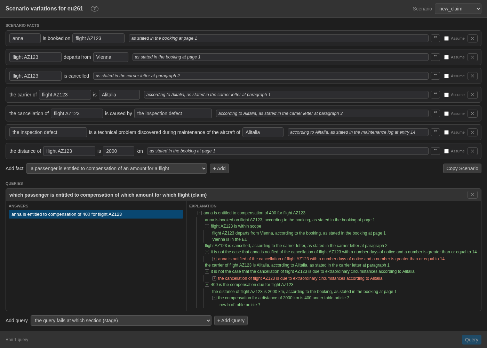

### Remove a fact

Do these steps:

1. Change the distance back to 800.
2. Delete that row with its **✕**.
3. Click **Query**.

The result is **No answers (false)**. In the explanation, *an amount is the
compensation due for flight AZ123* is red. Below that line is *the distance of flight
AZ123 is a number km*. This is the fact that is now missing. Remove a fact and run the
query again: this is how you find the facts that an answer depends on.

You can also right-click a step of this explanation to change the case. A green step
that is a fact of the scenario shows **Patch scenario — delete this fact**. A red step
that agrees with a template shows **Patch scenario — add this fact** and **Assume
fact**. Each of these three items runs the queries again.

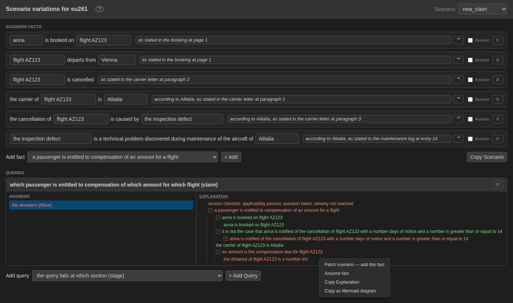

### Assume a fact

Sometimes nobody has confirmed a fact yet, and you want the answer *if* the fact is
true. To add the distance row again, do these steps:

1. In **Add fact**, select *the distance of a flight is a number km*.
2. Click **+ Add**.
3. Type `flight AZ123` and `800` in the fields.
4. Select the **Assume** box of the row.

The fields of the row become grey. The fact now shows as *it is unknown whether the
distance of flight AZ123 is 800 km*. Run the query again:

> anna is entitled to compensation of 250 for flight AZ123

The answer has a **?** mark. Put the mouse pointer on the answer to see:

> Unknown goal: the distance of flight AZ123 is 800 km

In the explanation, the assumed condition is **amber**. The answer is true *only if*
the assumption is true. The unknowns in the list of an answer are the items that you
must still examine.

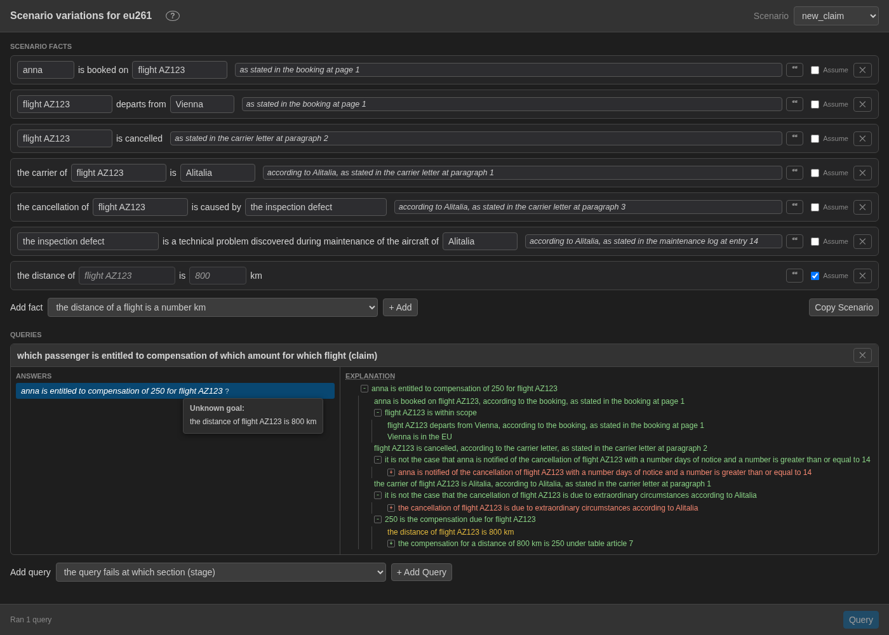

The window keeps the changed facts and the list of queries in its own web address.
Copy that address to share this "what if". Or use **Copy Scenario** to copy the
changed facts as a `scenario … is:` block.

## 5. Flip: what would change the answer?

Scenario Variations tries one change at a time. A *flip* asks the program for the
smallest changes to the case that change the answer.

Do these steps:

1. Go back to the editor.
2. With `new_claim` and `claim`, run the query.
3. Select the answer.
4. Click **Flip…**.

A window with the heading *Flip the outcome* proposes:

> which minimal change to the scenario makes it the case that … it is not the
> case that anna is entitled to compensation of 250 for flight AZ123

*it is not the case that* is a selected box. The answer is in a text box that you can
change. Clear the box to ask what makes a sentence true instead.

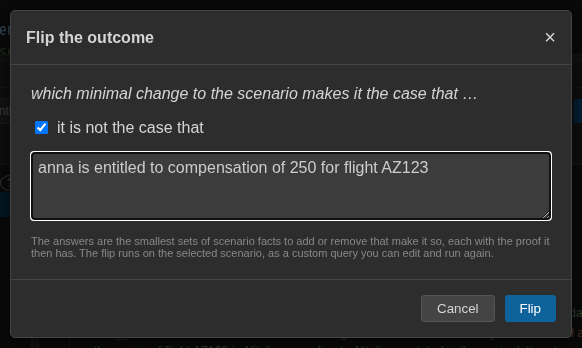

Click **Flip**. The flip runs as a query that you made. The **Query** list now says
*Another...*. The text of the flip is in the **Custom Query** box. You can change the
text there and run the flip again. Each answer is one change:

- remove: flight AZ123 is cancelled
- remove: flight AZ123 departs from Vienna
- remove: anna is booked on flight AZ123
- remove: the carrier of flight AZ123 is Alitalia
- remove: the distance of flight AZ123 is 800 km

Each change has the proof of the changed case. Below *remove: flight AZ123 is
cancelled*, the right of anna to compensation fails. The failure is at *flight AZ123
is cancelled*.

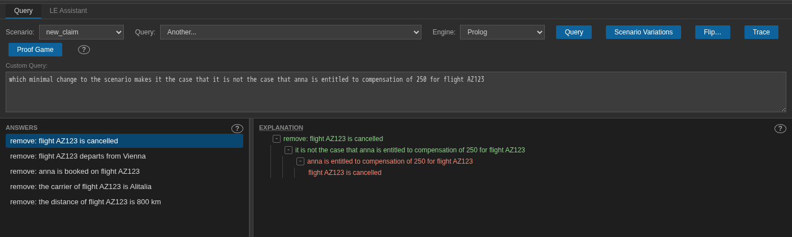

Some facts are not in that list. If you remove the statement of the maintenance log,
or the cause of the cancellation, the answer does not change. The carrier must
*establish* (show with proof) extraordinary circumstances. Without those facts, the
carrier shows nothing. The program asks the same question in its own query, `flip`.
For flip queries, refer to [the language reference](../reference/language.md) §17.7.

## 6. The Explanation Drill

The Explanation Drill takes you through an explanation as a series of questions. It
starts with the most important reasons.

Do these steps:

1. Select the answer of `claim` on `new_claim`.
2. Right-click **EXPLANATION**.
3. Select **Explanation Drill…**.

A window opens with the heading *Understanding why anna is entitled to compensation of
250 for flight AZ123:* and a progress bar. The window shows the most important reason
and asks **Accept?**:

- **Yes**: you accept that reason. The drill puts the reason aside and asks about the
  next reason.
- **Not yet**: you want more data. The drill divides the reason into the reasons below
  it. Then it asks about the most important of those reasons.

Each question highlights, in the editor, the sentence that it came from. At any time,
you can change an earlier answer, or delete a question with its **✕**. The drill then
calculates its questions again from that point. When nothing remains, the drill says
*Nothing else to show*.

Answer *Not yet* where a step is not clear to you. On this program, the first question
is *the inspection defect counts as inherent in the normal exercise of the activity of
Alitalia*. Give these answers:

1. **Not yet**: the drill asks about *for all cases in which a factor disfavours
   inherent and the inspection defect has factor a factor* (no factor against
   *inherent* applies to the defect);
2. **Yes**: the drill asks about *for all cases in which a factor favours inherent and
   wallentin hermann has factor a factor* (the factors of the precedent);
3. **Not yet**: *for case maintenance problem favours inherent and wallentin hermann
   has factor maintenance problem*;
4. **Yes**: *it is true that the inspection defect has factor maintenance problem*.
   The entry of the maintenance log proves this step.

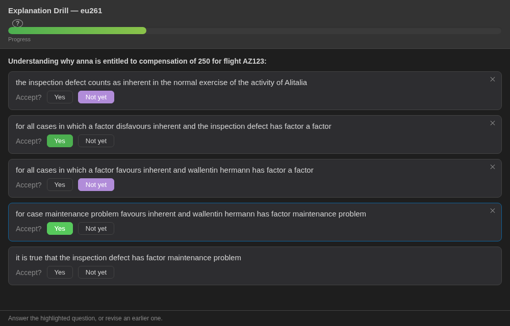

Those four questions are the steps of the tree of section 2, one at a time: the
factor of the precedent, and the defect that has the same factor. When you accept all
the reasons below a *Not yet*, the drill counts the reason above them as accepted. The
drill then goes back up. A **Yes** to the last question shows *the inspection defect is
forced for inherent by wallentin hermann*. Then the drill shows the other conditions
of the answer (the extraordinary circumstances, the compensation due, the scope,
...). When you accept all of them, the progress bar is full. The drill then says
*Nothing else to show*.

## 7. The same program for its users

A passenger or a person who processes claims does not need the text of the program.
**Misc ▸ Open Executive View** opens the same program in the
[executive view](../guide/executive-view.md), in a new tab. The view uses the scenario
and the query that you selected in the editor. The web address
`/executive?program=regulatory/eu261_integration&scenario=new_claim&query=claim`
opens the same view. The executive view has a **Scenario** list, a **Query** list, a
**Scenario Variations** button, and the answers below them. There is no Run button.
The query runs immediately when one of the two selections changes. Click an answer to
open it. An answer opens on its **Citations**. The citations are the steps of the
proof that cite a document, for example *the booking · page 1* or *C-549/07 ·
paragraph 25*. **Full explanation**, below the citations, is the tree.

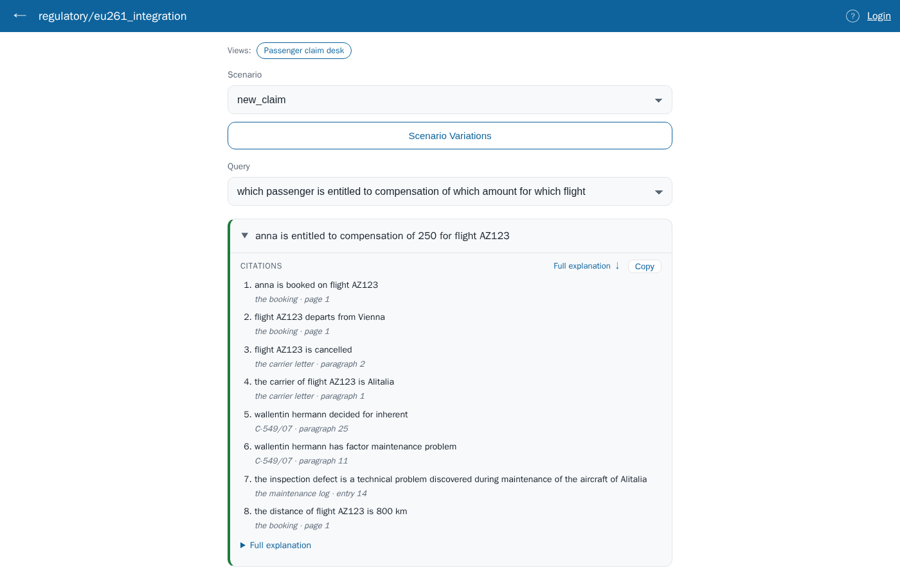

With `notified`, the executive view says *No — no answers for this query.* It also
shows **Why not**: *it is not the case that anna is notified of the cancellation …
with a number days of notice and a number is greater than or equal to 14*. This
condition has the mark **not met**. After *given:*, the view shows the facts that the
program compared. With `outside_the_eu`, the view shows *Istanbul is in the EU*, also
with the mark **not met**.

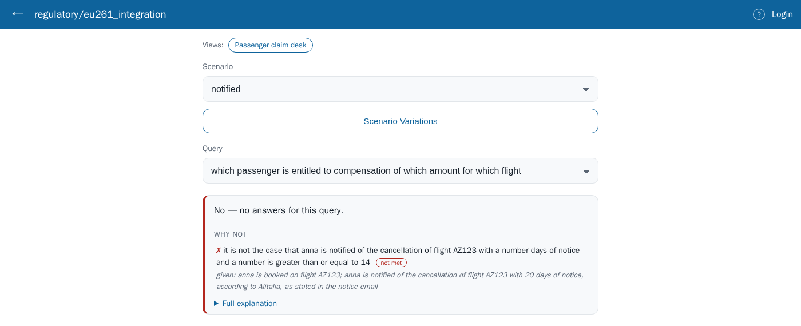

Above the two lists, a **Views:** strip shows *Passenger claim desk*. The next section
is about views.

## 8. Views: a screen made for one decision

Those two lists show all programs in the same way: a scenario, a query, and the
answers as sentences. A person who decides a claim wants other things:

- the facts of the case, to examine and correct;
- the amount;
- the stage that the claim reached;
- the sources;
- the changes that change the result.

A **view** is how the author of the program describes such a screen. A view is a
section of fixed sentences at the end of the program. It starts with
`the view claim desk is: …` ([the language reference](../reference/language.md)
§17.10). No reasoning
uses a view. The answers and the tests of the program are the same with or without the
view. A view changes only what the person who runs the program sees, and the sequence
in which that person sees it.

To try the view, click **Passenger claim desk** in the **Views:** strip. Or open
`/executive?program=regulatory/eu261_integration&view=claim%20desk`. The two lists
change to a screen of three columns. Each card on the screen comes from one sentence
of the view:

- On the left is **the case**: a list of the scenarios, and the facts of the selected
  scenario. The facts are in the groups that the view names (*the booking*, *the
  cancellation*, *the event*, *judgments*). Each fact is a row that you can change,
  with its citation. Where the view asks for it, a badge shows who states the fact
  (*Alitalia*). If the case says nothing about a template, the screen shows that
  template as *not stated*.
- In the middle is the **Result**. Its heading is the amount, *250 euros*. Below it
  are the **Stage** that the claim reaches (applicability, question and remedy all
  passed), the **Citations**, and **What would change this?**. The **Find the smallest
  changes** button of that card runs a flip.
- On the right are the answers to three other questions, as tables (the factors, and
  the precedents that decided for and against *inherent*). There is also a
  **Compare** card with the same question on `bird_strike`, and the **Documents** that
  the case cites.

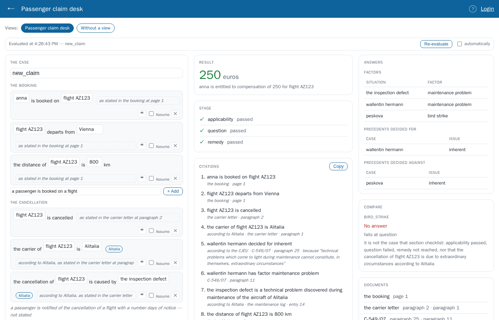

Now select `notified` in the list of cases. The web address now ends in
`&scenario=notified`, thus the link opens the view on this case. The result is *No
answer*, *fails at question*. The stage shows that the question failed and that the
program did not reach the remedy. The **Citations** and **Documents** still show the
items that the failure depends on: the booking and the notice email. The claim desk
view does not ask for the reasons of a failure. The sentence
`the result shows its reasons` adds a *Why not*. Thus the view answers with the stage. **Find the smallest
changes** tells what gives anna her compensation: *remove: anna is notified of the
cancellation of flight AZ123 with 20 days of notice*.

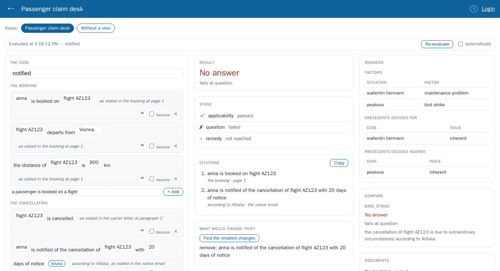

The changes to the facts stay on the screen as a new case. The program does not
change. **Re-evaluate** calculates the result again. Select **automatically** to
calculate the result again after each change. **Without a view** goes back to the two
lists.

Other programs in `examples/regulatory` have different kinds of views:

- `sections_benefit` has *rent help*, which asks what is missing, and *rent
  decision*, which tells why not.
- `flip_housing` has *benefit check*, an interview that asks one question at a time.
- `judged_damage` has *claim file*, a result that waits for a judgment.

A program without its own view shows an **Automatic view**, which the system makes
from the text of the program. To write a view, start with the [LE Views](views.md)
tutorial.

## 9. Quick reference

| To… | Do this |
|---|---|
| Ask a question | Select a **Scenario** and a **Query**, and click **Query** |
| Read the reasoning | Use the explanation tree: green is proved, red is not proved, amber is assumed |
| Find the origin of a step | Click the step |
| Find the main reason | Put the mouse pointer on **EXPLANATION**. Right-click the title for **Show important reason** |
| See why there is no answer | Read the failure explanation: the section checklist, then the red condition |
| Try a "what if" | In **Scenario Variations**, change, delete, add or **Assume** facts. Then click **Query** |
| Find the smallest change that flips an answer | Select the answer, click **Flip…**, then click **Flip** |
| Examine an explanation one step at a time | Right-click **EXPLANATION**, and select **Explanation Drill…** |
| Show the program to its users | Select **Misc ▸ Open Executive View** |
| See the program through a view | In the executive view, click a name in the **Views:** strip |
| Write a view | Read the [LE Views](views.md) tutorial |

The [editor guide](../guide/editor.md) describes all of these items in full. The
[Proof Game](../guide/proof-game.md) is a different method: in the game, you make the
proof of an answer yourself.
