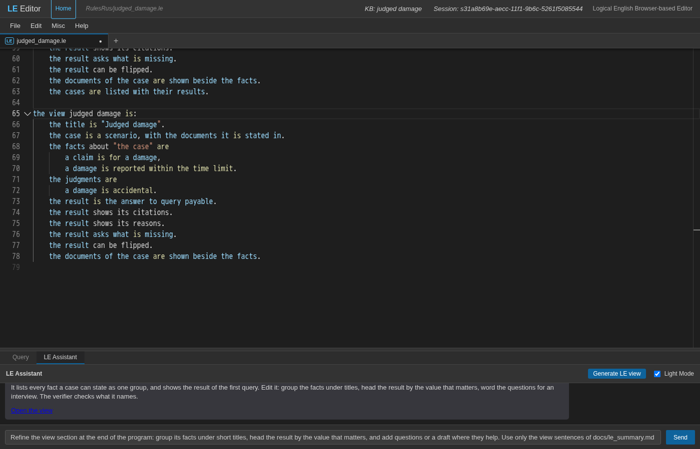
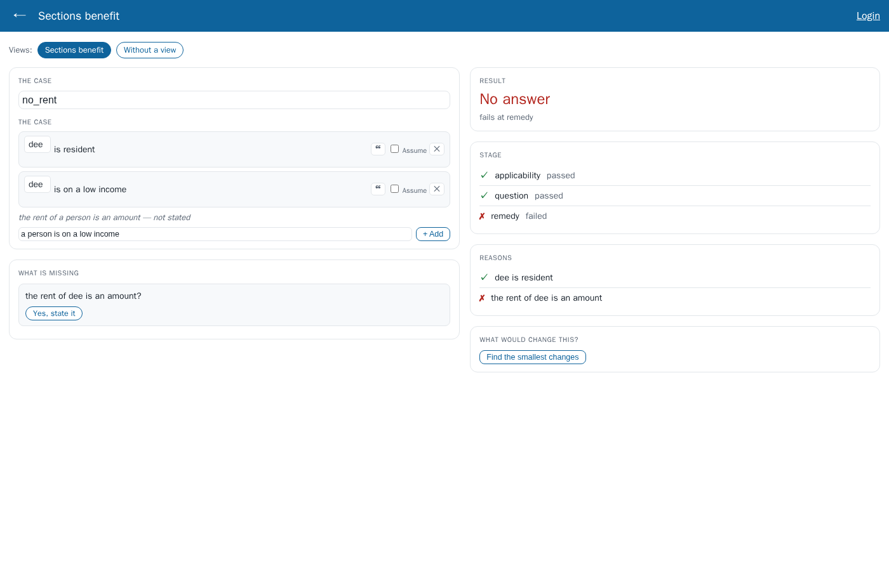
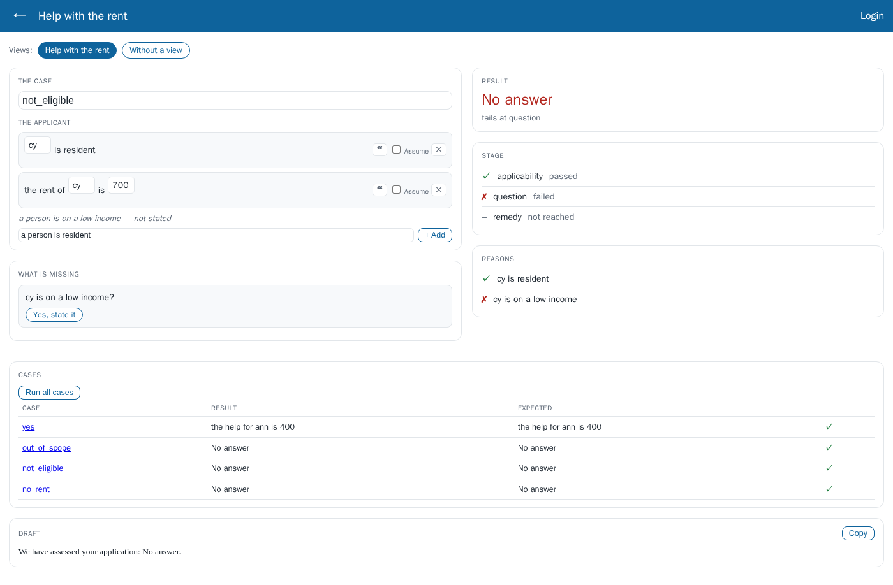
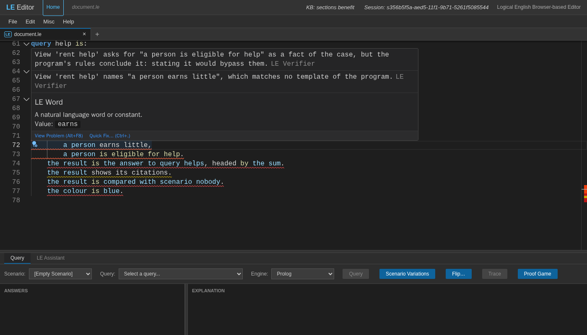
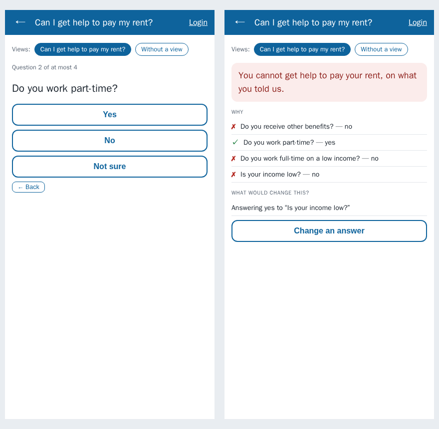
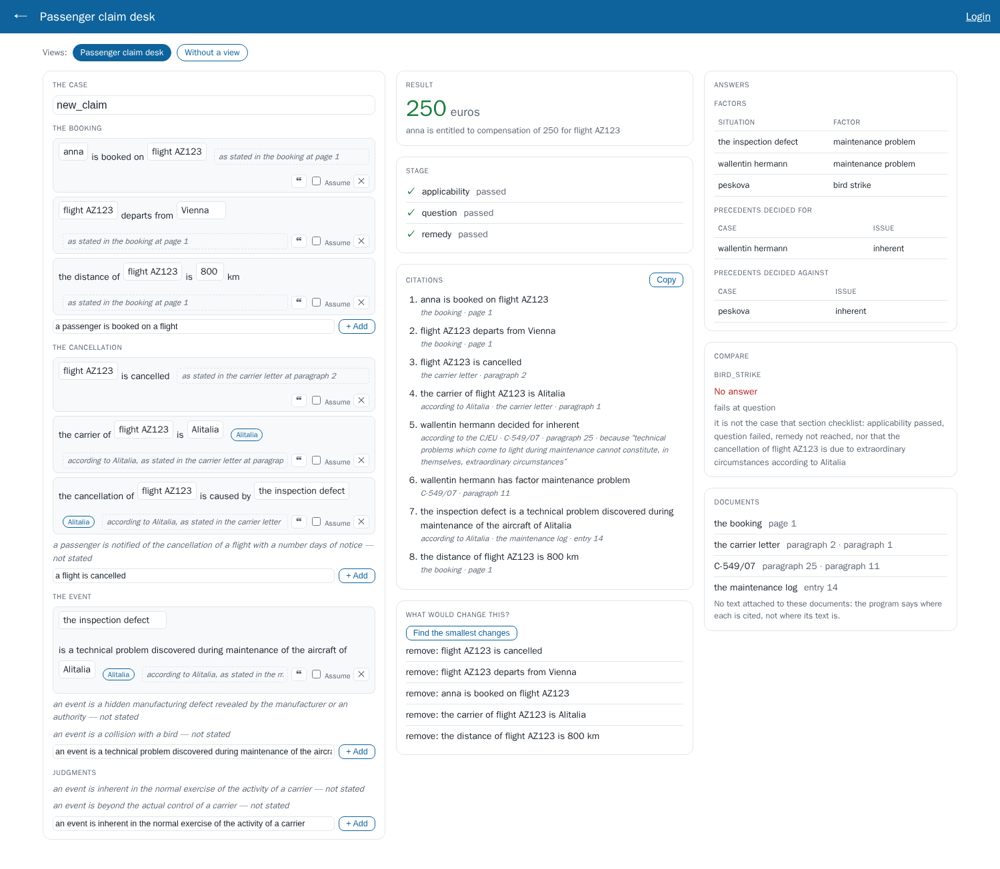
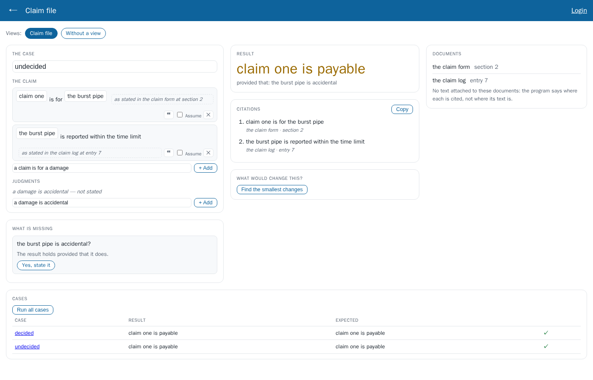
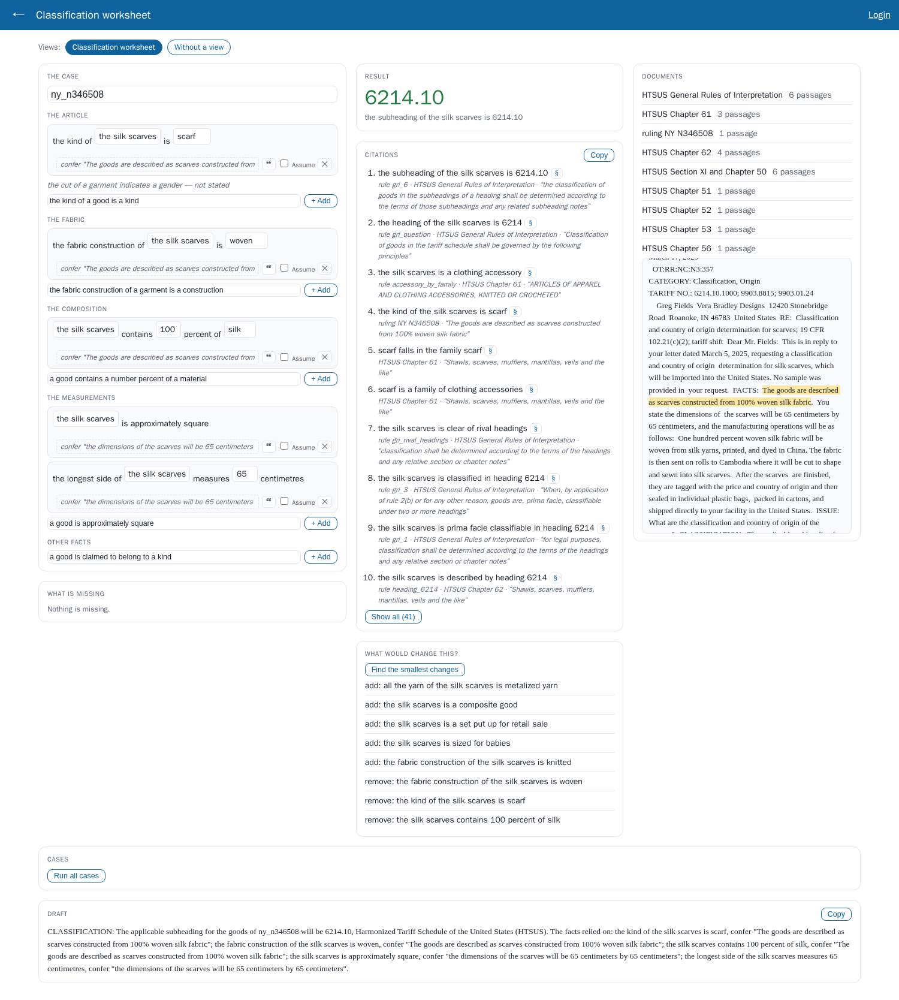

# Introducing LE Views

*Kind: tutorial · Audience: users · Status: current (2026-09-16)*

*This document is a tutorial. You need the Logical English 2 editor and its server.
To start the server, run `start_api_server`. Then open
http://localhost:3050/editor/index.html. All the programs in this tutorial are in
`examples/regulatory/`, in the files of this project. Language reference:
[le_summary.md](../reference/language.md) §17.10.*

A Logical English (LE) program answers questions. The editor shows the program to
the person who writes it. The editor shows the text, the queries, and the
explanations as proof trees. Other people use the decisions of the program: a
caseworker, a claims handler, a customs specialist, a citizen. These people need a
different thing: a **screen for one kind of decision**. Such a screen asks for the
facts of a case in the sequence that these people use. The screen shows the result
in their words. It gives the reasons and the sources, and it tells which facts are
missing.

A **view** is the description of that screen. The author of the program writes the
view in Logical English:

```le
the view rent help is:
    the title is "Help with the rent".
    the case is a scenario.
    the facts about "the applicant" are
        a person is resident,
        a person is on a low income,
        the rent of a person is an amount.
    the result is the answer to query help, headed by the amount.
    the result shows the stage it reaches.
    the result asks what is missing.
```

A view is approximately twelve fixed sentences at the end of the program. The
**executive view** shows these sentences on the screen with parts that are correct
for all programs. These parts are: forms for the facts, a card for the result, the
stage that the result gets to, the citations, the missing facts, an interview, a
"what if", tables of answers, a comparison, the documents, a list of cases and a
draft text.

This design has four properties:

- **No part of a view is about one specific subject.** The parts that draw the
  screen know about templates, queries, scenarios and documents, and about nothing
  more. The words "applicant", "euros" and "Is your income low?" are part of the
  view, and thus part of the program. No rent, flight or tariff goes into Logical
  English itself.
- **The verifier checks the sentences.** The verifier is the part of the system that
  checks a program for mistakes. A view names the templates, queries and scenarios
  of the program. The verifier reports each name that the program does not have, on
  the line of that name.
- **A view changes nothing more.** No reasoning uses a view. The program gives the
  same answers, and its tests pass, exactly as they do without a view.
- **You write a view in the language of the program.** The phrases of a view are
  rows of the translation dictionaries, the same as all other keywords.

The tutorial makes a view step by step for a small program. Then it shows the two
other kinds of screen: an interview and a desk for a professional. It also shows
what the verifier tells you about an incorrect view. At the end, it gives the
sentences for reference.

## Contents

1. [The program](#1-the-program)
2. [A first view, drafted for you](#2-a-first-view-drafted-for-you)
3. [Open the view](#3-opening-the-view)
4. [Make the view better](#4-refining-it)
5. [What only the author knows](#5-what-only-the-author-knows)
6. [When a view is incorrect](#6-when-a-view-is-wrong)
7. [An interview: a citizen's check on a phone](#7-an-interview-a-citizens-check-on-a-phone)
8. [A desk for a professional](#8-a-professionals-desk)
9. [Views in other languages](#9-views-in-other-languages)
10. [Where a view is](#10-where-a-view-lives)
11. [Reference: the sentences](#11-reference-the-sentences)
12. [How views operate](#how-it-works) (for developers)

---

## 1. The program

`examples/regulatory/sections_benefit.le` decides if a person gets help with the
rent, and how much help. Its rules are in three sections with reserved names:
**applicability**, **question** and **remedy**. These sections are the decision
skeleton of [le_summary.md](../reference/language.md) §17.4. Thus a failed
application can tell how far it went:

```le
the templates are:
    *a person* is in scope.
    *a person* is eligible for help.
    *a person* is resident; undefined.
    *a person* is on a low income; undefined.
    the help for *a person* is *an amount*.
    the rent of *a person* is *an amount*; undefined.

the knowledge base sections benefit includes:

section applicability is:
a person is in scope if the person is resident.

section question is:
a person is eligible for help
    if the person is in scope
    and the person is on a low income.

section remedy is:
the help for a person is an amount
    if the person is eligible for help
    and the rent of the person is a rent
    and the amount is the rent / 2.
```

The program has four scenarios: `yes` (ann, who gets 400), `out_of_scope`,
`not_eligible` and `no_rent`. A scenario is a set of facts that describes one case.
The program also has two queries: `help` ("the help for which person is which
amount") and `stage`.

Three templates have the mark `; undefined`. These three templates are the facts that
a case states. The rules conclude the other templates. A view uses exactly this
difference.

## 2. A first view, drafted for you

Do these steps:

1. Select **File → Open example from server…**.
2. Select `regulatory/sections_benefit`.
3. Delete the view section at the end of the program. Then you start from nothing.
4. Open the **LE Assistant** tab.
5. Click **Generate LE view**.



The system does not use a language model for this draft. It makes the draft from the
program itself:

```le
the view sections benefit is:
    the title is "Sections benefit".
    the case is a scenario.
    the facts about "the case" are
        a person is on a low income,
        a person is resident,
        the rent of a person is an amount.
    the result is the answer to query help.
    the result shows the stage it reaches.
    the result shows its reasons.
    the result asks what is missing.
    the result can be flipped.
```

- **The facts** are all the templates that a case can state. These are the templates
  with the mark `; undefined` or `; judged`, and the templates that no rule
  concludes. All of these templates are in one group. If the program had judged
  templates, these templates would get a separate `the judgments are …` sentence.
- **The result** is the first query of the program. If a program has no query, the
  result is `the result is whether <its top conclusion>`.
- **The draft adds what the program can show**, but only where the program can show
  it. The draft adds the stage because this program has the reserved sections. The
  draft adds the citations and the documents only if the program cites a source.
- **The name** is the name of the knowledge base (`sections benefit`). Some knowledge
  bases have no name, for example a contract. Such a program uses the name of its
  file.
- The draft does not include a template that contains a comma or a full stop. The
  reason is that a view puts commas between its facts, and ends its sentences with a
  full stop.

The editor adds the draft to the program as one edit. Thus **Ctrl+Z** removes the
draft. The reply of the assistant contains a link to the view (**Open the view**).
The link opens the view with the program as the editor has it when you click the
link. You do not have to save first. The assistant also puts a request in the box
where you type: *Refine the view section…*. You can send this request if a language
model is available (Misc → API Keys). In this tutorial, you make the view better
yourself.

**Possibly, you do not have to generate a view.** If a program does not declare a
view, the executive view gives an **Automatic view**. The automatic view is the same
draft. The executive view makes the automatic view from the program when you open it.
Thus the automatic view always agrees with the program. Generate LE view gives you
that draft as text, so that you can change it. When the program declares a view, the
declared views replace the automatic view.

## 3. Opening the view

The executive view shows a view. The executive view is the companion of the editor
for the people who run programs, not for the people who write them. You can open a
view in three ways:

- In the editor, select **Misc → Open Executive View**. The program opens in a new
  tab, on the scenario and query that you selected in the editor. The new tab shows
  the program as it is in the editor, with the changes that you did not save. The
  reason is that the editor gives its text to the new tab through the storage of the
  browser. Copy a link from that tab, and open it in a different browser. That
  browser shows the saved program.
- On the executive page of the program
  (`/executive?program=regulatory/sections_benefit`), a row of links shows the views
  of the program. For a program without a view, the row shows the automatic view.
  **Without a view** goes back to the usual screen with a scenario and a query.
- A direct link: `/executive?program=regulatory/sections_benefit&view=sections%20benefit`.



The picture shows the draft, without changes, on the scenario `no_rent`. In this
scenario, dee is resident and on a low income, and the scenario gives no rent. Each
card on the screen comes from one sentence:

| Card | Sentence | What the card shows here |
|---|---|---|
| **The case** | `the case is a scenario` | a list of the scenarios of the program, and *New case* |
| the group *THE CASE* | `the facts about "the case" are …` | the facts of dee as rows that you can edit, with one field for each slot in the template. You can add the template that the case does not state, *the rent of a person is an amount — not stated*, with one click. |
| **Result** | `the result is the answer to query help` | *No answer*, and where it failed: *fails at remedy* |
| **Stage** | `the result shows the stage it reaches` | applicability passed, question passed, remedy failed |
| **Reasons** | `the result shows its reasons` | the facts that the result uses or that failed: ✓ dee is resident, ✗ the rent of dee is an amount |
| **What is missing** | `the result asks what is missing` | the case fact that the failed proof looked for, as a question, with *Yes, state it* |
| **What would change this?** | `the result can be flipped` | *Find the smallest changes*: the smallest additions or removals that change the result (a flip query, §17.7) |

Do these steps:

1. Click **Yes, state it**.
2. Type 800 into the new row.

When you click **Yes, state it**, a row for the rent of dee appears. The amount is
empty. While the amount is empty, the screen does not use the row. The reason is that
a rent of "an amount" is true of all amounts. When you type 800, the screen calculates
the answer again. The result becomes **400**, and the stage shows that remedy passed.
*What is missing* tells you that nothing is missing. The changes stay on the screen,
as a new case that the screen makes from the scenario. The text of the program does
not change.

The layout is fixed intentionally:

- The facts are on the left.
- The result and its explanations are in the middle.
- Tables, the comparison and the documents are on the right.
- The case list and the draft are below, with the full width.
- In a column, the cards are in the sequence of the sentences.
- On a screen with a width of less than 1000 pixels, the columns become one column,
  as on a phone.

## 4. Refining it

The draft is correct, but it is correct for any program. The final view of
`sections_benefit.le` makes seven changes:

```le
the view rent help is:
    the title is "Help with the rent".
    the case is a scenario.
    the facts about "the applicant" are
        a person is resident,
        a person is on a low income,
        the rent of a person is an amount.
    the result is the answer to query help, headed by the amount.
    the result shows the stage it reaches.
    the result shows its reasons.
    the result asks what is missing.
    the cases are listed with their results.
    the draft reads "We have assessed your application: {the answer}.".
```

1. **A name and a title.** The name (`rent help`) is for links. The title is for the
   screen.
2. **The title of the group, and the sequence of the facts.** Give each group the name
   that its readers use. Put its facts in the sequence in which the screen asks for
   them. A view can have more than one group. The EU 261 desk below has "the
   booking", "the cancellation" and "the event".
3. **`headed by the amount`.** The query asks "the help for which person is which
   amount". With *the amount* as heading, the screen shows the value of
   `which amount` in large type (400). The full answer is below the value. Add
   `, in euros`, and the unit comes after the number.
4. **The flip is removed.** A flip is useful to a person who examines the program. A
   screen for a caseworker does not need a flip.
5. **`the cases are listed with their results`.** The screen shows each scenario of the
   program with its result and with the result that the scenario expects (its
   `expects answers`). A ✓ shows where the two agree. For a small program, the cases
   run when the screen opens. For a larger program, the screen waits until you click
   *Run all cases*. Click the name of a case to open that case.
6. **`the draft reads "…"`.** This sentence gives a text that the screen fills in, with a
   *Copy* button. The text can be the start of a letter or of a decision. The draft
   can use these placeholders. The screen replaces each placeholder with a value from
   the screen:

   | Placeholder | Becomes |
   |---|---|
   | `{the result}` | the value in the heading (400), or the full answer when the result has no heading |
   | `{the answer}` | the full answer ("the help for ann is 400"), or *No answer* |
   | `{the facts}` | the facts of the case as written, with their citations |
   | `{the citations}` | the steps that a labelled rule or a table row cites, one for each source |
   | `{the case}` | the name of the case |

7. Nothing more: the other sentences stay as in the draft.



In the scenario `not_eligible`, cy is resident and the rent is 700. The scenario does
not state the income. The application fails at **question**. The reasons show why:
✓ cy is resident, ✗ cy is on a low income. *What is missing* asks if cy is on a low
income. The cases table shows that all four scenarios agree with their expected
results.

## 5. What only the author knows

Generate LE view does not need a language model. Generate LE view reads the structure
of the program. Thus it makes the same view each time. The executive view can also
show that draft when the program does not declare a view (the automatic view,
section 2). Thus, why write views? The reason is that the structure of the program
does not tell most of what makes a view useful. The draft knows which templates a
case states and which queries there are. It also knows if the program cites sources
or has sections. The draft cannot know these things:

- **Groups and sequence.** The draft puts all the facts that a case can state in one
  group. For a small program, one group is satisfactory. For an insurance policy,
  one group means approximately sixty facts below "the case". Nobody can work
  through so many facts. In the EU 261 desk, "The booking", "the cancellation" and
  "the event" come from the knowledge of the author. The author knows how people read
  a claim file, and in which sequence.
- **Which answer is important.** If a program has more than one query, the draft uses
  the first query as its result. Also, `headed by the amount, in euros` selects the
  value that the user waits for from the full answer.
- **Words.** Almost all of the housing interview is in the words of the author: "Do
  you work part-time?", "You can get help to pay your rent." Nothing in the rules
  tells how to ask a citizen a question, or how to tell the citizen the result.
- **The users.** A desk or an interview. The scenario to compare a case with. The
  other questions that need a table. The text of the draft letter. The things to
  remove (the rent-help view for the caseworker removes the flip). All of these are
  decisions about the people who use the screen, not about the rules.

Thus:

- **Start with the automatic view.** The automatic view changes when the program
  changes, and you do not have to keep it up to date. Usually the automatic view is
  sufficient when you try a program, or when you show the program to a person.
- **Write a view when the screen has users.** Generate LE view gives you the
  automatic view as text, so that you can edit it. After that, the declared view
  replaces the automatic view.
- **Keep the view short.** A view tells only what it changes. The facts that no group
  contains still appear, below *Other facts*. Thus a view can be as small as a title
  and `the result is the answer to query 3, headed by the amount.`
- **Let the verifier keep the view correct.** A declared view can become older than
  the program. The verifier reports each name in the view that the program does not
  have any more.

## 6. When a view is wrong

The verifier reads a view against the full program, including the resources that the
program includes. The verifier does this in the same way as for all other parts of
the program. This view has the usual kinds of mistake:

```le
the view rent help is:
    the title is "Help with the rent".
    the case is a scenario.
    the facts about "the applicant" are
        a person is resident,
        a person earns little,
        a person is eligible for help.
    the result is the answer to query helps, headed by the sum.
    the result shows its citations.
    the result is compared with scenario nobody.
    the colour is blue.
```



Each message comes with a repair. Where the editor can apply the repair, the editor
gives it as a *Quick Fix*:

| Line | Message | Fix |
|---|---|---|
| `a person earns little` | View 'rent help' names "a person earns little", which matches no template of the program. | Write the fact as an instance of one of the templates of the program, in the same way as a condition of a rule. |
| `a person is eligible for help` | … asks for "a person is eligible for help" as a fact of the case, but the program's rules conclude it: stating it would bypass them. | List the facts that the rules read. |
| `query helps` | … takes its result from query 'helps', which the program does not define. | Name one of the queries of the program, or write the result as "the result is whether …". |
| `shows its citations` | … shows citations or documents, but the program cites nothing. | Give rules and facts their source (§15.5, §17.1), or remove the sentence. |
| `scenario nobody` | … compares with scenario 'nobody', which the program does not define. | Name one of the scenarios of the program. |
| `the colour is blue` | This sentence of view 'rent help' is not one a view understands: "the colour is blue". | Write the sentence as one of the view sentences, with a full stop at the end. |

These are the checks, from the most serious to the least serious:

- **Errors**:
  - a sentence that no view form reads;
  - an instance of no template;
  - a query or scenario that the program does not have;
  - a table question that is not a query;
  - two views with the same name.
- **Warnings**:
  - a judgment whose template is not `; judged`;
  - a fact to state that the rules conclude;
  - a view without a result;
  - a sentence that occurs two times;
  - a heading that the query does not ask for (`headed by the sum` when the query has
    no `which sum`);
  - a stage in a program without the reserved sections;
  - citations or documents in a program that cites nothing.

The second warning is the most important. If a view lets a user state a conclusion,
the user can go around the rules. The verifier cannot prevent such a program. But
the verifier shows the danger.

## 7. An interview: a citizen's check on a phone

A caseworker edits a case. A citizen answers questions.
`examples/regulatory/flip_housing.le` contains the housing-benefit rules of Kowalski
(*Computational Logic and Human Thinking*, §5.7). Help to pay the rent comes with
housing benefit. Housing benefit is for a person with other benefits, or a person who
works part-time, or a person who works full-time on a low income. But housing benefit
is not for a person who is ineligible. A person without a low income is ineligible.
This is the view of the program:

```le
the view benefit check is:
    the title is "Can I get help to pay my rent?".
    the case is about the applicant.
    the facts are asked one at a time.
    the question for the applicant is on other benefits is "Do you receive other benefits?".
    the question for the applicant works part-time is "Do you work part-time?".
    the question for the applicant works full-time on a low income is "Do you work full-time on a low income?".
    the question for the applicant is on a low income is "Is your income low?".
    the result is whether the applicant gets help to pay rent.
    the result reads "You can get help to pay your rent." when it holds.
    the result reads "You cannot get help to pay your rent, on what you told us." when it does not.
    the result shows its reasons.
    the result can be flipped, as "What would change this?".
```

- **`the case is about the applicant`** names the subject. Each *yes* states a fact
  about *the applicant* ("the applicant works part-time"). The screen has no list of
  scenarios and no form of facts.
- **`the facts are asked one at a time`** changes the screen into an interview. The
  next question is the first question of the view that the proof still examines,
  after the answers that you gave. When the result is true, the screen asks no more
  questions. If you answer *No* to "Do you receive other benefits?", the part-time
  question comes next. If you answer *Yes* to the part-time question, the proof
  continues to the income. The screen counts "Question 2 of at most 4". *Not sure*
  leaves a fact unstated. *Back* cancels the last answer.
- **`the question for <fact> is "<text>"`** gives the words for each fact. The
  screen uses these words again in the reasons ("Do you work part-time? — yes") and
  in the flip ("Answering yes to “Is your income low?”").
- **`the result is whether <fact>`** gives a result that is yes or no. You write this
  result in the view, not as a query of the program.
  **`the result reads "…" when it holds` / `when it does not`** gives the result in
  the words of the view.



The screen is one column, for a phone. The right side of the picture shows this
case: the applicant works part-time, but the income is not low. Thus the answer is
no. The reasons show each question with its answer. The only change that changes the
result is the answer yes to the income question.

## 8. A professional's desk

A view becomes larger when the program becomes larger.
`examples/regulatory/eu261_integration.le` decides the compensation for a cancelled
flight under EU Regulation 261. Each of its facts names its source ("according to
Alitalia, as stated in the carrier letter at paragraph 2"). Some questions have no
fixed answer. An example is: was the event *inherent in the normal exercise of the
activity of the carrier*? The program decides these judgments from the precedents of
the Court of Justice of the European Union (CJEU). Its amounts come from a decision
table. This is the view of the program:

```le
the view claim desk is:
    the title is "Passenger claim desk".
    the case is a scenario, with the documents it is stated in.
    the facts about "the booking" are
        a passenger is booked on a flight,
        a flight departs from an airport,
        the distance of a flight is a number km.
    the facts about "the cancellation" are
        a flight is cancelled,
        a passenger is notified of the cancellation of a flight with a number days of notice,
        the carrier of a flight is a carrier,
        the cancellation of a flight is caused by an event.
    the facts about "the event" are
        an event is a technical problem discovered during maintenance of the aircraft of a carrier,
        an event is a hidden manufacturing defect revealed by the manufacturer or an authority,
        an event is a collision with a bird.
    the judgments are
        an event is inherent in the normal exercise of the activity of a carrier,
        an event is beyond the actual control of a carrier.
    every fact shows who states it.
    the result is the answer to query claim, headed by the amount, in euros.
    the result shows the stage it reaches.
    the result shows its citations.
    the answers to "which situation has factor which factor" are listed as "Factors".
    the answers to "which case decided for which issue" are listed as "Precedents decided for".
    the answers to "which case decided against which issue" are listed as "Precedents decided against".
    the result is compared with scenario bird_strike.
    the result can be flipped.
    the documents of the case are shown beside the facts.
```



This view adds these sentences:

- **`the judgments are …`** puts the `; judged` facts in a separate group. The
  passenger and the carrier do not state such facts. A decision gives these facts.
  Here a precedent gives the decision, as the citations show.
- **`every fact shows who states it`** puts the `according to` of each fact on its
  row, as a badge. The facts of the carrier have the badge *Alitalia*.
- **`the result shows its citations`** shows the steps of the proof that cite a
  source. Each step comes with its document and the location in that document. A
  step that uses a precedent comes with the reasoning of the Court ("technical
  problems which come to light during maintenance cannot constitute, in themselves,
  extraordinary circumstances"). *Copy* copies the citations, so that you can paste
  them in a different location. The program can tell where the text of a document is
  (`the text of <document> is at "<url or file>"`). Then a § opens the passage in
  that document.
- **`the answers to "<query body>" are listed as "<title>"`** adds a table of the
  answers to a different question, with one column for each `which`. The program must
  be able to answer the question as it is. A precedent library can have rules that
  need the name of a specific situation. Such a library cannot list each "forced"
  answer. Thus this view asks for the factors and the decided cases instead.
- **`the result is compared with scenario bird_strike`** shows the same question on a
  different scenario. Here the result is no compensation, with a failure at
  *question*. The reason is that a bird strike is an extraordinary circumstance.
- **`the documents of the case are shown beside the facts`** shows the documents that
  the facts of the case and the proof cite, with their passages. If the program gives
  the location of the text of a document, the document opens with those passages
  marked.
- **`the case is a scenario, with the documents it is stated in`** shows the document
  of the case itself (its `as stated in`) first.

Two more views in the files of the project show the other sentences:

- **`judged_damage.le`, "claim file"** shows a result that is true only *provided
  that* a judgment has a specific result: "claim one is payable, provided that: the
  burst pipe is accidental". *What is missing* lets you make that judgment. The cases
  table shows the result of each claim.

  

- **`regulatory/customs/cbp_62.le`, "worksheet"** is the classification worksheet
  that a US customs specialist asked for, in a review of the customs programs:
  - the facts of the good as the CBP ruling states them. The groups are article,
    fabric, composition and measurements, and each fact has the passage of the
    ruling;
  - the subheading, with the code as heading, and with 41 cited steps that go to the
    lines of the tariff itself;
  - the ruling next to it, with the stated facts highlighted;
  - a draft CLASSIFICATION paragraph that the screen fills in from all of this.

  Logical English contains nothing about tariffs. The view is approximately twenty
  lines at the end of the customs program.

  

## 9. Views in other languages

Each phrase of a view is a row of `i18n/keywords.csv` (in the category `view`). Each
row gives the phrase in English, Portuguese, Spanish, French and Italian. Thus a
program writes its view in its own language. This is the view of the Portuguese
citizenship program (`examples/pt/cidadania.le`):

```le
a vista balcão é:
    o título é "Cidadania britânica".
    o caso é um cenário.
    os factos sobre "o nascimento" são
        uma pessoa nasceu em um lugar em uma data,
        uma pessoa é a mãe de uma pessoa,
        uma pessoa é o pai de uma pessoa.
    o resultado é a resposta à consulta um, encabeçado por a pessoa.
    o resultado mostra as suas razões.
    os casos são listados com os seus resultados.
```

The verifier also answers in Portuguese. The view above gets one warning. The reason
is that the program has a rule for who the father is, from the statement of a
qualified person: *A vista 'balcão' pede "uma pessoa é o pai de uma pessoa" como
facto do caso, mas as regras do programa concluem-no: afirmá-lo contornaria as
regras.* The screen shows each fact in the words of the view. The labels of the
parts of the screen (*Result*, *Stage*, *not stated*) use the language that the user
selected for the interface, the same as the rest of the interface.

## 10. Where a view lives

- **At the end of the program**, as in all the examples here. A program can have
  more than one view, for different users of the same rules. Each view must have a
  different name. The executive page of the program shows all the views.
- **In an included resource.** A view is a section, the same as other sections. Thus
  a `desk.le` file next to a family of programs can serve all of these programs:

  ```le
  the target language is: prolog.

  the knowledge base desk includes:

  the view desk is:
      the title is "A desk from a resource".
      the case is a scenario.
      the facts about "the applicant" are
          a person is resident,
          a person is on a low income.
      the result is the answer to query help, headed by the amount.
  ```

  Each program includes `desk.le`, the same as any other resource:

  ```le
  the knowledge base sections benefit includes these resources:
      desk.
  ```

  The verifier reads the view in `desk.le` against the program that includes it. Thus
  the verifier uses the templates, queries and scenarios of that program. In this
  way, one worksheet can serve all the files of rulings for a tariff.

## 11. Reference: the sentences

| Sentence | The screen |
|---|---|
| `the view <name> is:` | starts the section; links use the name |
| `the title is "<text>"` | the title of the screen |
| `the case is a scenario[, with the documents it is stated in]` | a list of the scenarios of the program, and *New case*; the document of the case first |
| `the case is about <constant>` | the subject of the facts that the answers of an interview state |
| `the facts about "<title>" are <instance>, <instance>, …` | a group of fact rows that you can edit, each with its citation (❝); you can add the facts of the group that the case does not state with one click |
| `the judgments are <instance>, …` | the `; judged` facts, in a separate group |
| `the other facts can be added` / `the other facts cannot be added` | if the case can state facts of templates that no group contains (by default, it can) |
| `every fact shows who states it` | the `according to` of each fact, as a badge |
| `the result is the answer to query <name>[, headed by <the word>][, in <unit>]` | the answers of the query; with a heading, the value of its `which <word>` in large type |
| `the result is whether <instance>` | a result that is yes or no; the query is in the view |
| `the result reads "<text>" when it holds` / `… when it does not` | the result in the words of the view |
| `the result shows its citations` | the cited steps of the proof, each with its passage, and *Copy* |
| `the result shows its reasons` | the facts that the result uses; for a result that fails, *Why not*: the conditions that it did not meet, each *not stated* or *not met*, with the rule that asks for the condition and its passage |
| `the result shows the stage it reaches` | the checklist of applicability / question / remedy (§17.4) |
| `the result asks what is missing` | the case facts that the failed proof looked for, or the facts that a conditional result waits for; you can state each one with a click |
| `the facts are asked one at a time` | an interview: the questions of the view, each asked only while the result can still change because of it |
| `the question for <instance> is "<text>"` | the question for a fact, and its words in the reasons and the flip |
| `the result can be flipped[, as "<text>"]` | the smallest changes that change the result (§17.7) |
| `the flip keeps <instance>, …` | the facts that the flip does not change (the facts that define the case) |
| `the section <name> reads "<text>"` | a section of the stage, in the words of the view |
| `the answers to "<query body>" are listed as "<title>"` | a table of the answers to a different question, with one column for each `which` |
| `the result is compared with scenario <name>` | the result of a different scenario, and where it fails |
| `the documents of the case are shown beside the facts` | the cited documents, with their passages |
| `the cases are listed with their results` | each scenario, its result and its expected result, run one after the other ("running case i of N", and a button to stop) |
| `the draft reads "<text>"` | a text that the screen fills in: `{the result}`, `{the answer}`, `{the facts}`, `{the citations}`, `{the reasons}` (what a failed result did not meet), `{the missing}` (of those, the facts to ask for), `{the case}`; a list placeholder alone on its line gives one item on each line, and `\n` is a new line |
| `the draft reads "<text>" when it holds` / `… when it does not` | a text for each result |

The facts, questions and results that a view names are **instances of the templates
of the program**. You write them in the same way as the conditions of a rule: "a
person is resident", "the applicant is on a low income". Each sentence ends with a
full stop. The lines of a list end with commas.

## How it works

For how the server reads and checks a view, the operations that the parts of the
screen use, and how the sentences compare with the original proposal, refer to
[LE Views: how they work](../../dev/views.md).
